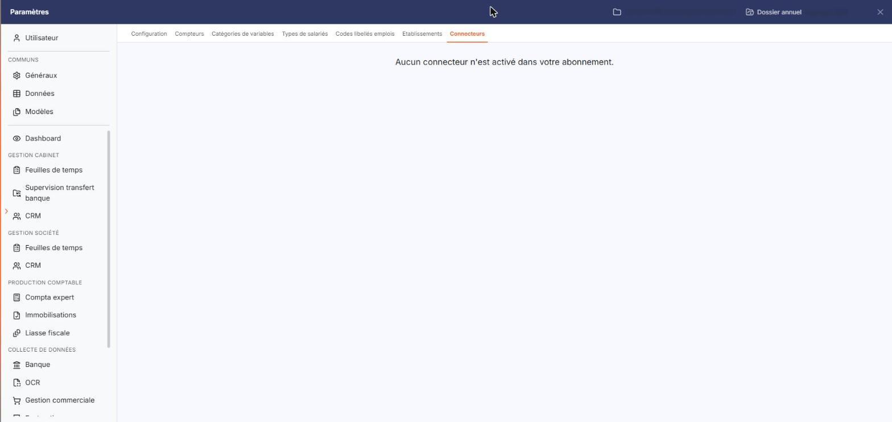

# Connecteurs


**Où le trouver :** Panneau **Paramètres** › **Transfert paie** › **Connecteurs**



**En bref** — Cet écran porte le paramétrage d'un connecteur, c'est-à-dire du lien avec un autre logiciel depuis lequel vous récupérez vos données de paie. Il ne présente qu'un message tant qu'aucun connecteur n'est activé.

* Pour savoir si vous pouvez paramétrer un connecteur : ouvrez l'écran ; le message « Aucun connecteur n'est activé dans votre abonnement. » indique qu'il n'y a rien à y faire.


Cette option porte le paramétrage du connecteur Lucca, le seul connecteur que gère le module, c'est-à-dire du lien entre le module et un autre logiciel, depuis lequel vous récupérez vos données de paie au lieu de les ressaisir. Elle s'ouvre par Paramètres > Transfert paie > Connecteurs.

<figure><figcaption>
Écran « Connecteurs » de la nouvelle interface
</figcaption></figure>

Le connecteur est activé au niveau de votre abonnement, et non depuis cette option. Tant qu'il n'est pas activé, l'écran ne présente qu'une phrase, centrée, en haut de la zone de travail :

« Aucun connecteur n'est activé dans votre abonnement. »

Vous n'y trouvez alors ni rubrique, ni champ, ni bouton : il n'y a rien à y faire, et l'activation ne se demande pas depuis cet écran.
