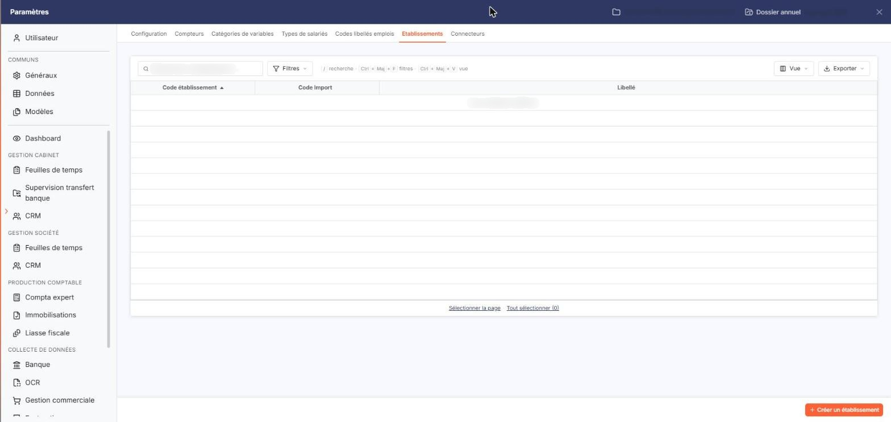
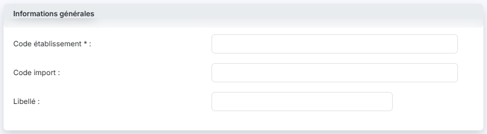

# Etablissements


**Où le trouver :** Panneau **Paramètres** › **Transfert paie** › **Etablissements**



**En bref** — Cet écran permet de constituer la liste des établissements de la société, ensuite repris dans le champ Code établissement de la fiche d'un salarié.

* Pour créer un établissement : bouton \[Créer un établissement], saisissez le « Code établissement » (5 caractères au plus), puis bouton \[Enregistrer].
* Pour faire correspondre vos fichiers importés : renseignez le « Code import » de l'établissement, puis bouton \[Enregistrer].
* Pour supprimer des établissements : sélectionnez-les, puis bouton \[Supprimer] du bandeau de sélection.


Cette option permet de constituer la liste des établissements de la société. L'établissement est ensuite porté sur la fiche d'un salarié, dans son champ **Code établissement**, où il se recherche parmi les établissements déclarés ici. Lorsque la société ne compte qu'un seul établissement, le logiciel le propose de lui-même à la création d'un salarié. Elle s'ouvre par Paramètres > Transfert paie > Etablissements.

<figure><figcaption>
Écran « Etablissements » de la nouvelle interface
</figcaption></figure>

Chaque établissement porte deux codes, qui n'ont pas le même rôle : le **code établissement** est celui que le module emploie et qui est repris sur la fiche du salarié ; le **code import** est celui sous lequel ce même établissement est désigné dans les fichiers que vous importez. Renseignez-le lorsque votre fichier n'emploie pas les mêmes codes que vous : à l'import de vos salariés, le logiciel rapproche alors les deux et retient le bon établissement.

Le logiciel présente la liste des établissements déjà créés, sur trois colonnes. Tant qu'aucun établissement n'a été créé, la liste affiche la mention « Aucun élément à afficher. » :

| Champ                  | Ce qu'il faut savoir                                                                                                                         |
| ---------------------- | -------------------------------------------------------------------------------------------------------------------------------------------- |
| **Code établissement** | Le code de l'établissement. C'est la colonne sur laquelle la liste est triée à l'ouverture.                                                  |
| **Code Import**        | Le code de correspondance décrit ci-dessus. Il reste vide sur un établissement que vous avez créé à la main et qui ne vient pas d'un import. |
| **Libellé**            | Le nom de l'établissement.                                                                                                                   |

Au-dessus de la liste, une barre porte le champ « Rechercher un établissement… » et les boutons \[Filtres], \[Vue] et \[Exporter] ; le bouton \[Vue] ouvre la personnalisation des colonnes. Sous la liste, les liens « Sélectionner la page » et « Tout sélectionner » (suivi du nombre de lignes) permettent de sélectionner les lignes de la page en cours ou celles de toutes les pages.

## Bouton \[Créer un établissement]

<figure><figcaption>
Bouton [Créer un établissement]
</figcaption></figure>

<figure><figcaption>
Rubrique « Informations générales »
</figcaption></figure>

Situé en bas à droite du panneau, il ouvre la fiche de création d'un établissement, qui comporte une seule rubrique « Informations générales » :

| Champ                                                              | Ce qu'il faut savoir                                                                           |
| ------------------------------------------------------------------ | ---------------------------------------------------------------------------------------------- |
| 
<strong>Code établissement</strong> <em>Obligatoire</em>
 | 5 caractères au maximum, et différent du code des établissements déjà créés.                   |
| **Code import**                                                    | 10 caractères au maximum, et lui aussi différent du code import des établissements déjà créés. |
| **Libellé**                                                        | 50 caractères au maximum.                                                                      |

bouton **\[Enregistrer]** : il enregistre le nouvel établissement.

**Chevron « Retour »**, à gauche de la barre d'onglets du panneau : il vous ramène à la liste sans rien enregistrer.

## Bouton \[Supprimer]

Il apparaît dans le bandeau de sélection, une fois un établissement sélectionné dans la liste, et supprime les établissements sélectionnés.
