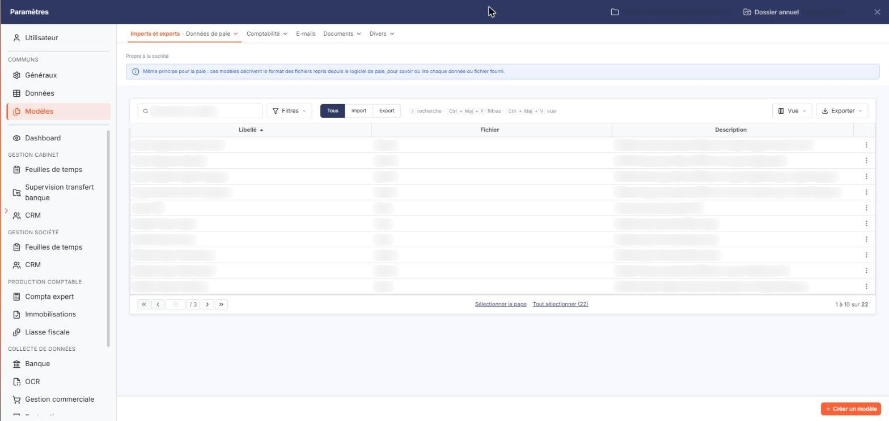
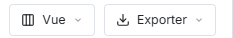
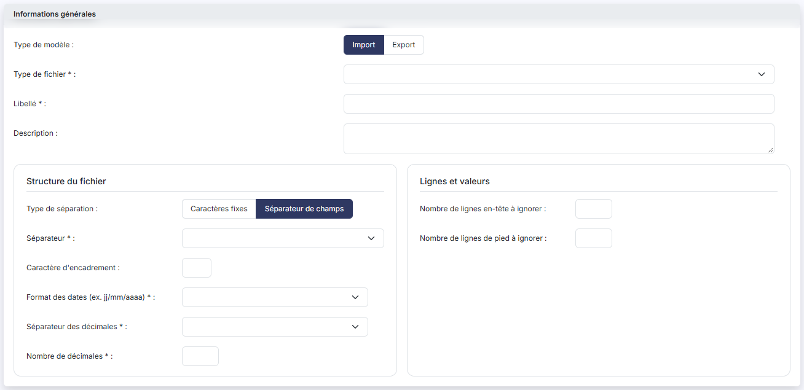
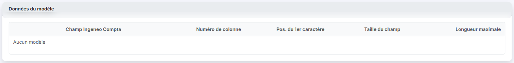

# Modèles


**Où le trouver :** Panneau **Paramètres**



**En bref** — Cet écran regroupe les modèles d'import et d'export de la société : chaque modèle décrit la structure d'un fichier échangé avec un autre outil ou avec votre logiciel de paie.

* Pour créer un modèle : bouton \[Créer un modèle], choisissez « Import » ou « Export » et le « Type de fichier », renseignez le « Libellé », puis bouton \[Enregistrer].
* Pour n'afficher que les modèles d'un sens : boutons \[Import] ou \[Export] de la barre d'outils ; le bouton \[Tous] est retenu à l'ouverture.
* Pour supprimer des modèles : sélectionnez leurs lignes, puis bouton \[Supprimer] du bandeau de sélection.


Cette option contient les **modèles d'import et d'export** de la société. Un modèle décrit la structure d'un fichier : la façon dont ses données sont séparées, le format de ses dates et de ses nombres, et la correspondance entre chacune de ses colonnes et les données du logiciel.

<figure><figcaption>
Écran « Modèles » de la nouvelle interface
</figcaption></figure>

C'est un modèle d'import qui vous permet de reprendre dans le logiciel un fichier produit par un autre outil, et un modèle d'export qui vous permet de produire le fichier attendu par votre logiciel de paie.

Ingeneo Compta met à votre disposition un certain nombre de modèles, correspondant aux principaux logiciels de paie du marché.

Cet écran ne figure plus dans la barre de menus du module : il s'ouvre dans le panneau Paramètres, par Paramètres > « Modèles » > « Imports et exports » > « Données de paie ».

## La liste des modèles

<figure><figcaption>
Bouton [Exporter]
</figcaption></figure>

La liste comporte trois colonnes qui se trient par un clic sur leur en-tête : « Libellé », « Fichier » et « Description ». Elle s'ouvre triée sur le libellé, par ordre croissant, et se parcourt par la pagination placée dessous.

| Champ           | Ce qu'il faut savoir                                                                                                          |
| --------------- | ----------------------------------------------------------------------------------------------------------------------------- |
| **Libellé**     | Le nom du modèle.                                                                                                             |
| **Fichier**     | La nature des données que le modèle traite, « Saisie » pour les variables de paie, « Salariés » pour les fiches des salariés. |
| **Description** | Le commentaire porté sur le modèle. La colonne étant étroite, une description longue s'y affiche tronquée.                    |

Rien ne distingue dans cette liste les modèles livrés par Ingeneo Compta de ceux que votre cabinet a créés.

Au-dessus de la liste, la mention « Propre à la société » et un encadré bleu (« Même principe pour la paie : ces modèles décrivent le format des fichiers repris depuis le logiciel de paie, pour savoir où lire chaque donnée du fichier fourni. ») rappellent la portée de l'écran. La barre d'outils comporte le champ « Rechercher un modèle… », le bouton \[Filtres], un groupe de trois boutons d'infobulle « Sens » — le bouton \[Tous] (retenu à l'ouverture), le bouton \[Import] et le bouton \[Export] — qui restreint la liste aux modèles du sens choisi, le bouton \[Vue] et le bouton \[Exporter]. Il n'y a plus de pictogrammes « Engrenage », « Entonnoir » et « Imprimante » en en-tête, ni de case d'en-tête : le bouton \[Vue] remplace la personnalisation des colonnes, le bouton \[Filtres] la fenêtre de filtres, et le menu \[Exporter] propose l'aperçu, l'impression, l'export Excel ou PDF de la liste et son envoi par courriel. Un clic sur une ligne la sélectionne ; les liens « Sélectionner la page » et « Tout sélectionner (N) » du pied étendent la sélection, et un bandeau de sélection apparaît alors, qui indique le nombre de modèles sélectionnés et propose « Tout désélectionner », \[Supprimer] et \[Exporter].

Chaque ligne ne porte plus qu'une commande visible : un bouton à trois points, d'infobulle « Autres actions ». Son menu propose « Supprimer ».


Attention également : sur les modèles livrés par Ingeneo Compta, aucune commande n'ouvre le modèle. Le libellé n'est pas un lien, un double clic ne fait que sélectionner la ligne, et la fiche décrite ci-dessous ne s'atteint alors que par le bouton \[Créer un modèle].


bouton **\[Créer un modèle]**

Bouton du pied de l'écran, en bas à droite, qui remplace le bouton \[Nouveau]. Il ouvre la fiche d'un nouveau modèle, décrite ci-dessous.

bouton **\[Exporter]**

Il se trouve désormais dans la barre d'outils, au-dessus de la liste, et non plus dans le pied. Il produit une sortie de la liste des modèles (aperçu, impression, Excel, PDF, courriel). Le bandeau de sélection porte aussi un bouton \[Exporter].

bouton **\[Supprimer]**

Il supprime les modèles que vous avez sélectionnés dans la liste. Ce bouton se trouve dans le bandeau de sélection, qui n'apparaît qu'une fois une ligne sélectionnée.

## La fiche d'un modèle

<figure><figcaption>
Rubrique « Informations générales »
</figcaption></figure>

<figure><figcaption>
Rubrique « Comptes auxiliaires et collectifs »
</figcaption></figure>

<figure><figcaption>
Rubrique « Données du modèle »
</figcaption></figure>

<figure><figcaption>
Bouton [Enregistrer]
</figcaption></figure>

La fiche compte trois rubriques, qui se lisent de haut en bas. Les champs affichés dépendent de vos réponses aux deux premières questions : le type de modèle et le type de séparation. Les champs obligatoires sont marqués d'un astérisque.

**Rubrique « Informations générales »**

| Champ                                                                             | Ce qu'il faut savoir                                                                                                                                                                                                                                                                                                                                                                                                                                                                                                                                                                                                                                                                                                      |
| --------------------------------------------------------------------------------- | ------------------------------------------------------------------------------------------------------------------------------------------------------------------------------------------------------------------------------------------------------------------------------------------------------------------------------------------------------------------------------------------------------------------------------------------------------------------------------------------------------------------------------------------------------------------------------------------------------------------------------------------------------------------------------------------------------------------------- |
| **Type de modèle**                                                                | Deux boutons-bascule, « Import » et « Export », le premier étant retenu par défaut. « Import » désigne un modèle qui fait entrer des données dans le logiciel, « Export » un modèle qui en produit un fichier.                                                                                                                                                                                                                                                                                                                                                                                                                                                                                                            |
| 
<strong>Type de fichier</strong> <em>Obligatoire</em>
                   | La nature des données traitées. La liste offre deux choix : « Saisie » pour les variables de paie, « Salariés » pour les fiches des salariés. C'est ce choix qui détermine la liste des champs de la rubrique « Données du modèle » ; tant qu'il n'est pas fait, cette rubrique affiche « Aucun modèle ».                                                                                                                                                                                                                                                                                                                                                                                                                 |
| 
<strong>Libellé</strong> <em>Obligatoire</em>
                           | Le nom du modèle. C'est lui qui vous permettra de le retrouver au moment de choisir un modèle d'import ou d'export.                                                                                                                                                                                                                                                                                                                                                                                                                                                                                                                                                                                                       |
| **Description**                                                                   | Zone de texte libre, sur plusieurs lignes, où vous portez toutes les informations que vous jugez utiles sur ce modèle.                                                                                                                                                                                                                                                                                                                                                                                                                                                                                                                                                                                                    |
| **Type de séparation**                                                            | 
Deux boutons-bascule, « Caractères fixes » et « Séparateur de champs », le second étant retenu par défaut. Le fichier contient toujours un enregistrement par ligne, mais la séparation des données au sein de cette ligne se fait de deux manières : • avec des <strong>caractères fixes</strong>, chaque enregistrement a la même longueur et les champs sont identifiés par leur position et leur longueur ; • avec un <strong>séparateur de champs</strong>, les champs sont séparés par un caractère particulier, ce qui autorise des enregistrements de longueur variable et donc des fichiers moins lourds. Les deux champs suivants ne s'affichent que si vous retenez « Séparateur de champs » :
 |
| 
<strong>Séparateur</strong> <em>Obligatoire</em>
                        | Le caractère qui sépare les champs du fichier. La liste propose le point, la virgule, le point-virgule, la tabulation, le tiret, le sous-tiret et le choix « Autre ». Si le caractère que vous cherchez n'y figure pas, retenez « Autre » : une zone de saisie s'affiche à droite de la liste, dans laquelle vous indiquez le caractère. Elle est alors obligatoire.                                                                                                                                                                                                                                                                                                                                                      |
| **Caractère d'encadrement**                                                       | Certains fichiers font précéder et suivre chaque donnée d'un caractère particulier, en plus du séparateur. Indiquez-le ici le cas échéant.                                                                                                                                                                                                                                                                                                                                                                                                                                                                                                                                                                                |
| 
<strong>Format des dates (ex. jj/mm/aaaa)</strong> <em>Obligatoire</em>
 | Choisissez dans la liste la disposition des dates du fichier. Elle propose vingt combinaisons de l'ordre des éléments et de leur séparateur, du jour sur deux chiffres et de l'année sur deux ou quatre chiffres, par exemple « JJ/MM/AAAA » ou « AAAAMMJJ ».                                                                                                                                                                                                                                                                                                                                                                                                                                                             |
| 
<strong>Séparateur des décimales</strong> <em>Obligatoire</em>
          | La liste propose la virgule, le point et le choix « Rien ».                                                                                                                                                                                                                                                                                                                                                                                                                                                                                                                                                                                                                                                               |
| 
<strong>Nombre de décimales</strong> <em>Obligatoire</em>
               | 
Le nombre de décimales des nombres du fichier, sur un seul chiffre. Les deux champs suivants ne s'affichent que pour un modèle d'<strong>import</strong> :
                                                                                                                                                                                                                                                                                                                                                                                                                                                                                                                                                      |
| **Nombre de lignes en-tête à ignorer**                                            | Un fichier à importer comporte parfois des lignes d'en-tête. Indiquez leur nombre pour qu'elles ne produisent pas de lignes incohérentes.                                                                                                                                                                                                                                                                                                                                                                                                                                                                                                                                                                                 |
| **Nombre de lignes de pied à ignorer**                                            | 
De même pour les lignes de pied, qui contiennent par exemple des totaux. Les trois interrupteurs suivants ne s'affichent que pour un modèle d'<strong>export</strong>, et sont tous positionnés sur Non :
                                                                                                                                                                                                                                                                                                                                                                                                                                                                                                       |
| **Ignorer les données vides**                                                     | À Oui, le logiciel ne produit pas de caractère séparateur lorsque le champ est vide.                                                                                                                                                                                                                                                                                                                                                                                                                                                                                                                                                                                                                                      |
| **Afficher un en-tête**                                                           | À Oui, le logiciel fait précéder les lignes du fichier d'un en-tête portant les libellés de toutes les colonnes.                                                                                                                                                                                                                                                                                                                                                                                                                                                                                                                                                                                                          |
| **Supprimer les caractères '0' terminaux des comptes auxiliaires**                | Cet interrupteur concerne les comptes de la comptabilité, notion étrangère au transfert de paie.                                                                                                                                                                                                                                                                                                                                                                                                                                                                                                                                                                                                                          |

**Rubrique « Comptes auxiliaires et collectifs »**

Cette rubrique présente deux phrases d'explication — « Ingeneo Compta gère les comptes auxiliaires dans un fichier distinct des comptes généraux. » et « Dans une écriture concernant un tiers, Ingeneo Compta gère le numéro de compte général (compte collectif) et le numéro de compte auxiliaire. » — puis un interrupteur Oui/Non, **Les écritures exportées sont-elles gérées de la même manière ?**, positionné sur Oui.


Attention : cette rubrique s'affiche sur tous les modèles, quel que soit leur type. Elle parle d'écritures comptables et de comptes auxiliaires, qui sont des notions de la comptabilité : aucun des champs proposés par les deux types de fichier du transfert de paie n'est un compte. Cet interrupteur commande seulement l'affichage des lignes « N° de compte auxiliaire » et « Intitulé du compte auxiliaire » de la rubrique « Données du modèle » ; ces deux lignes n'existant dans aucun des deux types de fichier du module, il est sans effet sur un modèle de transfert de paie et vous pouvez le laisser sur sa position d'origine.


**Rubrique « Données du modèle »**

Cette rubrique établit la correspondance entre les données du logiciel et les colonnes de votre fichier. Elle se présente en cinq colonnes :

| Champ                    | Ce qu'il faut savoir                                                                                                                                                                                               |
| ------------------------ | ------------------------------------------------------------------------------------------------------------------------------------------------------------------------------------------------------------------ |
| **Champ Ingeneo Compta** | Le nom de la donnée. Cette colonne ne se saisit pas.                                                                                                                                                               |
| **Numéro de colonne**    | 
Le rang de la donnée dans la ligne du fichier. <strong>Pos. du 1er caractère</strong> et <strong>Taille du champ :</strong> la position du premier caractère de la donnée dans la ligne, et sa longueur.
 |
| **Longueur maximale**    | La taille maximale que le logiciel gère pour cette donnée. Cette colonne ne se saisit pas ; elle vous renseigne sur le dimensionnement de votre fichier.                                                           |

Le contenu de la rubrique dépend du type de fichier retenu :

* avec le type **Saisie**, huit lignes seulement, dont trois obligatoires : « Code salarié », « Code variable » et « Donnée 1 », puis « Donnée 2 » à « Donnée 6 ». Ce sont les six colonnes de valeur d'une variable de paie ;
* avec le type **Salariés**, soixante-dix-neuf lignes, qui reprennent les données de la fiche du salarié : son identité, son adresse, son immatriculation, son établissement et son emploi, son contrat, sa rémunération, sa domiciliation bancaire et sa situation familiale. Une seule y est obligatoire, « Matricule export ». Deux d'entre elles renvoient à d'autres écrans du panneau Paramètres, rubrique « Transfert paie » : « Code établissement », qui reprend les codes de l'écran « Etablissements », et « Libellé d'emploi », qui reprend ceux de l'écran « Codes libellés emplois ».

bouton **\[Enregistrer]**

Il enregistre le modèle.

**Chevron « Retour »**

Il remplace le bouton \[Retour] : placé à gauche de la barre d'onglets du panneau, il vous ramène à la liste des modèles, sans enregistrer.
