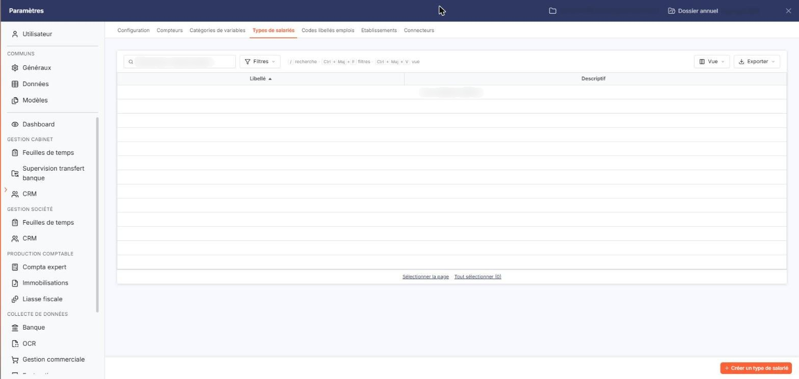
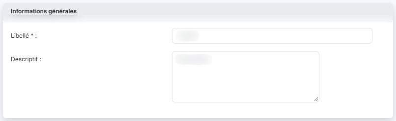
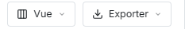

# Types de salariés


**Où le trouver :** Panneau **Paramètres** › **Transfert paie** › **Types de salariés**



**En bref** — Cet écran permet de constituer la liste des types de salariés de la société, des familles que vous définissez et qui servent de filtre dans les listes, les saisies et les éditions.

* Pour créer un type : bouton \[Créer un type de salarié], saisissez le « Libellé » (30 caractères au plus), puis bouton \[Enregistrer].
* Pour supprimer des types : sélectionnez-les, puis bouton \[Supprimer] du bandeau de sélection.


Cette option permet de constituer la liste des types de salariés de la société. Un type de salariés est une famille que vous définissez vous-même, et que vous portez ensuite sur la fiche d'un salarié, dans son champ **Type de salarié**. Elle s'ouvre par Paramètres > Transfert paie > Types de salariés.

<figure><figcaption>
Écran « Types de salariés » de la nouvelle interface
</figcaption></figure>

Ces types servent surtout à travailler sur une partie de l'effectif : le filtre **Type de salariés** proposé au-dessus des listes de salariés, des écrans de saisie et des éditions du module ne présente que les types déclarés ici. Tant que cette liste est vide, ce filtre n'offre que le choix « Tous ».

Le logiciel présente la liste des types déjà créés, sur deux colonnes. Tant qu'aucun type n'a été créé, la liste affiche la mention « Aucun élément à afficher. » :

| Champ          | Ce qu'il faut savoir                                                                    |
| -------------- | --------------------------------------------------------------------------------------- |
| **Libellé**    | Le nom du type. La liste est triée sur cette colonne par ordre croissant à l'ouverture. |
| **Descriptif** | Le texte libre que vous avez porté sur le type.                                         |

Au-dessus de la liste, une barre porte le champ « Rechercher un type de salarié… » et les boutons \[Filtres], \[Vue] et \[Exporter] ; le bouton \[Vue] ouvre la personnalisation des colonnes. Sous la liste, les liens « Sélectionner la page » et « Tout sélectionner » (suivi du nombre de lignes) permettent de sélectionner les lignes de la page en cours ou celles de toutes les pages.

## Bouton \[Créer un type de salarié]

<figure><figcaption>
Bouton [Créer un type de salarié]
</figcaption></figure>

<figure><figcaption>
Rubrique « Informations générales »
</figcaption></figure>

Situé en bas à droite du panneau, il ouvre la fiche de création d'un type de salariés, qui comporte une seule rubrique « Informations générales » :

| Champ                                                   | Ce qu'il faut savoir                                                                                                                                                                                                                        |
| ------------------------------------------------------- | ------------------------------------------------------------------------------------------------------------------------------------------------------------------------------------------------------------------------------------------- |
| 
<strong>Libellé</strong> <em>Obligatoire</em>
 | 30 caractères au maximum, et différent du libellé des types déjà créés. C'est le nom qui sera proposé sur la fiche du salarié et dans les filtres.                                                                                          |
| **Descriptif**                                          | 1 024 caractères au maximum. Cette zone accepte plusieurs lignes et vous permet de préciser ce que le type regroupe. Notez qu'à l'écran, elle est amorcée par le mot « Description », qui disparaît dès que vous y saisissez quelque chose. |

bouton **\[Enregistrer]** : il enregistre le nouveau type.

**Chevron « Retour »**, à gauche de la barre d'onglets du panneau : il vous ramène à la liste sans rien enregistrer.

## Bouton \[Exporter]

<figure><figcaption>
Bouton [Exporter]
</figcaption></figure>

Situé dans la barre au-dessus de la liste, il ouvre un menu qui propose notamment d'exporter la liste des types de salariés en Excel ou en PDF, ou de l'envoyer par e-mail.

## Bouton \[Supprimer]

Il apparaît dans le bandeau de sélection, une fois un type sélectionné dans la liste, et supprime les types de salariés sélectionnés.
