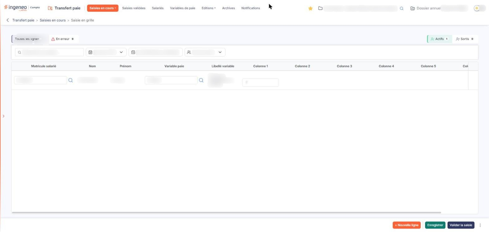
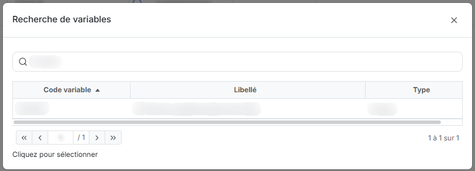
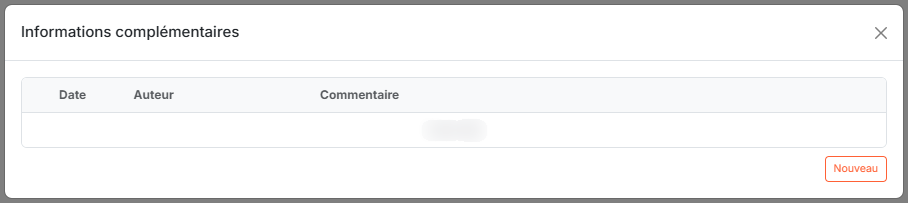
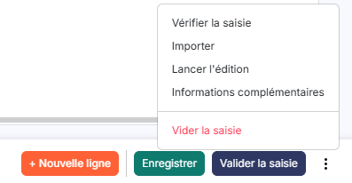

# Saisie en grille


**Où le trouver :** Menu **Saisies en cours › Saisie en grille**



**En bref** — Cet écran permet de saisir, dans un tableau, les éléments variables de paie de la société pour une période donnée : une ligne par salarié et par variable de paie.

* Pour ajouter une variable à un salarié : bouton \[Nouvelle ligne], saisissez le matricule et le code de la variable, renseignez les colonnes, puis bouton \[Enregistrer].
* Pour repérer les lignes à corriger : bouton \[Vérifier la saisie] du menu « Autres actions », puis onglet « En erreur ».
* Pour terminer la période : bouton \[Valider la saisie], une fois la saisie contrôlée ; les saisies validées se consultent dans « Saisies validées ».


Cette option vous permet de saisir les éléments variables de paie de la société pour une période donnée, directement dans un tableau : une ligne par salarié et par variable de paie.

<figure><figcaption>
Écran « Saisie en grille » de la nouvelle interface
</figcaption></figure>

La saisie porte toujours sur une **période de saisie**, c'est-à-dire un mois et une année. La période doit exister avant toute saisie ; les périodes se créent depuis l'écran « Configuration » du panneau Paramètres (Paramètres > « Transfert paie » > « Configuration »), qui décrit leur constitution.

Les quatre options de la rubrique « Saisies en cours » présentent la **même** saisie, sous quatre formes différentes : le tableau de cette option, la liste ligne à ligne de « Saisie par page », le bordereau d'un salarié de « Saisie par salarié » et celui d'une variable de « Saisie par variable ». Ce que vous saisissez dans l'une se retrouve dans les trois autres.

## Le bandeau de sélection, au-dessus du tableau

Il compte six contrôles, répartis sur deux lignes. Les quatre derniers restreignent les lignes présentées ; ils ne modifient pas votre saisie.

| Champ                    | Ce qu'il faut savoir                                                                                                                                                                                                                                                                                                                                                                       |
| ------------------------ | ------------------------------------------------------------------------------------------------------------------------------------------------------------------------------------------------------------------------------------------------------------------------------------------------------------------------------------------------------------------------------------------ |
| **Période sélectionnée** | Choisissez dans la liste la période sur laquelle vous voulez travailler. La liste ne propose que les périodes déjà créées.                                                                                                                                                                                                                                                                 |
| **Période de saisie**    | Cette zone n'est pas à renseigner. Elle affiche les bornes de la période retenue, sous la forme « du 01/09/2026 au 30/09/2026 ».                                                                                                                                                                                                                                                           |
| **Recherche**            | 
Saisissez ici un salarié pour ne conserver que ses lignes. <strong>Toutes les lignes</strong> et <strong>En erreur :</strong> deux onglets, chacun suivi d'un compteur (« Toutes les lignes (1) », « En erreur (0) »), qui remplacent l'ancien interrupteur « N'afficher que les lignes en erreur ». Choisissez « En erreur » pour ne garder que les lignes signalées en erreur.
 |
| **Type de salariés**     | Restreint le tableau à un type de salariés. La liste ne propose que les types que vous avez paramétrés dans l'écran « Types de salariés » du panneau Paramètres (Paramètres > « Transfert paie » > « Types de salariés ») ; tant qu'aucun type n'est paramétré, elle n'offre que le choix « Tous ».                                                                                        |

**Actifs** et **Sortis :** ces deux onglets, chacun suivi d'un compteur (« Actifs (1) », « Sortis (0) »), remplacent les anciens boutons-bascule « Uniquement les salariés actifs » et « Uniquement les salariés sortis ». Ils s'excluent. Il n'existe pas d'onglet présentant à la fois les uns et les autres.

## Le tableau de saisie

<figure><figcaption>
Rubrique « Les deux fenêtres de recherche »
</figcaption></figure>

<figure><figcaption>
Rubrique « Les deux fenêtres de recherche »
</figcaption></figure>

Ce n'est pas une grille de consultation : les cellules sont des zones de saisie, et le tableau ne comporte donc ni fenêtre de filtres, ni impression, ni pagination, ni tri par les en-têtes. Lorsque le tableau est plus large que votre écran, il défile horizontalement, la ligne d'en-tête restant visible.

Chaque ligne correspond à **une variable de paie d'un salarié** pour la période retenue, et se lit de gauche à droite :

| Champ                 | Ce qu'il faut savoir                                                                                                                                                                                                                                                                                                                                                                                                                                                                                                                                                                                                                                                                                                                      |
| --------------------- | ----------------------------------------------------------------------------------------------------------------------------------------------------------------------------------------------------------------------------------------------------------------------------------------------------------------------------------------------------------------------------------------------------------------------------------------------------------------------------------------------------------------------------------------------------------------------------------------------------------------------------------------------------------------------------------------------------------------------------------------- |
| **Matricule salarié** | 
Le matricule du salarié dans votre logiciel de paie. Saisissez-le dans la zone, ou cliquez sur le pictogramme « Loupe » (infobulle « Rechercher un salarié ») placé à sa droite pour ouvrir la fenêtre « Recherche de salariés ». <strong>Nom</strong> et <strong>Prénom :</strong> ces deux colonnes ne sont pas saisissables. Le logiciel les renseigne d'après le matricule.
                                                                                                                                                                                                                                                                                                                                                 |
| **Variable paie**     | Le code de la variable à saisir. Saisissez-le dans la zone, ou cliquez sur le pictogramme « Loupe » (infobulle « Rechercher une variable de paie ») pour ouvrir la fenêtre « Recherche de variables ».                                                                                                                                                                                                                                                                                                                                                                                                                                                                                                                                    |
| **Libellé variable**  | 
Cette colonne n'est pas saisissable. Le logiciel la renseigne d'après le code de la variable. <strong>Colonne 1</strong> à <strong>Colonne 6 :</strong> ce sont les valeurs de la variable. Chaque cellule comporte deux zones superposées : en haut, le nom de la donnée attendue, que le logiciel affiche sans que vous puissiez le modifier ; en dessous, la valeur à saisir. Le nombre de colonnes ouvertes dépend de la structure de la variable de paie retenue sur la ligne, telle qu'elle est définie dans l'option « Variables de paie » : les colonnes que la variable n'utilise pas restent grisées et ne se saisissent pas. L'infobulle de la zone de valeur indique la nature attendue, par exemple « Numérique ».
 |
| **Origine**           | Cette colonne n'est pas saisissable et indique la provenance de la ligne. Une ligne saisie dans ce tableau porte l'origine « grille ».                                                                                                                                                                                                                                                                                                                                                                                                                                                                                                                                                                                                    |


Attention : les en-têtes se lisent « Colonne 1 » à « Colonne 6 » et ne nomment pas la donnée. C'est dans la cellule, au-dessus de la valeur, que le logiciel écrit le nom réel de la donnée attendue.


**Les commandes de chaque ligne**

La première cellule de chaque ligne ne porte plus qu'une seule commande : une **case à cocher** (« Sélectionner la ligne »), qui désigne la ligne pour les actions qui travaillent sur une sélection, dont la suppression. Le pictogramme « Croix », d'infobulle « Effacer », a disparu : une ligne se supprime désormais en la sélectionnant, puis par le bouton \[Supprimer] du bandeau des lignes sélectionnées, décrit au paragraphe c). La case d'en-tête qui sélectionnait toutes les lignes du tableau a disparu elle aussi : ce bandeau propose à la place « Tout sélectionner (N) » et « Tout désélectionner ». Ce tableau n'offre ni duplication de ligne, ni personnalisation des colonnes : la duplication d'une ligne se trouve dans l'option « Saisie par page ».

**Les deux fenêtres de recherche**

Les deux pictogrammes « Loupe » du tableau ouvrent des fenêtres bâties sur le même modèle : une zone de recherche qui filtre la liste à mesure que vous saisissez (il n'y a plus de bouton « Afficher »), une liste à trois colonnes triables, une pagination, et la consigne « Cliquez pour sélectionner ». Elles se ferment par la croix de leur bandeau de titre.

* « Recherche de salariés » présente les colonnes « Matricule », « Nom de naissance » et « Prénom » ;
* « Recherche de variables » présente les colonnes « Code variable », « Libellé » et « Type ».

## Les boutons

<figure><figcaption>
Bouton [Informations complémentaires]
</figcaption></figure>

Le bas de l'écran présente trois boutons visibles : \[Nouvelle ligne], \[Enregistrer] et \[Valider la saisie]. À leur droite, un bouton à trois points, d'infobulle « Autres actions », ouvre un menu qui porte les autres commandes : « Vérifier la saisie », « Importer », « Lancer l'édition », « Informations complémentaires » puis, séparée des autres par un trait et écrite en rouge, « Vider la saisie ». Le bouton \[Supprimer] ne figure plus dans le pied : il se trouve dans le bandeau des lignes sélectionnées, qui n'apparaît qu'une fois une ligne sélectionnée (à ne pas confondre avec le bandeau de filtres décrit en a). Les paragraphes ci-dessous gardent, pour chaque commande, la forme « Bouton \[Libellé] ».

bouton **\[Nouvelle ligne]**

Il ajoute une ligne vierge au tableau, dans laquelle vous saisissez un nouveau couple salarié / variable de paie.

bouton **\[Enregistrer]**

Il mémorise les données du tableau et vous permet de reprendre votre saisie ultérieurement. C'est le seul écran de la rubrique qui enregistre en une fois la totalité du tableau, tous salariés confondus : « Saisie par page » enregistre ligne par ligne, dans la fenêtre de la ligne, et « Saisie par salarié » un bordereau à la fois.

bouton **\[Lancer l'édition]**

Entrée du menu « Autres actions » du pied. Elle édite les saisies de la période. La même édition se lance, avec le choix de ses critères, par l'option « Saisies » de la rubrique « Editions ».

bouton **\[Valider la saisie]**

Lorsque votre saisie est terminée, vous la validez. Les saisies validées se consultent ensuite par la rubrique « Saisies validées ».


Attention : ce bouton est le troisième de la barre, placé immédiatement à droite d'\[Enregistrer]. Assurez-vous d'avoir terminé votre saisie avant de l'employer.


bouton **\[Vérifier la saisie]**

Entrée du menu « Autres actions » du pied (elle s'appelait « Vérifier »). Elle soumet le tableau aux contrôles du logiciel sans le valider, ce qui vous permet de repérer les lignes incomplètes ou non conformes avant la validation. Le bandeau de filtres comporte à cet effet l'onglet « En erreur ».

bouton **\[Informations complémentaires]**

Entrée du menu « Autres actions » du pied. Elle ouvre une fenêtre du même nom, qui présente les commentaires portés sur la période de saisie dans un tableau à trois colonnes : « Date », « Auteur » et « Commentaire ». Lorsqu'il n'y en a aucun, la fenêtre affiche « Liste vide ». Elle se ferme par la croix de son bandeau.

La fenêtre comporte désormais, en bas à droite, un bouton \[Nouveau], qui permet d'y ajouter un commentaire ; il n'est proposé que si votre profil vous y autorise.

bouton **\[Vider la saisie]** et bouton **\[Supprimer]**

Ce sont tous deux des actions de suppression, mais elles ne sont plus voisines : \[Vider la saisie] est une entrée du menu « Autres actions » du pied, \[Supprimer] un bouton du bandeau des lignes sélectionnées.


Attention : lisez la fenêtre de confirmation avant de poursuivre.


bouton **\[Vider la saisie]**

Il vide la totalité de la saisie de la période retenue, et non les seules lignes que vous avez cochées.

bouton **\[Supprimer]**

Il supprime les lignes que vous avez sélectionnées dans le tableau. Il n'apparaît qu'une fois une ligne sélectionnée : le message « Aucune ligne n'est sélectionnée, veuillez en choisir une au moins s'il vous plaît. », qui répondait à un clic sans ligne cochée, ne peut donc plus se produire par ce bouton.

## Autres vues de l'écran

<figure><figcaption>
Bouton [Importer]
</figcaption></figure>
