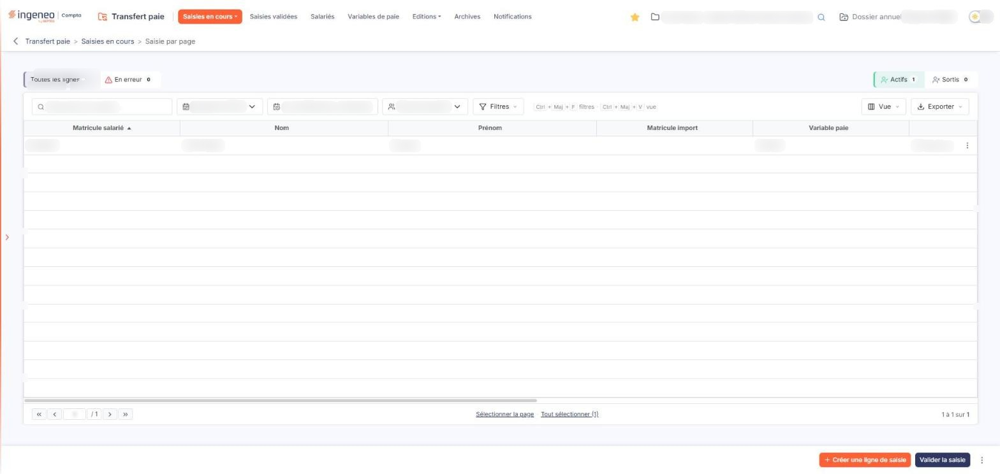
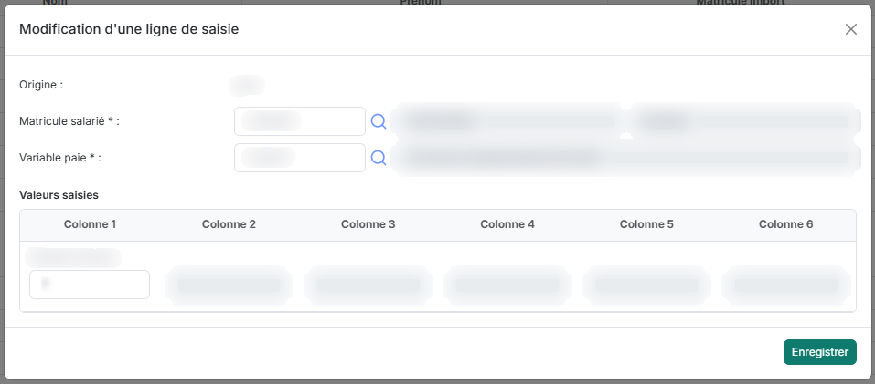

# Saisie par page


**Où le trouver :** Menu **Saisies en cours › Saisie par page**



**En bref** — Cet écran présente la saisie de la période sous forme de liste ligne à ligne : chaque ligne s'ouvre dans sa propre fenêtre. Il convient aux saisies comportant un grand nombre de lignes.

* Pour ajouter une ligne : bouton \[Créer une ligne de saisie], renseignez « Matricule salarié » et « Variable paie », saisissez les colonnes, puis validez par le bouton Enregistrer de la fenêtre.
* Pour corriger une ligne : menu ⋮ « Autres actions » de la ligne, puis « Modifier ».
* Pour terminer la période : bouton \[Valider la saisie], une fois la saisie contrôlée.


Cette option vous permet de saisir les éléments variables de paie de la société pour une période donnée, en travaillant **ligne par ligne**.

<figure><figcaption>
Écran « Saisie par page » de la nouvelle interface
</figcaption></figure>

Elle a été conçue pour les saisies comportant un grand nombre de lignes. Il n'y a pas de règle formelle pour dire quand la préférer à l'option « Saisie en grille », car cela dépend de nombreux paramètres : puissance de votre ordinateur, bande passante, navigateur employé. Elle est à votre disposition dès que vous jugez que la saisie en grille n'est pas assez confortable.

Les quatre options de la rubrique « Saisies en cours » présentent la **même** saisie : ce que vous saisissez ici se retrouve dans « Saisie en grille », dans « Saisie par salarié » et dans « Saisie par variable », et inversement.

La saisie porte toujours sur une **période de saisie**, c'est-à-dire un mois et une année. La période doit exister avant toute saisie ; les périodes se créent depuis l'écran « Configuration » du panneau Paramètres (rubrique « Transfert paie »), qui décrit leur constitution.

## La barre et les onglets, au-dessus de la liste

Elle réunit le champ de recherche, la liste de la période, les bornes de la période, la liste « Type de salariés » et les boutons \[Filtres], \[Vue] et \[Exporter], avec deux groupes d'onglets à compteurs ; ils sont identiques à ceux de l'option « Saisie en grille ». La recherche, « Type de salariés » et les onglets restreignent les lignes présentées ; ils ne modifient pas votre saisie.

| Champ                                              | Ce qu'il faut savoir                                                                                                                                                                                                                                                             |
| -------------------------------------------------- | -------------------------------------------------------------------------------------------------------------------------------------------------------------------------------------------------------------------------------------------------------------------------------- |
| **Période**                                        | Choisissez dans la liste la période sur laquelle vous voulez travailler. La liste ne propose que les périodes déjà créées.                                                                                                                                                       |
| **Période de saisie**                              | Cette zone n'est pas à renseigner. Elle affiche les bornes de la période retenue, sous la forme « du 01/09/2026 au 30/09/2026 ».                                                                                                                                                 |
| **Rechercher un salarié…**                         | Saisissez ici un salarié pour ne conserver que ses lignes.                                                                                                                                                                                                                       |
| **Onglets « Toutes les lignes » et « En erreur »** | Chacun porte un compteur entre parenthèses ; « Toutes les lignes » est retenu à l'ouverture. Choisissez « En erreur » pour ne garder que les lignes signalées en erreur.                                                                                                         |
| **Type de salariés**                               | Restreint la liste à un type de salariés. La liste ne propose que les types que vous avez paramétrés dans l'écran « Types de salariés » du panneau Paramètres, rubrique « Transfert paie » ; tant qu'aucun type n'est paramétré, elle n'offre que le choix « Type de salariés ». |
| **Onglets « Actifs » et « Sortis »**               | Chacun porte un compteur entre parenthèses ; ils s'excluent, et « Actifs » est retenu à l'ouverture. Il n'existe pas d'onglet présentant à la fois les uns et les autres.                                                                                                        |

## La liste des lignes de saisie

Chaque ligne correspond à **une variable de paie d'un salarié** pour la période retenue. Toutes les colonnes se trient par un clic sur leur en-tête, et la liste s'ouvre triée sur « Matricule salarié », par ordre croissant. Elle se parcourt par la pagination placée dessous, et défile horizontalement lorsqu'elle est plus large que votre écran, la ligne d'en-tête restant visible.

Les colonnes sont les suivantes, de gauche à droite (la colonne de commandes, sans libellé, termine la ligne) :

| Champ                 | Ce qu'il faut savoir                                                                                                                                                                                                                                                                                                                  |
| --------------------- | ------------------------------------------------------------------------------------------------------------------------------------------------------------------------------------------------------------------------------------------------------------------------------------------------------------------------------------- |
| **Matricule salarié** | 
Le matricule du salarié dans votre logiciel de paie. <strong>Nom</strong> et <strong>Prénom :</strong> l'identité du salarié.
                                                                                                                                                                                               |
| **Matricule import**  | 
Le matricule du salarié dans le fichier que vous importez, lorsqu'il diffère de celui de votre logiciel de paie. Cette colonne reste vide pour une ligne qui n'est pas issue d'un import. <strong>Variable paie</strong> et <strong>Libellé variable :</strong> le code de la variable saisie sur la ligne, et son libellé.
 |
| **Erreurs**           | Indique si la ligne est signalée en erreur. C'est le seul indicateur d'état de la liste, et c'est lui que reprend l'onglet « En erreur ».                                                                                                                                                                                             |

**Colonne 1** à **Colonne 6 :** les valeurs saisies sur la ligne. Le nombre de colonnes utilisées dépend de la structure de la variable de paie, telle qu'elle est définie dans l'option « Variables de paie » ; les colonnes que la variable n'utilise pas restent vides.


Attention : les en-têtes se lisent « Colonne 1 » à « Colonne 6 » et ne nomment pas la donnée.


**Les commandes de la liste**

L'en-tête de la colonne de commandes ne porte plus de cases à cocher ni de pictogramme « Engrenage » : leurs fonctions passent dans la barre. \[Filtres] ouvre le volet de critères de la liste, \[Vue] ouvre le choix des colonnes affichées, et \[Exporter] propose « Aperçu édition HTML », « Imprimer », « Exporter en Excel », « Exporter en PDF », « Envoyer la liste par e-mail » et « Lancer l'édition ». Sous la liste, les liens « Sélectionner la page » et « Tout sélectionner », suivi du nombre de lignes entre parenthèses, étendent la sélection à la page affichée, puis à toutes les pages. Le filtrage passe par la barre et les onglets décrits plus haut.

Chaque ligne porte un seul pictogramme ⋮, d'infobulle « Autres actions », dont le menu propose trois commandes :

* « Modifier » ;
* « Dupliquer » ;
* « Supprimer ».

La case à cocher de la ligne n'est plus affichée : un clic sur la ligne la sélectionne, pour les actions travaillant sur une sélection.

## Les boutons de l'écran

Le bas de l'écran présente deux boutons, \[Créer une ligne de saisie] et \[Valider la saisie], puis un menu ⋮ d'infobulle « Autres actions » qui porte quatre commandes : « Importer », « Lancer l'édition », « Informations complémentaires » et « Vider la saisie ».

bouton **\[Créer une ligne de saisie]**

Il vous permet d'ajouter une variable de paie à un salarié pour la période retenue.

**Commande « Importer » du menu ⋮**

Il vous permet de reprendre les variables de paie d'un fichier produit par un autre logiciel ou par un matériel de suivi des temps, au lieu de les saisir. Le fichier est interprété d'après un modèle d'import de type « Saisie », que vous définissez dans le panneau Paramètres, sous Modèles > « Imports et exports » > « Données de paie ».

**Commande « Lancer l'édition » du menu ⋮**

Il édite les saisies de la période. La même édition se lance, avec le choix de ses critères, par l'option « Saisies » de la rubrique « Editions ».

bouton **\[Valider la saisie]**

Lorsque votre saisie est terminée, vous la validez. Les saisies validées se consultent ensuite par la rubrique « Saisies validées ».


Attention : ce bouton est placé juste à côté de \[Créer une ligne de saisie]. Assurez-vous d'avoir terminé votre saisie avant de l'employer.


**Commande « Informations complémentaires » du menu ⋮**

Il ouvre une fenêtre qui présente les commentaires portés sur la période de saisie ; le bouton \[Nouveau], en bas à droite de cette fenêtre, permet d'y ajouter un commentaire (il n'est proposé que si votre profil vous y autorise).

## Autres vues de l'écran

<figure><figcaption>
c) La fenêtre « Modification d'une ligne de saisie »
</figcaption></figure>
