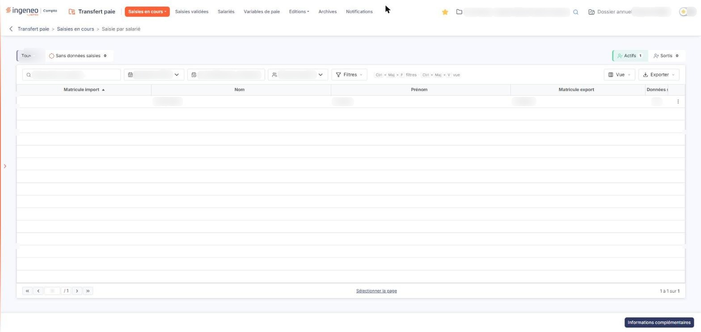
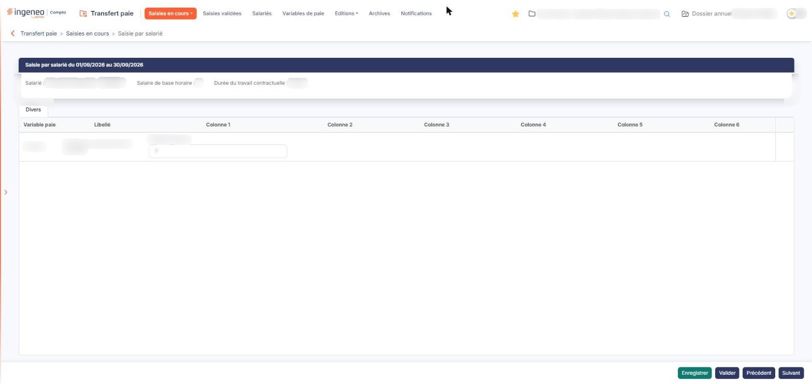

# Saisie par salarié


**Où le trouver :** Menu **Saisies en cours › Saisie par salarié**



**En bref** — Cet écran permet de saisir ou de consulter les variables de paie d'un seul salarié à la fois, sur un bordereau qui rassemble toutes ses variables pour la période.

* Pour saisir un salarié : choisissez la période, ouvrez sa ligne par le menu ⋮ puis « Modifier », saisissez les valeurs, puis bouton \[Enregistrer].
* Pour valider : bouton \[Valider] du bordereau, ou cochez plusieurs salariés dans la liste puis bouton \[Valider les salariés sélectionnés].
* Pour passer d'un salarié à l'autre sans revenir à la liste : boutons \[Précédent] et \[Suivant].


Cette option vous permet de saisir ou de consulter les variables de paie **d'un seul salarié** à la fois, sur un bordereau qui rassemble toutes ses variables pour la période.

<figure><figcaption>
Écran « Saisie par salarié » de la nouvelle interface
</figcaption></figure>

Elle présente la même saisie que les options « Saisie en grille », « Saisie par page » et « Saisie par variable » de la rubrique « Saisies en cours » : ce que vous saisissez dans le bordereau d'un salarié se retrouve dans les trois autres écrans, et inversement.

La saisie porte toujours sur une **période de saisie**, c'est-à-dire un mois et une année. La période doit exister avant toute saisie ; les périodes se créent depuis l'écran « Configuration » du panneau Paramètres (rubrique « Transfert paie »), qui décrit leur constitution.

L'écran se parcourt en deux temps : une liste des salariés de la période, puis le bordereau du salarié que vous y choisissez.

## La liste des salariés

<figure><figcaption>
Bouton [Informations complémentaires]
</figcaption></figure>

Une barre surmonte la liste : le champ de recherche, la liste de la période, les bornes de la période, la liste « Type de salariés », puis les boutons \[Filtres], \[Vue] et \[Exporter] ; deux groupes d'onglets à compteurs l'accompagnent. La recherche, « Type de salariés » et les onglets restreignent les salariés présentés ; ils ne modifient aucune saisie.

| Champ                                            | Ce qu'il faut savoir                                                                                                                                                                                                                                                                                                                                                                                                                                                                                                                                      |
| ------------------------------------------------ | --------------------------------------------------------------------------------------------------------------------------------------------------------------------------------------------------------------------------------------------------------------------------------------------------------------------------------------------------------------------------------------------------------------------------------------------------------------------------------------------------------------------------------------------------------- |
| **Période**                                      | Choisissez dans la liste la période sur laquelle vous voulez travailler. La liste ne propose que les périodes déjà créées.                                                                                                                                                                                                                                                                                                                                                                                                                                |
| **Période de saisie**                            | Cette zone n'est pas à renseigner. Elle affiche les bornes de la période retenue, sous la forme « du 01/09/2026 au 30/09/2026 ».                                                                                                                                                                                                                                                                                                                                                                                                                          |
| **Rechercher un salarié…**                       | Saisissez ici un salarié pour ne conserver que lui.                                                                                                                                                                                                                                                                                                                                                                                                                                                                                                       |
| **Onglets « Tous » et « Sans données saisies »** | Chacun porte un compteur entre parenthèses ; « Tous » est retenu à l'ouverture. Choisissez « Sans données saisies » pour ne conserver que les salariés dont aucune variable n'est encore renseignée. Attention : un salarié dont une seule variable est saisie n'apparaît plus dans la liste, même si sa saisie n'est pas terminée à vos yeux.                                                                                                                                                                                                            |
| **Type de salariés**                             | Restreint la liste à un type de salariés. La liste ne propose que les types que vous avez paramétrés dans l'écran « Types de salariés » du panneau Paramètres, rubrique « Transfert paie » ; tant qu'aucun type n'est paramétré, elle n'offre que le choix « Type de salariés ».                                                                                                                                                                                                                                                                          |
| **Onglets « Actifs » et « Sortis »**             | 
Chacun porte un compteur entre parenthèses ; ils s'excluent, et « Actifs » est retenu à l'ouverture. Il n'existe pas d'onglet présentant à la fois les uns et les autres. La liste comporte les colonnes « Matricule import », « Nom », « Prénom », « Matricule export » et « Données saisies », qui se trient toutes par un clic sur leur en-tête, puis, en dernière position, une colonne de commandes sans libellé. Elle s'ouvre triée sur « Matricule import », par ordre croissant, et se parcourt par la pagination placée sous la liste.
 |
| **Matricule import**                             | Le matricule du salarié dans le fichier que vous importez, lorsqu'il diffère de celui de votre logiciel de paie. Cette colonne reste vide pour un salarié qui n'est pas issu d'un import.                                                                                                                                                                                                                                                                                                                                                                 |
| **Matricule export**                             | Le matricule du salarié dans votre logiciel de paie.                                                                                                                                                                                                                                                                                                                                                                                                                                                                                                      |
| **Données saisies**                              | Indique si le salarié a déjà au moins une variable renseignée pour la période. C'est le seul indicateur d'état de la liste, et c'est lui que reprend le filtre « Afficher uniquement les salariés sans données saisies ».                                                                                                                                                                                                                                                                                                                                 |

L'en-tête de la colonne de commandes ne porte plus de case à cocher ni de pictogramme « Engrenage » : leurs fonctions passent dans la barre. \[Filtres] ouvre le volet de critères de la liste, \[Vue] ouvre le choix des colonnes affichées, et \[Exporter] propose « Aperçu édition HTML », « Imprimer », « Exporter en Excel », « Exporter en PDF » et « Envoyer la liste par e-mail ». Sous la liste, le lien « Sélectionner la page » sélectionne les lignes de la page affichée ; cette liste ne propose pas « Tout sélectionner » : votre sélection ne peut donc pas dépasser la page affichée.

Chaque ligne porte un seul pictogramme ⋮, d'infobulle « Autres actions », dont le menu n'a qu'une entrée, « Modifier », qui ouvre le bordereau du salarié. La case à cocher de la ligne n'est plus affichée. Il n'y a ni suppression ni duplication de ligne sur cette liste.

bouton **\[Informations complémentaires]**

Il ouvre une fenêtre qui présente les commentaires portés sur la période de saisie ; le bouton \[Nouveau], en bas à droite de cette fenêtre, permet d'y ajouter un commentaire (il n'est proposé que si votre profil vous y autorise).

## Le bordereau du salarié

<figure><figcaption>
Rubrique « b) Le bordereau du salarié »
</figcaption></figure>

La commande « Modifier » du menu ⋮ d'une ligne ouvre le bordereau du salarié. Le titre de la rubrique reprend les bornes de la période, sous la forme « Saisie par salarié du 01/09/2026 au 30/09/2026 ».

Trois zones précèdent le tableau des variables :

| Champ                              | Ce qu'il faut savoir                                                                                                                                                                                                                                                                                                                                                                                                                                                                                                                                                                                                                                                          |
| ---------------------------------- | ----------------------------------------------------------------------------------------------------------------------------------------------------------------------------------------------------------------------------------------------------------------------------------------------------------------------------------------------------------------------------------------------------------------------------------------------------------------------------------------------------------------------------------------------------------------------------------------------------------------------------------------------------------------------------- |
| **Salarié**                        | Le salarié dont vous saisissez le bordereau. Le logiciel l'écrit sous la forme prénom, nom, puis matricule.                                                                                                                                                                                                                                                                                                                                                                                                                                                                                                                                                                   |
| **Salaire de base horaire**        | Le salaire horaire de base du salarié.                                                                                                                                                                                                                                                                                                                                                                                                                                                                                                                                                                                                                                        |
| **Durée du travail contractuelle** | 
La durée du travail portée par le contrat, suivie de son unité, par exemple « Heure ». Ces trois zones ne portent pas d'astérisque : le logiciel ne les signale pas comme obligatoires. Les variables de paie se répartissent ensuite sur des onglets, un par <strong>catégorie de variables</strong>. Les catégories se définissent dans l'écran « Catégories de variables » du panneau Paramètres, rubrique « Transfert paie » ; une variable sans catégorie propre se présente sous l'onglet « Divers ». Sous chaque onglet, un tableau porte une colonne de commandes, puis les colonnes « Variable paie », « Libellé » et « Colonne 1 » à « Colonne 6 ».
 |
| **Variable paie**                  | Le code de la variable. Sur la ligne observée, cette zone n'est pas saisissable.                                                                                                                                                                                                                                                                                                                                                                                                                                                                                                                                                                                              |
| **Libellé**                        | Cette colonne n'est pas saisissable. Le logiciel la renseigne d'après le code de la variable.                                                                                                                                                                                                                                                                                                                                                                                                                                                                                                                                                                                 |

**Colonne 1** à **Colonne 6 :** ce sont les valeurs de la variable. La cellule porte, au-dessus de la valeur, le nom de la donnée attendue, que le logiciel affiche sans que vous puissiez le modifier. Le nombre de colonnes utilisées dépend de la structure de la variable, telle qu'elle est définie dans l'option « Variables de paie » : les colonnes que la variable n'utilise pas restent vides et sans nom. L'infobulle de la cellule rappelle le nom de la donnée et la nature attendue, par exemple « Numérique ».

Les cases à cocher du tableau (celle de l'en-tête, qui sélectionne toutes les lignes, et celle de chaque ligne) ne sont plus affichées, et le pictogramme « Croix », d'infobulle « Effacer », a disparu des lignes.

bouton **\[Valider]**

Il valide la saisie du salarié affiché.


Attention : c'est le **deuxième** bouton de la barre, immédiatement à droite de \[Enregistrer], et il a le même aspect que \[Précédent] et \[Suivant]. Assurez-vous d'avoir terminé le bordereau avant de l'employer.


bouton **\[Enregistrer]**

Il mémorise le bordereau et vous permet de reprendre votre saisie ultérieurement.

bouton **\[Précédent]** et bouton **\[Suivant]**

Ils vous font passer d'un bordereau de salarié à un autre sans repasser par la liste. Ils parcourent la liste telle que vous l'avez laissée : la recherche, le type de salariés, le choix des salariés actifs ou sortis et le tri en cours sont conservés. Après le dernier salarié de la liste, le logiciel revient au premier.

bouton **\[Vider]**

Ce bouton ne figure plus dans la barre du bas, qui ne porte plus que \[Enregistrer], \[Valider], \[Précédent] et \[Suivant].

Malgré son libellé, ce bouton ne retire aucune ligne et aucun salarié : il efface les valeurs saisies sur les lignes que vous avez cochées dans le bordereau. Le logiciel vous demande de confirmer, par une fenêtre titrée « Suppression des données des lignes de saisie sélectionnées ». Si vous n'avez coché aucune ligne, il vous répond « Aucune ligne n'est sélectionnée, veuillez en choisir une au moins s'il vous plaît. » et ne fait rien.

**Flèche « Revenir en arrière »**

Placée à gauche du fil d'Ariane, elle vous ramène à la liste des salariés. Il n'y a plus de bouton \[Retour] dans la barre du bas.
