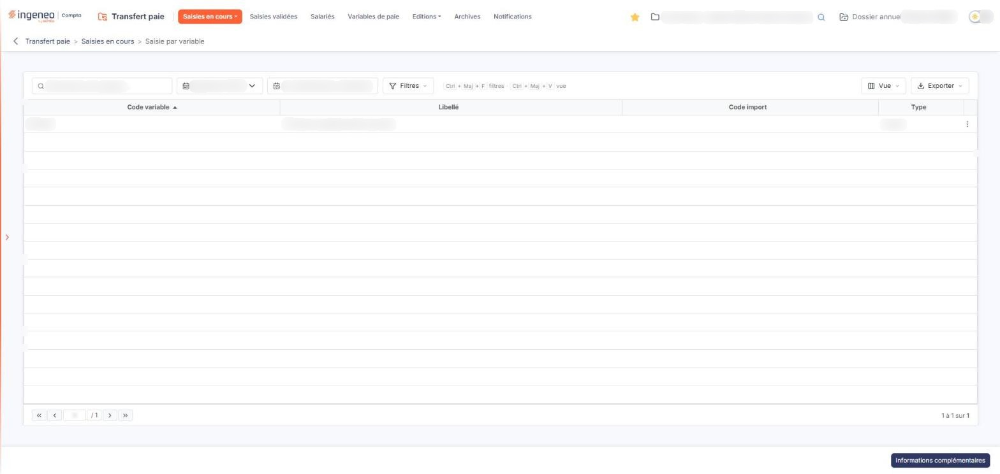
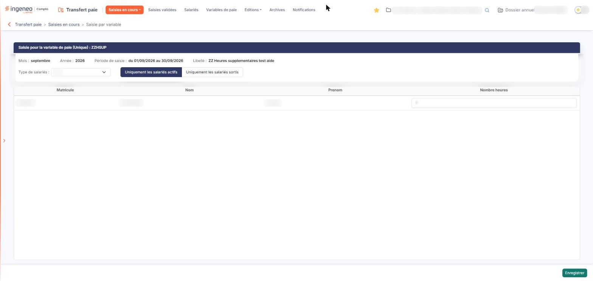

# Saisie par variable


**Où le trouver :** Menu **Saisies en cours › Saisie par variable**



**En bref** — Cet écran permet de saisir ou de consulter une même variable de paie pour tous les salariés à la fois ; il convient quand une variable est à renseigner pour un grand nombre de salariés.

* Pour saisir une variable : menu ⋮ de sa ligne, puis « Modifier », saisissez les valeurs dans la grille, puis bouton \[Enregistrer].
* Pour reporter une valeur sur les autres salariés : cliquez la ligne à reprendre, bouton \[Appliquer à tous les salariés], puis confirmez ; les lignes déjà renseignées ne sont pas écrasées.
* Pour lire ou ajouter un commentaire sur la période : bouton \[Informations complémentaires], puis bouton \[Nouveau].


Cette option vous permet de saisir ou de consulter **une seule variable de paie pour tous les salariés à la fois**. Elle est la transposée de l'option « Saisie par salarié » : celle-là fixe le salarié et déroule ses variables, celle-ci fixe la variable et déroule les salariés. Elle est donc adaptée au cas d'une même variable à renseigner pour un grand nombre de salariés.

<figure><figcaption>
Écran « Saisie par variable » de la nouvelle interface
</figcaption></figure>

La saisie porte toujours sur une période de saisie, c'est-à-dire un mois et une année. La période doit exister avant toute saisie ; les périodes se créent depuis Paramètres > Transfert paie > Configuration, qui décrit leur constitution.

L'écran se parcourt en deux temps : une liste des variables de paie de la période, puis le bordereau de la variable que vous y choisissez.

## La liste des variables de paie

<figure><figcaption>
Bouton [Informations complémentaires]
</figcaption></figure>

Une barre surmonte la liste : elle porte trois contrôles, puis les boutons \[Filtres], \[Vue] et \[Exporter]. Les deux champs de période n'affichent pas de libellé : leur nom apparaît en infobulle.

| Champ                        | Ce qu'il faut savoir                                                                                                                                                                                                                                                                                                                                                                                                                                                                                                                                                                                                                                                                                                                                                                                                                                                       |
| ---------------------------- | -------------------------------------------------------------------------------------------------------------------------------------------------------------------------------------------------------------------------------------------------------------------------------------------------------------------------------------------------------------------------------------------------------------------------------------------------------------------------------------------------------------------------------------------------------------------------------------------------------------------------------------------------------------------------------------------------------------------------------------------------------------------------------------------------------------------------------------------------------------------------- |
| **Période**                  | Choisissez dans la liste la période sur laquelle vous voulez travailler. La liste ne propose que les périodes déjà créées.                                                                                                                                                                                                                                                                                                                                                                                                                                                                                                                                                                                                                                                                                                                                                 |
| **Période de saisie**        | Cette zone n'est pas à renseigner. Elle affiche les bornes de la période retenue, sous la forme « du 01/09/2026 au 30/09/2026 ».                                                                                                                                                                                                                                                                                                                                                                                                                                                                                                                                                                                                                                                                                                                                           |
| **Rechercher une variable…** | 
Saisissez ici ce que vous cherchez pour ne conserver que les variables correspondantes. C'est la barre la plus courte des quatre options de saisie : le filtre sur le type de salariés et le choix entre salariés actifs et salariés sortis ne sont pas ici, mais dans le bordereau décrit plus bas. Il n'y a pas non plus de filtre sur les lignes en erreur. La liste comporte les colonnes « Code variable », « Libellé », « Code import » et « Type », qui se trient toutes par un clic sur leur en-tête, puis une colonne de commandes, sans libellé. Elle s'ouvre triée sur « Code variable », par ordre croissant, et se parcourt par la pagination placée dessous. <strong>Code variable</strong> et <strong>Libellé :</strong> le code de la variable de paie et son libellé, tels que vous les avez définis dans l'option « Variables de paie ».
 |
| **Code import**              | Le code de la variable dans le fichier importé, lorsque vous alimentez vos saisies depuis un autre logiciel. Cette colonne reste vide pour une variable que vous avez créée à la main.                                                                                                                                                                                                                                                                                                                                                                                                                                                                                                                                                                                                                                                                                     |
| **Type**                     | « Unique » ou « Multiple », selon ce que vous avez défini sur la fiche de la variable. Le bordereau reprend ce type dans son titre.                                                                                                                                                                                                                                                                                                                                                                                                                                                                                                                                                                                                                                                                                                                                        |

Au-dessus de la liste, le bouton \[Vue] ouvre la personnalisation des colonnes, le bouton \[Filtres] permet de poser des critères et le bouton \[Exporter] ouvre un menu pour imprimer, exporter ou envoyer la liste. Il n'y a pas de sélection de lignes dans cette liste.

Chaque ligne ne porte elle aussi qu'une seule commande : le menu ⋮ « Autres actions », dont l'unique entrée « Modifier » ouvre le bordereau de la variable. On ne supprime ni ne duplique une variable depuis cette liste.

bouton **\[Informations complémentaires]**

Il ouvre la fenêtre « Informations complémentaires », qui présente les commentaires portés sur la période de saisie dans un tableau à trois colonnes : **Date**, **Auteur** et **Commentaire**. Tant qu'aucun commentaire n'a été porté, le logiciel y affiche « Liste vide ».

La fenêtre comporte aussi un bouton \[Nouveau], en bas à droite, qui permet d'y ajouter un commentaire ; il n'est proposé que si votre profil vous y autorise. La fenêtre se ferme par la croix de son bandeau.

C'est le seul bouton de la liste : ni la saisie, ni l'import, ni l'édition, ni la validation ne s'y trouvent.

## Le bordereau de la variable

<figure><figcaption>
Rubrique « b) Le bordereau de la variable »
</figcaption></figure>

<figure><figcaption>
Bouton [Appliquer à tous les salariés]
</figcaption></figure>

L'entrée « Modifier » du menu ⋮ d'une ligne ouvre le bordereau de la variable. Le titre de la rubrique s'écrit « Saisie pour la variable de paie », suivi du type de la variable entre parenthèses, puis de son code.

Six zones précèdent la grille des salariés. Les quatre premières ne sont pas saisissables : elles rappellent sur quoi vous travaillez.

**Mois** et **Année :** le mois et l'année de la période retenue.

| Champ                 | Ce qu'il faut savoir                                                                                                                                                                                                                                                                                                                                                                                                                                                                                                                                                                                                                                                                                                                                                                         |
| --------------------- | -------------------------------------------------------------------------------------------------------------------------------------------------------------------------------------------------------------------------------------------------------------------------------------------------------------------------------------------------------------------------------------------------------------------------------------------------------------------------------------------------------------------------------------------------------------------------------------------------------------------------------------------------------------------------------------------------------------------------------------------------------------------------------------------- |
| **Période de saisie** | Les bornes de cette période.                                                                                                                                                                                                                                                                                                                                                                                                                                                                                                                                                                                                                                                                                                                                                                 |
| **Libellé**           | Le libellé de la variable.                                                                                                                                                                                                                                                                                                                                                                                                                                                                                                                                                                                                                                                                                                                                                                   |
| **Type de salariés**  | 
Restreint la grille à un type de salariés. La liste ne propose que les types que vous avez paramétrés dans Paramètres > Transfert paie > Types de salariés ; tant qu'aucun type n'est paramétré, elle n'offre que le choix « Tous ». <strong>Uniquement les salariés actifs</strong> et <strong>Uniquement les salariés sortis :</strong> ces deux boutons-bascule s'excluent, et le premier est retenu par défaut. Il n'existe pas de position présentant à la fois les uns et les autres. <strong>La grille des salariés</strong> Elle porte une ligne par salarié, et sa ligne d'en-tête reste visible lorsque vous la faites défiler. Elle présente tous les salariés d'un seul tenant : elle ne comporte pas de pagination. Après la colonne de commandes viennent :
 |
| **Matricule**         | Le matricule du salarié.                                                                                                                                                                                                                                                                                                                                                                                                                                                                                                                                                                                                                                                                                                                                                                     |

**Nom** et **Prenom :** l'identité du salarié. Ces trois colonnes sont présentées en information et ne se saisissent pas.

Puis **une colonne par colonne de la variable**, et c'est là que vous saisissez. Ces colonnes ne portent pas de numéro : elles portent le nom même de la donnée attendue, tel que vous l'avez défini dans l'option « Variables de paie ». L'infobulle de la cellule rappelle la nature attendue, par exemple « Numérique ».

Les cases à cocher de la grille sont masquées : un clic sur une ligne la sélectionne.

bouton **\[Appliquer à tous les salariés]**

Il apparaît dans le bandeau de sélection, une fois une ligne sélectionnée.

bouton **\[Enregistrer]**

Situé en bas à droite, il mémorise le bordereau et vous permet de reprendre votre saisie ultérieurement.

Cet écran ne comporte pas de bouton de validation : la validation de la saisie s'effectue depuis les autres options de la rubrique « Saisies en cours ».

bouton **\[Supprimer]**

Il apparaît dans le bandeau de sélection, une fois une ligne sélectionnée.

**Flèche « Revenir en arrière »**

Située à gauche du fil d'Ariane, elle vous ramène à la liste des variables de paie.
