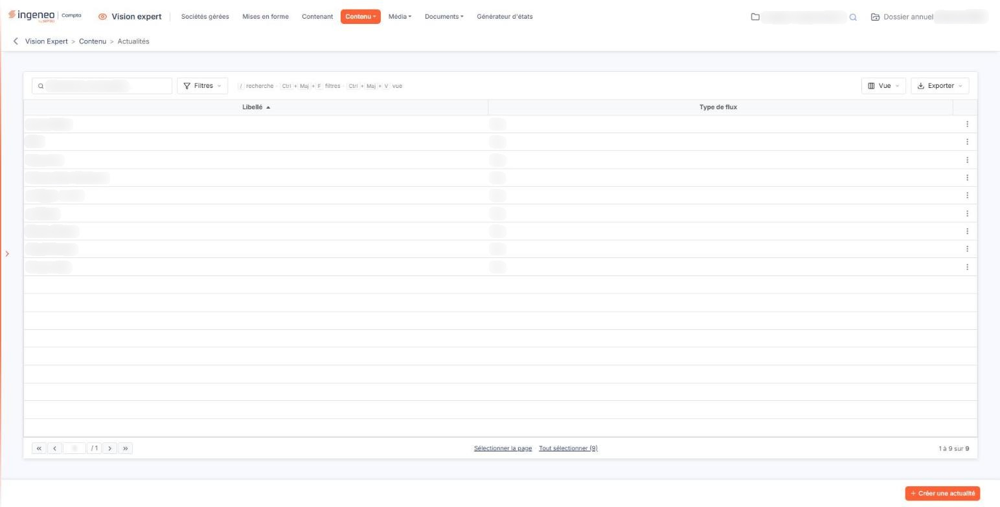
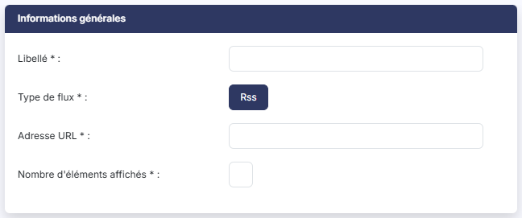

# Actualités


**Où le trouver :** Menu **Contenu › Actualités**



**En bref** — Cet écran liste les actualités du cabinet, issues de flux RSS, que vous pouvez afficher dans un pavé du tableau de bord.

* Pour ajouter une actualité : bouton \[Créer une actualité], renseignez le libellé, l'adresse URL du flux et le nombre d'éléments affichés, puis bouton \[Enregistrer].
* Pour supprimer des actualités : sélectionnez leurs lignes, puis bouton \[Supprimer].


Les actualités correspondent aux informations qui seront affichées dans un pavé du tableau de bord. Elles proviennent de flux RSS.

<figure><figcaption>
Écran « Actualités » de la nouvelle interface
</figcaption></figure>

La grille présente toutes les actualités déclarées pour le cabinet, quel que soit le collaborateur qui les a créées. Elle en présente le **Libellé** et le **Type de flux**. Au-dessus de la grille, le champ « Rechercher une actualité… » le bouton **\[Filtres]**, le bouton **\[Vue]** et le bouton **\[Exporter]** fonctionnent comme sur toutes les listes : voir la page « Les listes ».

Au survol d'une ligne, deux pictogrammes apparaissent à droite, dont l'infobulle vous rappelle la fonction : « Modifier » (un crayon) et « Dupliquer » (deux feuilles superposées) ; le pictogramme « Autres actions » (trois points) propose « Supprimer ».

Un clic sur une ligne la sélectionne ; les liens « Sélectionner la page » et « Tout sélectionner » placés sous la grille sélectionnent plusieurs lignes à la fois. Dès qu'une ligne est sélectionnée, le bas de l'écran propose le bouton **\[Supprimer]**, qui supprime les actualités sélectionnées, et le bouton **\[Tout désélectionner]**.

Pour créer une nouvelle actualité, cliquez sur le bouton **\[Créer une actualité]** et renseignez les quatre champs de la rubrique "Informations générales", qui sont tous obligatoires.

| Champ                          | Ce qu'il faut savoir                                                                                                      |
| ------------------------------ | ------------------------------------------------------------------------------------------------------------------------- |
| **Libellé**                    | Il permettra d'identifier l'actualité dans la liste de toutes celles que vous allez créer.                                |
| **Type de flux**               | Seul le type "Rss" est proposé aujourd'hui, et il est déjà retenu : vous n'avez pas à y toucher.                          |
| **Adresse URL**                | Il s'agit de l'adresse du flux RSS.                                                                                       |
| **Nombre d'éléments affichés** | Il s'agit du nombre d'informations que le logiciel reprendra du flux, pour les présenter dans le pavé du tableau de bord. |

Cliquez sur le bouton **\[Enregistrer]** pour finaliser la création de votre actualité, ou sur la flèche « Revenir en arrière » placée à gauche du fil d'Ariane pour y renoncer.

## Autres vues de l'écran

<figure><figcaption>
Informations générales
</figcaption></figure>
