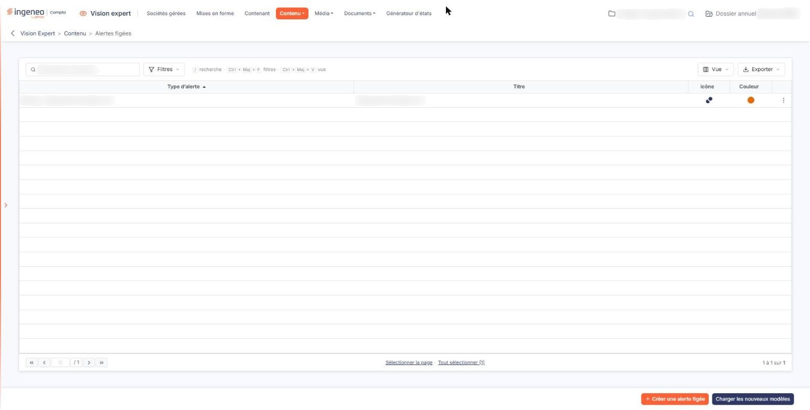
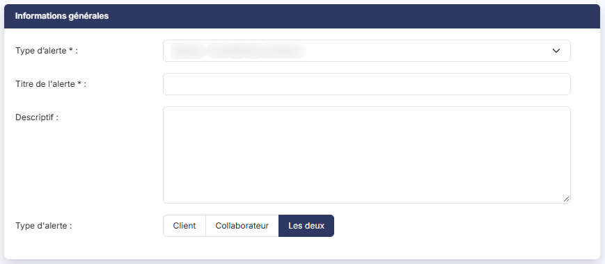
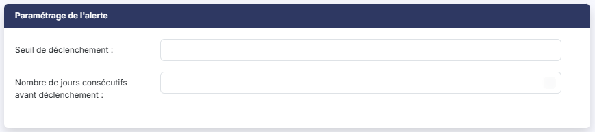
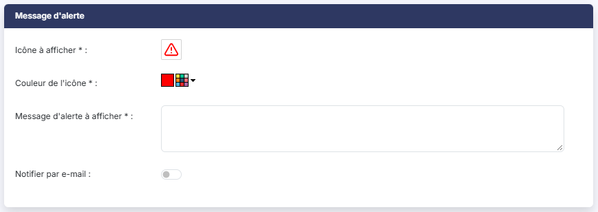

# Alertes figées


**Où le trouver :** Menu **Contenu › Alertes figées**



**En bref** — Cet écran gère les alertes figées, dont la règle de déclenchement est portée par le logiciel : vous choisissez le type, le message, son icône, sa couleur et qui les voit.

* Pour créer une alerte : bouton \[Créer une alerte figée], choisissez le type d'alerte, ajustez le titre et le message, puis bouton \[Enregistrer].
* Pour supprimer des alertes : sélectionnez leurs lignes, puis bouton \[Supprimer].


Les alertes sont des tests de comparaison entre une valeur constatée dans vos données et une valeur de référence.

<figure><figcaption>
Écran « Alertes figées » de la nouvelle interface
</figcaption></figure>

Les alertes **figées** sont celles que le logiciel connaît déjà : vous choisissez leur type dans une liste, et la règle de déclenchement est portée par le logiciel — vous ne la décrivez pas. Vous restez maître du message affiché, de son icône et de sa couleur, et vous décidez qui les voit.

Si vous souhaitez au contraire définir vous-même la règle, à partir d'un agrégat de comptes ou d'un ratio, reportez-vous à l'aide du menu « Contenu », option « Alertes personnalisées ».

Pour créer une nouvelle alerte figée, cliquez sur le bouton **\[Créer une alerte figée]**, en bas de l'écran.

### Ce que présente la liste

La liste est triée sur le **Type d'alerte**. Elle présente quatre colonnes : le **Type d'alerte** retenu, le **Titre** que vous avez saisi, puis l'**Icône** et la **Couleur** du message tels qu'ils seront affichés.

Au-dessus de la liste, le champ « Rechercher une alerte » filtre les lignes affichées ; le bouton **\[Filtres]** restreint la liste par des critères posés sur ses colonnes, le bouton **\[Vue]** choisit les colonnes affichées, et le bouton **\[Exporter]** imprime ou exporte la liste.

Au survol d'une ligne, deux pictogrammes apparaissent à droite, dont l'infobulle vous rappelle la fonction : « Modifier » (un crayon) et « Dupliquer » (deux feuilles superposées) ; le pictogramme « Autres actions » (trois points) propose « Supprimer ». Un clic sur une ligne la sélectionne ; les liens « Sélectionner la page » et « Tout sélectionner » placés sous la liste sélectionnent plusieurs lignes à la fois. Dès qu'une ligne est sélectionnée, le bas de l'écran propose le bouton **\[Supprimer]**, qui supprime les alertes sélectionnées, et le bouton **\[Tout désélectionner]**.

Le bas de l'écran porte aussi le bouton **\[Charger les nouveaux modèles]**, commun à plusieurs options du menu.

### Rubrique "Informations générales"

| Champ                 | Ce qu'il faut savoir                                                                                                                                                                                                                                                                                                                                                                                                                                                                                                                                                                                                                                                                                                                                  |
| --------------------- | ----------------------------------------------------------------------------------------------------------------------------------------------------------------------------------------------------------------------------------------------------------------------------------------------------------------------------------------------------------------------------------------------------------------------------------------------------------------------------------------------------------------------------------------------------------------------------------------------------------------------------------------------------------------------------------------------------------------------------------------------------- |
| **Type d'alerte**     | 
Champ obligatoire. C'est le premier champ à renseigner, car c'est lui qui détermine tout le reste de la fiche. Sept types vous sont proposés, classés par ordre alphabétique : • Banque – Anomalie de connexion, • Banque – Dépassement de découvert, • Banque – Pas de remontée depuis 15 jours, • Banque – Soldes des imports incohérents, • Comptabilité – Exercice non clôturé depuis 6 mois, • OCR - Documents à traiter, • OCR – Facture en anomalie. Lorsque vous choisissez un type, le logiciel renseigne pour vous le <strong>Titre de l'alerte</strong> et le <strong>Descriptif</strong> : le descriptif vous indique alors dans quel cas cette alerte se déclenche. Vous pouvez modifier l'un et l'autre.
 |
| **Titre de l'alerte** | Champ obligatoire. Il permet de distinguer l'alerte parmi la liste de toutes celles que vous allez créer. Sa longueur est limitée à 30 caractères : au-delà, le logiciel n'accepte plus la saisie.                                                                                                                                                                                                                                                                                                                                                                                                                                                                                                                                                    |
| **Descriptif**        | Il s'agit d'une zone de commentaire décrivant l'alerte.                                                                                                                                                                                                                                                                                                                                                                                                                                                                                                                                                                                                                                                                                               |
| **Type d'alerte**     | Indiquez si l'alerte peut être visible seulement pour les clients utilisateurs des sociétés gérées, seulement pour les collaborateurs du cabinet ou pour les deux.                                                                                                                                                                                                                                                                                                                                                                                                                                                                                                                                                                                    |

Ce champ, en bas de la rubrique, porte le même libellé que la liste déroulante du haut, sans en être le prolongement : le premier désigne la nature de l'alerte, celui-ci désigne les personnes qui la verront.

### Rubrique "Paramétrage de l'alerte"

Cette rubrique n'apparaît que pour le type **OCR - Documents à traiter**. Pour les six autres types, la règle de déclenchement est entièrement portée par le logiciel et il n'y a rien à paramétrer : la rubrique reste masquée.

| Champ                                               | Ce qu'il faut savoir                                                                                                                                   |
| --------------------------------------------------- | ------------------------------------------------------------------------------------------------------------------------------------------------------ |
| **Seuil de déclenchement**                          | Indiquez le nombre de documents à traiter au-delà duquel l'alerte doit se déclencher.                                                                  |
| **Nombre de jours consécutifs avant déclenchement** | Si vous souhaitez que la situation perdure plusieurs jours avant que l'alerte ne soit déclenchée, indiquez le nombre de jours ; le logiciel propose 0. |

Aucun de ces deux champs n'est marqué comme obligatoire.

### Rubrique "Message d'alerte"

Cette rubrique est la même que celle des alertes personnalisées : elle porte l'**Icône à afficher**, la **Couleur de l'icône**, le **Message d'alerte à afficher** et l'interrupteur **Notifier par e-mail**. Reportez-vous à l'aide du menu « Contenu », option « Alertes personnalisées », rubrique « Message d'alerte », pour le détail de ces quatre champs.

Cliquez sur le bouton **\[Enregistrer]** pour finaliser la création de votre alerte, ou sur la flèche « Revenir en arrière » placée à gauche du fil d'Ariane pour y renoncer.

L'accès à une alerte se donne société gérée par société gérée : la fiche d'une société gérée présente la liste de toutes vos alertes, avec pour chacune un interrupteur **Accès** et un pictogramme de personnalisation. Reportez-vous à l'aide de l'option « Sociétés gérées ».

## Autres vues de l'écran

<figure><figcaption>
Informations générales
</figcaption></figure>

<figure><figcaption>
Paramétrage de l'alerte
</figcaption></figure>

<figure><figcaption>
Message d'alerte
</figcaption></figure>
