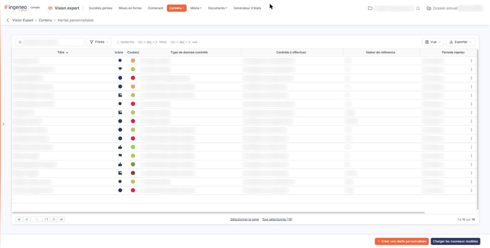
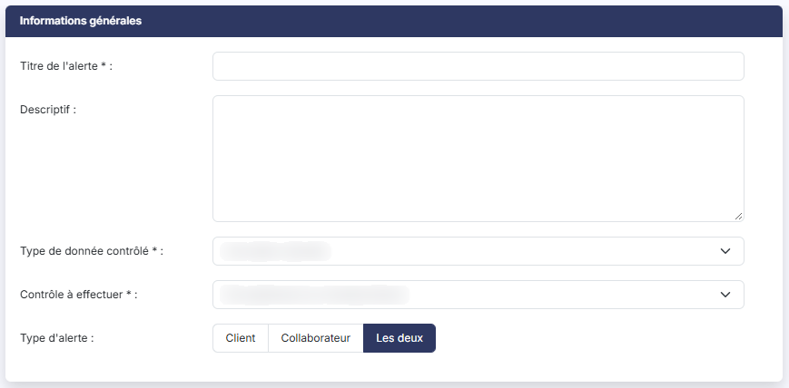
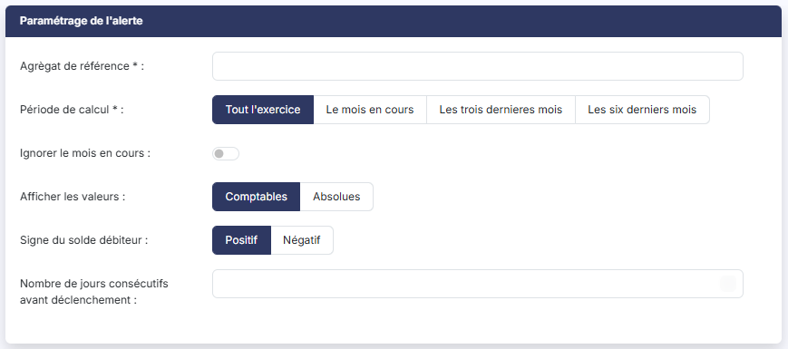
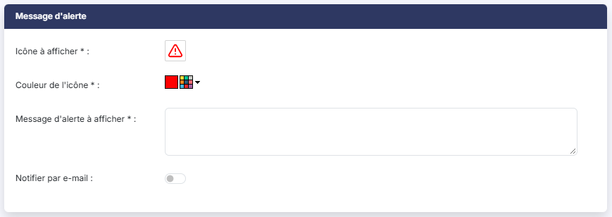
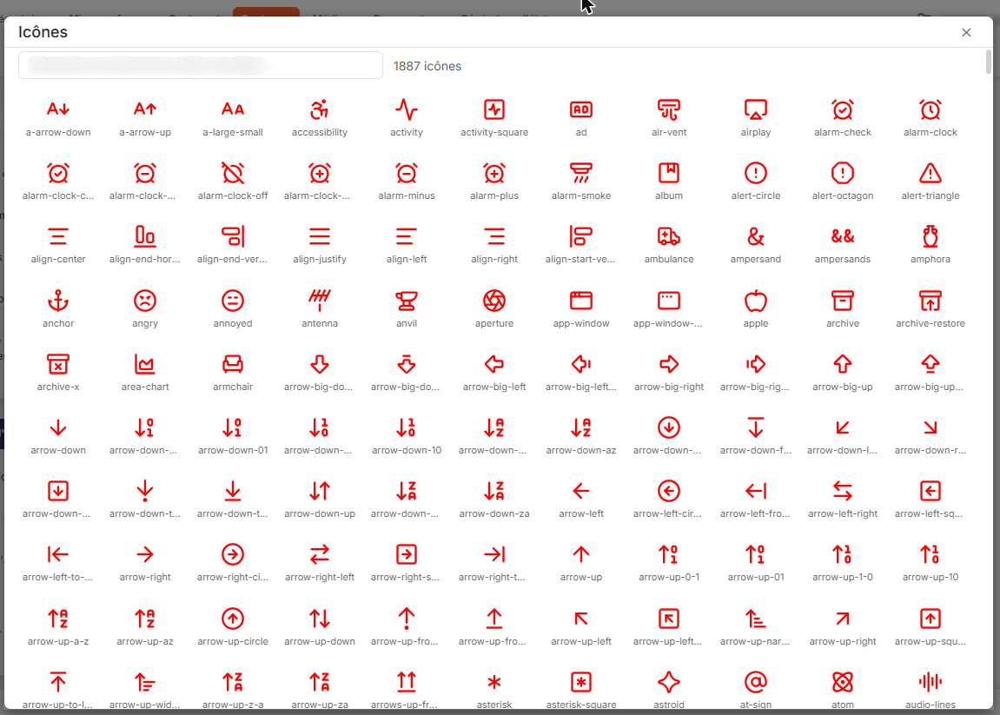

# Alertes personnalisées


**Où le trouver :** Menu **Contenu › Alertes personnalisées**



**En bref** — Cet écran gère les alertes personnalisées, dont vous décrivez vous-même la règle : comparaison entre une valeur calculée sur vos écritures et le seuil que vous fixez.

* Pour créer une alerte : bouton \[Créer une alerte personnalisée], renseignez le type de donnée, le contrôle, l'agrégat, le seuil et le message, puis enregistrez.
* Pour supprimer des alertes : sélectionnez leurs lignes, puis bouton \[Supprimer].


Les alertes sont des tests de comparaison de valeurs entre celles indiquées dans vos paramétrages et celles calculées à partir des données issues du logiciel. Elles peuvent avoir un aspect positif (atteinte d'objectif, par exemple) ou négatif (dépassement du découvert autorisé).

<figure><figcaption>
Écran « Alertes personnalisées » de la nouvelle interface
</figcaption></figure>

Cette option ne présente que les alertes **personnalisées**, c'est-à-dire celles dont vous décrivez vous-même la règle de déclenchement. Les alertes livrées avec le logiciel, dont la règle n'est pas modifiable, se paramètrent depuis l'option « Alertes figées » ; reportez-vous à l'aide du menu « Contenu », option « Alertes figées ».

Pour créer une nouvelle alerte, cliquez sur le bouton **\[Créer une alerte personnalisée]**, en bas d'écran.

### Ce que présente la liste

La liste est triée sur le **Titre**. Elle rappelle, pour chaque alerte, l'icône et la couleur du message qui sera affiché (colonnes **Icône** et **Couleur**), puis le résumé de son paramétrage : le **Type de donnée contrôlé**, le **Contrôle à affectuer**, la **Valeur de référence** (les comptes ou l'agrègat analysé), la **Période représentée** et la **Valeur de déclenchement** (la valeur à laquelle la comparaison est faite).


Notez que la colonne **Contrôle à affectuer** et le champ **Contrôle à effectuer** de la fiche désignent la même information ; de même, la colonne **Valeur de déclenchement** reprend le seuil de déclenchement de l'alerte.


Au-dessus de la liste, la zone « Rechercher une alerte… » filtre les lignes au fil de la saisie. Le bouton **\[Filtres]** ouvre un volet où vous ajoutez des critères, colonne par colonne ; le bouton **\[Vue]** permet de choisir les colonnes affichées et d'enregistrer la présentation de la liste ; le bouton **\[Exporter]** propose l'aperçu, l'impression, l'export Excel ou PDF et l'envoi de la liste par e-mail.

Au survol d'une ligne apparaissent, à droite, deux pictogrammes dont l'infobulle vous rappelle la fonction, « Modifier » et « Dupliquer », ainsi qu'un pictogramme « Autres actions » (trois points) qui porte « Supprimer ». Un clic sur une ligne la sélectionne ; les liens « Sélectionner la page » et « Tout sélectionner », sous la liste, en sélectionnent davantage. Dès qu'une ligne est sélectionnée, un bandeau en bas d'écran rappelle le nombre d'alertes retenues et porte le lien « Tout désélectionner » et le bouton **\[Supprimer]**, qui supprime les alertes sélectionnées.

Le bouton **\[Charger les nouveaux modèles]** ouvre la fenêtre « Nouveaux modèles », qui vous invite à choisir les nouveaux modèles que vous voulez charger, puis à valider : la liste qu'elle présente contient les modèles éditeurs qui sont absents de votre fichier ou qui ont été mis à jour.

### Rubrique "Informations générales"

| Champ                       | Ce qu'il faut savoir                                                                                                                                                                                                                                                                                                                                                                                                                                                                                                                                                                                                                                                                                                                                                                                                           |
| --------------------------- | ------------------------------------------------------------------------------------------------------------------------------------------------------------------------------------------------------------------------------------------------------------------------------------------------------------------------------------------------------------------------------------------------------------------------------------------------------------------------------------------------------------------------------------------------------------------------------------------------------------------------------------------------------------------------------------------------------------------------------------------------------------------------------------------------------------------------------ |
| **Titre de l'alerte**       | Champ obligatoire. Il permet de la distinguer parmi la liste de toutes celles que vous allez créer.                                                                                                                                                                                                                                                                                                                                                                                                                                                                                                                                                                                                                                                                                                                            |
| **Descriptif**              | Il s'agit d'une zone de commentaire décrivant l'alerte.                                                                                                                                                                                                                                                                                                                                                                                                                                                                                                                                                                                                                                                                                                                                                                        |
| **Type de donnée contrôlé** | 
Champ obligatoire. Il décrit ce sur quoi porte la comparaison. Ce champ peut prendre les valeurs suivantes : • <strong>une valeur calculée</strong>, pour comparer le résultat d'un agrégat de comptes à un montant, • <strong>le ratio entre deux valeurs calculées</strong>, pour comparer ce ratio à un pourcentage, • <strong>le montant d'une ligne d'écriture</strong>, pour rechercher une ligne dont le montant dépasse une valeur.
                                                                                                                                                                                                                                                                                                                                                                    |
| **Contrôle à effectuer**    | 
Champ obligatoire. Le contrôle à effectuer est l'opération logique de comparaison entre les valeurs calculées et la valeur de référence paramétrée dans l'alerte. Les comparaisons proposées dépendent du type de donnée contrôlé : - pour une valeur calculée : si elle est supérieure, inférieure ou égale à un montant donné, - pour un ratio entre deux valeurs calculées : s'il est supérieur, inférieur ou égal à un certain ratio, - pour le montant d'une ligne d'écriture : s'il est supérieur à un certain montant, ou s'il a un montant supérieur à un certain ratio. Ce dernier type de donnée n'offre ni comparaison "inférieur", ni comparaison "égal". Le contrôle retenu ne change pas les champs à renseigner dans la rubrique suivante : c'est le type de donnée contrôlé qui les détermine.
 |
| **Type d'alerte**           | Indiquez si l'alerte peut être visible seulement pour les clients utilisateurs des sociétés gérées, seulement pour les collaborateurs du cabinet ou pour les deux. Ce champ se trouve en bas de la rubrique.                                                                                                                                                                                                                                                                                                                                                                                                                                                                                                                                                                                                                   |

### Rubrique "Paramétrage de l'alerte"

Le contenu de cette rubrique dépend du type de donnée contrôlé. Le champ **Agrègat de référence** — **Comptes à analyser** pour le montant d'une ligne d'écriture — admet une liste de comptes ou une formule : reportez-vous à l'aide du menu « Annexe », option « Construction d'un agrégat ».

Aucun contrôle n'est fait sur la forme de l'agrégat que vous saisissez. Si sa syntaxe est erronée, le logiciel ne vous le signale pas : l'alerte est évaluée mais ne se déclenche jamais. Vérifiez donc votre saisie sur un dossier dont vous connaissez les valeurs attendues.

1. Paramétrage dans le cas d'une valeur calculée ou d'un ratio entre deux valeurs calculées

| Champ                                               | Ce qu'il faut savoir                                                                                                                                                                                                                                                                                                          |
| --------------------------------------------------- | ----------------------------------------------------------------------------------------------------------------------------------------------------------------------------------------------------------------------------------------------------------------------------------------------------------------------------- |
| **Agrègat de référence**                            | Champ obligatoire. Il s'agit de la valeur à calculer sur la base des écritures comptables.                                                                                                                                                                                                                                    |
| **Période de calcul**                               | Champ obligatoire. Indiquez sur quelle période doivent être prises en compte les écritures pour élaborer le calcul : "Tout l'exercice", "Le mois en cours", "Les trois dernieres mois" ou "Les six derniers mois".                                                                                                            |
| **Ignorer le mois en cours**                        | Si vous l'activez, aucune des données du mois en cours ne sera prise en compte dans l'analyse. Cette option permet d'éviter les incohérences de certains indicateurs si toutes les données du mois en cours ne sont pas présentes.                                                                                            |
| **Afficher les valeurs**                            | Vous avez le choix entre comptables (qui afficheront les valeurs positives et négatives) et absolues (qui ne tiendront pas compte du signe).                                                                                                                                                                                  |
| **Signe du solde débiteur**                         | Dans le cas où vous avez choisi d'afficher les valeurs comptables, indiquez quel signe les soldes débiteurs doivent prendre.                                                                                                                                                                                                  |
| **Nombre de jours consécutifs avant déclenchement** | 
Si vous souhaitez que l'alerte perdure plusieurs jours avant qu'elle ne soit déclenchée, indiquez le nombre de jours. La valeur saisie ici sert de valeur par défaut : chaque dossier peut lui substituer la sienne depuis l'option "Sociétés gérées". 2. Paramétrage dans le cas du montant d'une ligne d'écriture
 |
| **Comptes à analyser**                              | Champ obligatoire. Il s'agit des comptes dans lesquels les lignes d'écriture seront recherchées.                                                                                                                                                                                                                              |
| **Période de recherche**                            | Champ obligatoire. Indiquez sur quelle période les lignes d'écriture doivent être recherchées.                                                                                                                                                                                                                                |
| **Ignorer le mois en cours**                        | Si vous l'activez, aucune des données du mois en cours ne sera prise en compte dans l'analyse.                                                                                                                                                                                                                                |
| **Nombre de jours consécutifs avant déclenchement** | Si vous souhaitez que l'alerte perdure plusieurs jours avant qu'elle ne soit déclenchée, indiquez le nombre de jours. La valeur saisie ici sert de valeur par défaut : chaque dossier peut lui substituer la sienne depuis l'option "Sociétés gérées".                                                                        |

Les champs **Afficher les valeurs** et **Signe du solde débiteur** ne sont pas proposés pour ce type de donnée.

### Rubrique "Message d'alerte"

| Champ                           | Ce qu'il faut savoir                                                                                                                                                                                                                                                                                                                                                                                                                                                                                                                                                                                       |
| ------------------------------- | ---------------------------------------------------------------------------------------------------------------------------------------------------------------------------------------------------------------------------------------------------------------------------------------------------------------------------------------------------------------------------------------------------------------------------------------------------------------------------------------------------------------------------------------------------------------------------------------------------------- |
| **Icône à afficher**            | Champ obligatoire. Il s'agit de l'icône associée au message d'alerte. Cliquez sur l'icône affichée : le logiciel ouvre la fenêtre « Icônes », qui présente le catalogue des icônes disponibles, chacune accompagnée de son nom (en anglais). La zone « Rechercher une icône (nom Lucide, en anglais)… » restreint la liste aux icônes dont le nom contient les mots saisis, et le nombre d'icônes affichées est rappelé à côté. Cliquez sur l'icône de votre choix : la fenêtre se referme et l'icône est mise en place. Pour conserver l'icône actuelle, refermez la fenêtre par la croix de son en-tête. |
| **Couleur de l'icône**          | Champ obligatoire. Le carré affiche la couleur retenue ; cliquez sur le pictogramme de palette qui le suit et le logiciel ouvre une palette dans laquelle vous choisissez la couleur, soit en cliquant dans le dégradé et dans la bande de teintes, soit en saisissant ses composantes rouge, vert et bleu, ou teinte, saturation et valeur, soit en saisissant sa valeur hexadécimale. Validez par le pictogramme « Coche » ou renoncez par le pictogramme « Croix ».                                                                                                                                     |
| **Message d'alerte à afficher** | Champ obligatoire. Il s'agit du message de l'alerte. Ce message peut contenir des variables entre accolades, que le logiciel remplace par la valeur constatée au moment du déclenchement : par exemple "Le chiffre d'affaires est en hausse par rapport à l'année dernière ({valeur} € cette année, contre {comparaison} € l'année dernière)." Pour une alerte portant sur le montant d'une ligne d'écriture, la variable {nblignes} restitue le nombre de lignes détectées.                                                                                                                               |
| **Notifier par e-mail**         | Si vous l'activez, aucun autre champ n'est alors à renseigner : ni destinataire, ni fréquence.                                                                                                                                                                                                                                                                                                                                                                                                                                                                                                             |

La valeur à laquelle la comparaison est faite — celle que la liste présente en colonne **Valeur de déclenchement** — est obligatoire pour une alerte personnalisée (« Seuil de déclenchement » sur la fiche) : l'enregistrement est refusé tant qu'elle n'est pas renseignée.

L'accès à une alerte se donne dossier par dossier, et son paramétrage — le seuil de déclenchement et le nombre de jours avant déclenchement — peut y être personnalisé : reportez-vous à l'aide de l'option « Sociétés gérées ».

## Autres vues de l'écran

<figure><figcaption>
Informations générales
</figcaption></figure>

<figure><figcaption>
Paramétrage de l'alerte
</figcaption></figure>

<figure><figcaption>
Message d'alerte
</figcaption></figure>

<figure><figcaption>
Message d'alerte
</figcaption></figure>
