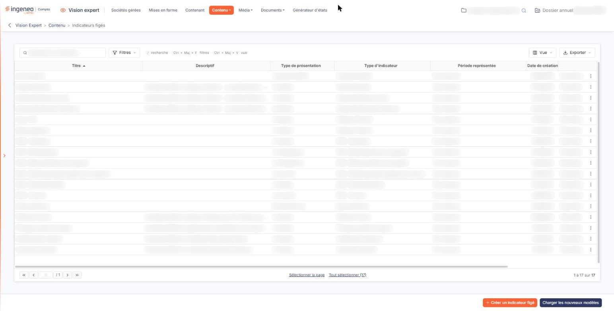
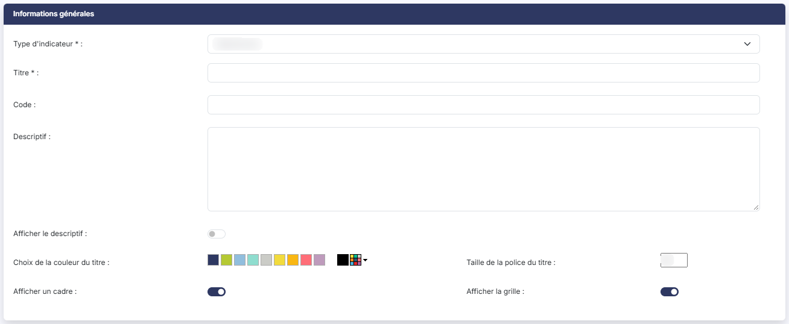
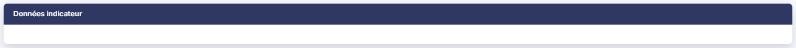

# Indicateurs figés


**Où le trouver :** Menu **Contenu › Indicateurs figés**



**En bref** — Cet écran gère les indicateurs figés du tableau de bord : construits sur un modèle type, leurs règles de calcul ne se modifient pas, seul leur affichage se personnalise.

* Pour créer un indicateur : bouton \[Créer un indicateur figé], choisissez d'abord le type d'indicateur, ajustez le titre, puis bouton \[Enregistrer].
* Pour rechercher un indicateur par son code : bouton \[Filtres], ajoutez un critère sur le code, puis bouton \[Filtrer].


Les indicateurs correspondent aux graphiques qui sont affichés dans le tableau de bord. Ils peuvent être soit de type figé, soit de type personnalisé.

<figure><figcaption>
Écran « Indicateurs figés » de la nouvelle interface
</figcaption></figure>

Les indicateurs personnalisables sont construits sur des données très structurées puisqu'il s'agit des écritures comptables. Ils sont donc facilement personnalisables à l'aide des racines ou des numéros de comptes.

Les indicateurs figés sont construits sur des données qui ne sont pas des écritures comptables structurées mais au contraire des éléments de nature très variable comme les factures clients ou le fichier des fournisseurs ; c'est pourquoi les règles de calcul ne sont pas modifiables. Cependant, certains éléments d'affichage de ces indicateurs figés sont personnalisables.

Un indicateur figé est toujours construit sur la base d'un des modèles types mis à votre disposition.

### Ce que présente la liste

La liste est triée sur le **Titre**. Elle présente le **Descriptif**, le **Type de présentation**, le **Type d'indicateur** retenu, la **Période représentée**, la **Date de création** et le nom du collaborateur qui l'a créé (**Créé par**).

Le **Type de présentation** — un tableau, une courbe, un histogramme… — n'est pas un champ de la fiche : il découle du type d'indicateur que vous avez retenu, et vous ne le choisissez pas.

Au-dessus de la liste, la zone « Rechercher un indicateur… » filtre les lignes au fil de la saisie. Le bouton **\[Filtres]** ouvre un volet où vous ajoutez des critères, colonne par colonne, par la liste « Ajouter un critère sur… » : elle propose chacune des colonnes, et aussi le **Code** de l'indicateur, qui n'est pas affiché par défaut. Le volet porte le bouton **\[Filtrer]** et le lien « Vider les filtres ». Le bouton **\[Vue]** permet de choisir les colonnes affichées — dont le **Code**, que vous pouvez y ajouter — et d'enregistrer la présentation de la liste ; le bouton **\[Exporter]** propose l'aperçu, l'impression, l'export Excel ou PDF et l'envoi de la liste par e-mail.

Au survol d'une ligne apparaissent, à droite, deux pictogrammes dont l'infobulle vous rappelle la fonction, « Modifier » et « Dupliquer », ainsi qu'un pictogramme « Autres actions » (trois points) qui porte « Supprimer ». Un clic sur une ligne la sélectionne ; les liens « Sélectionner la page » et « Tout sélectionner », sous la liste, en sélectionnent davantage. Dès qu'une ligne est sélectionnée, un bandeau en bas d'écran rappelle le nombre d'indicateurs retenus et porte le lien « Tout désélectionner » et le bouton **\[Supprimer]**, qui supprime les indicateurs sélectionnés.

Pour créer un nouvel indicateur, cliquez sur le bouton **\[Créer un indicateur figé]**, en bas d'écran.

Le bouton **\[Charger les nouveaux modèles]** ouvre la fenêtre « Nouveaux modèles », qui vous invite à choisir les nouveaux modèles que vous voulez charger, puis à valider : la liste qu'elle présente contient les modèles éditeurs qui sont absents de votre fichier ou qui ont été mis à jour.

### Rubrique "Informations générales"

| Champ                            | Ce qu'il faut savoir                                                                                                                                                                                                                                                                                                                                                                                                                                                                                                                                                                                                                                        |
| -------------------------------- | ----------------------------------------------------------------------------------------------------------------------------------------------------------------------------------------------------------------------------------------------------------------------------------------------------------------------------------------------------------------------------------------------------------------------------------------------------------------------------------------------------------------------------------------------------------------------------------------------------------------------------------------------------------- |
| **Type d'indicateur**            | Il s'agit de choisir la base d'indicateur que vous souhaitez utiliser. C'est le premier champ à renseigner : c'est lui qui commande tout le reste de la fiche. En création, la liste s'ouvre sur la mention "Sélectionnez", qui n'est pas un choix. Les modèles types couvrent l'analyse des factures clients, des factures fournisseurs et des devis, les palmarès de clients et de fournisseurs, l'état de trésorerie, la ventilation des créances et des dettes, les principaux postes de charges, une série d'indicateurs issus de la DSN, l'affichage d'un site tiers, un contenu que vous écrivez vous-même en HTML, et enfin l'indicateur financier. |
| **Titre**                        | Il permet de différencier l'indicateur. Le logiciel le préremplit avec le libellé du type que vous avez retenu ; vous pouvez le remplacer.                                                                                                                                                                                                                                                                                                                                                                                                                                                                                                                  |
| **Code**                         | Il n'est pas affiché dans le tableau de bord ; le volet ouvert par le bouton **\[Filtres]** de la liste permet de rechercher les indicateurs sur ce code.                                                                                                                                                                                                                                                                                                                                                                                                                                                                                                   |
| **Descriptif**                   | Il s'agit d'une zone de commentaire décrivant l'indicateur. Comme le titre, il est réécrit par le logiciel à chaque fois que vous changez de type d'indicateur, lorsque le modèle retenu en porte un ; renseignez-le donc après avoir arrêté votre choix de type.                                                                                                                                                                                                                                                                                                                                                                                           |
| **Afficher le descriptif**       | 
Désactivé par défaut. Si vous l'activez, le descriptif de l'indicateur sera visible dans le tableau de bord. <strong>Date de création</strong> et <strong>Créé par</strong> : ces deux champs ne sont pas saisissables, et ils n'apparaissent pas en création. Le logiciel les renseigne à l'enregistrement et les présente ensuite en modification ; ce sont eux que reprennent les colonnes de même nom de la liste.
                                                                                                                                                                                                                            |
| **Choix de la couleur du titre** | Par défaut le titre sera affiché en noir mais vous pouvez choisir une autre couleur, soit parmi les neuf pastilles proposées, soit en cliquant sur le carré multicolore, dont l'infobulle est « Personnaliser la couleur ».                                                                                                                                                                                                                                                                                                                                                                                                                                 |
| **Taille de la police du titre** | Il s'agit de la taille de la police du titre. Par défaut elle est à 12.                                                                                                                                                                                                                                                                                                                                                                                                                                                                                                                                                                                     |
| **Afficher un cadre**            | Activé par défaut. Désactivez-le si vous ne souhaitez pas que l'indicateur soit encadré dans le tableau de bord.                                                                                                                                                                                                                                                                                                                                                                                                                                                                                                                                            |
| **Afficher la grille**           | Activé par défaut.                                                                                                                                                                                                                                                                                                                                                                                                                                                                                                                                                                                                                                          |

### Rubrique "Données indicateur"

Le contenu de cette rubrique dépend entièrement du type d'indicateur retenu, et **aucun de ses champs n'est obligatoire**. Tant que vous n'avez choisi aucun type, elle reste vide ; et pour une partie des types — l'état de trésorerie, ainsi que tous les indicateurs issus de la DSN à l'exception de "DSN - Indicateurs", qui n'offre que la couleur de fond — elle ne s'affiche pas du tout, ces indicateurs ne se paramétrant que par la rubrique précédente. Ne cherchez donc pas un paramétrage qui ne vous est pas proposé : c'est que l'indicateur n'en attend aucun.

Selon le type retenu, vous pouvez rencontrer les champs suivants.

| Champ                               | Ce qu'il faut savoir                                                                                                                                                                                                                                                          |
| ----------------------------------- | ----------------------------------------------------------------------------------------------------------------------------------------------------------------------------------------------------------------------------------------------------------------------------- |
| **Période de calcul**               | Définissez la période de référence des calculs qui seront effectués. Vous avez le choix entre "Tout l'exercice", "Les trois derniers mois" et "Le mois en cours".                                                                                                             |
| **Couleur de fond**                 | Par défaut l'indicateur sera affiché sur un fond blanc mais vous pouvez choisir une autre couleur, soit parmi les neuf pastilles proposées, soit en cliquant sur le carré multicolore.                                                                                        |
| **Couleur de l'entête du tableau**  | Pour les indicateurs qui se présentent sous la forme d'un tableau.                                                                                                                                                                                                            |
| **Compte collectif de référence**   | Pour la ventilation des créances et des dettes, indiquez le compte collectif à partir duquel la ventilation est établie.                                                                                                                                                      |
| **Date de référence**               | Pour ces mêmes ventilations, indiquez si l'ancienneté se calcule sur la "Date d'écriture" ou sur la "Date d'échéance".                                                                                                                                                        |
| **Liste des comptes de référence**  | Pour les principaux postes de charges, indiquez les comptes retenus.                                                                                                                                                                                                          |
| **Adresse Url**                     | Pour l'affichage d'un site tiers, indiquez l'adresse du site à présenter dans le tableau de bord.                                                                                                                                                                             |
| **Code HTML**                       | Pour un contenu que vous composez vous-même. Vous disposez d'un éditeur de texte enrichi, avec ses mises en forme, ses listes, ses tableaux, l'insertion de liens et d'images, un bouton **Source** qui donne accès au code HTML lui-même, et un bouton **Insérer un champ**. |
| **Type d'édition**                  | Pour l'indicateur financier, choisissez l'édition à reprendre : "Bilan", "SIG", "Compte résultat", "Indicateur", "Balance générale", "Balance auxiliaire", "Balance âgée" ou "Budget".                                                                                        |
| **Nom du paramétrage de l'édition** | Le libellé du paramétrage mémorisé dans le module "Comptabilité". C'est le seul champ de cet écran à porter une infobulle d'aide, qui vous le rappelle.                                                                                                                       |
| **Ignorer le mois en cours**        | Si vous l'activez, aucune des données du mois en cours ne sera prise en compte.                                                                                                                                                                                               |

Cliquez sur le bouton **\[Enregistrer]** pour finaliser la création de votre indicateur, ou sur la flèche « Revenir en arrière », à gauche du fil d'Ariane, pour y renoncer.

## Autres vues de l'écran

<figure><figcaption>
Informations générales
</figcaption></figure>

<figure><figcaption>
Données indicateur
</figcaption></figure>
