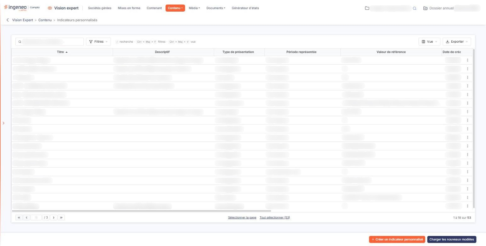
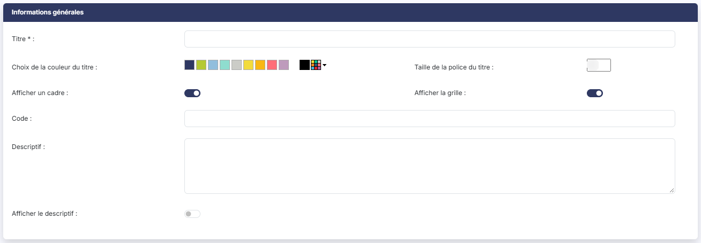
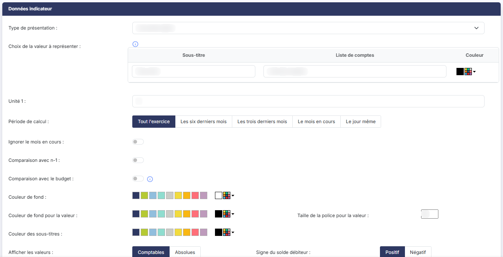
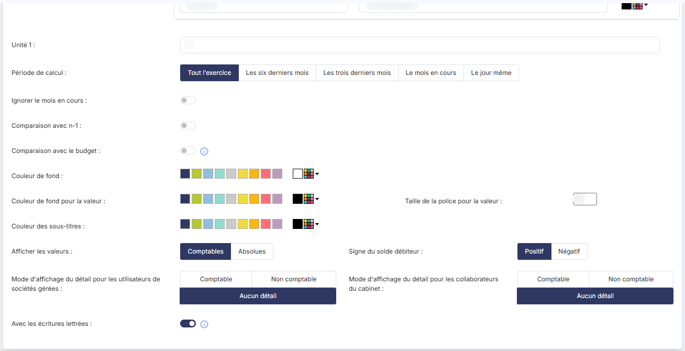

# Indicateurs personnalisés


**Où le trouver :** Menu **Contenu › Indicateurs personnalisés**



**En bref** — Cet écran gère les indicateurs personnalisés, graphiques du tableau de bord calculés sur les écritures comptables à partir de racines, de numéros de comptes ou de formules.

* Pour créer un indicateur : bouton \[Créer un indicateur personnalisé], choisissez le type de présentation, renseignez les valeurs à représenter, puis bouton \[Enregistrer].
* Pour ajouter une valeur à un graphique : bouton \[Nouvelle ligne], puis indiquez son libellé, sa liste de comptes ou formule et sa couleur.
* Pour récupérer les modèles nouveaux ou mis à jour par l'éditeur : bouton \[Charger les nouveaux modèles], choisissez-les, puis validez.


Les indicateurs correspondent aux graphiques qui sont affichés dans le tableau de bord. Ils peuvent être soit de type figé, soit de type personnalisé.

<figure><figcaption>
Écran « Indicateurs personnalisés » de la nouvelle interface
</figcaption></figure>

Les indicateurs personnalisés sont construits sur des données très structurées puisqu'il s'agit des écritures comptables. Ils sont donc facilement personnalisables à l'aide des racines ou des numéros de comptes.

### Ce que présente la liste

La liste est triée sur le **Titre**. Elle rappelle le **Descriptif**, le **Type de présentation**, la **Période représentée**, la **Valeur de référence** — c'est-à-dire la liste de comptes ou la formule de l'indicateur —, la **Date de création**, le collaborateur qui l'a créé (**Créé par**), puis l'état de chacune des options de comparaison (**Avec totalisation des périodes précédentes**, **Comparaison avec n-1**, **Comparaison avec n-2**, **Comparaison avec le budget**) et la colonne **Afficher les valeurs**.

Au-dessus de la liste, le champ « Rechercher un indicateur… » filtre les lignes affichées. Le bouton **\[Filtres]** permet de poser des critères, colonne par colonne : son choix « Ajouter un critère sur… » propose la plupart des colonnes, et aussi le **Type de comparaison**, le **Signe du solde débiteur** et le **Code** de l'indicateur, qui ne sont pas des colonnes de la liste. En revanche, la colonne **Valeur de référence** ne peut pas être filtrée. Le bouton **\[Vue]** et le bouton **\[Exporter]** fonctionnent comme sur toutes les listes : voir la page « Les listes ».

Au survol d'une ligne, deux pictogrammes apparaissent à droite, dont l'infobulle vous rappelle la fonction : « Modifier » (un crayon) et « Dupliquer » (deux feuilles superposées) ; le pictogramme « Autres actions » (trois points) propose « Supprimer ».

Un clic sur une ligne la sélectionne ; les liens « Sélectionner la page » et « Tout sélectionner » placés sous la liste sélectionnent plusieurs lignes à la fois. Dès qu'une ligne est sélectionnée, le bas de l'écran propose le bouton **\[Supprimer]**, qui supprime les indicateurs sélectionnés, et le bouton **\[Tout désélectionner]**.

Pour créer un nouvel indicateur, cliquez sur le bouton **\[Créer un indicateur personnalisé]**.

Le bouton **\[Charger les nouveaux modèles]** ouvre la fenêtre « Nouveaux modèles », qui vous invite à choisir les nouveaux modèles que vous voulez charger, puis à valider : la liste qu'elle présente contient les modèles éditeurs qui sont absents de votre fichier ou qui ont été mis à jour.

### Rubrique "Informations générales"

| Champ                            | Ce qu'il faut savoir                                                                                                                                                                                                        |
| -------------------------------- | --------------------------------------------------------------------------------------------------------------------------------------------------------------------------------------------------------------------------- |
| **Titre**                        | Il sera affiché mais permettra également d'identifier l'indicateur dans la liste d'affectation pour les sociétés gérées.                                                                                                    |
| **Choix de la couleur du titre** | Par défaut le titre sera affiché en noir mais vous pouvez choisir une autre couleur, soit parmi les neuf pastilles proposées, soit en cliquant sur le carré multicolore, dont l'infobulle est « Personnaliser la couleur ». |
| **Taille de la police du titre** | Il s'agit de la taille de la police du titre. Par défaut elle est à 12.                                                                                                                                                     |
| **Afficher un cadre**            | Activé par défaut. Désactivez-le si vous ne souhaitez pas que l'indicateur soit encadré dans le tableau de bord.                                                                                                            |
| **Afficher la grille**           | Activé par défaut.                                                                                                                                                                                                          |
| **Code**                         | Il n'est pas affiché dans le tableau de bord ; le bouton **\[Filtres]** de la liste permet de rechercher les indicateurs sur ce code.                                                                                       |
| **Descriptif**                   | Il s'agit d'une zone de commentaire décrivant l'indicateur.                                                                                                                                                                 |
| **Afficher le descriptif**       | Désactivé par défaut. Si vous l'activez, le descriptif de l'indicateur sera visible lors du survol par la souris du (i) d'information suivant le libellé de l'indicateur dans le tableau de bord.                           |

**Date de création** et **Créé par** : ces deux champs ne sont pas saisissables, et ils n'apparaissent pas en création. Le logiciel les renseigne à l'enregistrement et les présente ensuite en modification ; ce sont eux que reprennent les colonnes de même nom de la liste.

### Rubrique "Données indicateur"

| Champ                                                                   | Ce qu'il faut savoir                                                                                                                                                                                                                                                                                                                                                                                                                                                                                                                                                                                                                                                                                                                                                                                                                                                                                                                                                                                                                                                                                                                                                                                                                                                                                                                                                                                                                                                                                                                                                                                                                                                                                                                                                                                                                                                 |
| ----------------------------------------------------------------------- | -------------------------------------------------------------------------------------------------------------------------------------------------------------------------------------------------------------------------------------------------------------------------------------------------------------------------------------------------------------------------------------------------------------------------------------------------------------------------------------------------------------------------------------------------------------------------------------------------------------------------------------------------------------------------------------------------------------------------------------------------------------------------------------------------------------------------------------------------------------------------------------------------------------------------------------------------------------------------------------------------------------------------------------------------------------------------------------------------------------------------------------------------------------------------------------------------------------------------------------------------------------------------------------------------------------------------------------------------------------------------------------------------------------------------------------------------------------------------------------------------------------------------------------------------------------------------------------------------------------------------------------------------------------------------------------------------------------------------------------------------------------------------------------------------------------------------------------------------------------------- |
| **Type de présentation**                                                | 
C'est le premier champ de la rubrique, et c'est lui qui détermine tous les autres. Vous avez le choix entre : 1) Une seule valeur, qui ne présentera pas de graphique mais un seul chiffre 2) Deux valeurs, qui ne présenteront pas de graphique mais seulement deux chiffres 3) Une courbe 4) Une courbe pleine 5) Un histogramme 6) Un camembert 7) Un donut (un camembert troué au milieu et avec un goût très différent !).
                                                                                                                                                                                                                                                                                                                                                                                                                                                                                                                                                                                                                                                                                                                                                                                                                                                                                                                                                                                                                                                                                                                                                                                                                                                                                                                                                                                                          |
| **Choix des valeurs à représenter**                                     | 
Vous devez indiquer dans le tableau les différents éléments que vous souhaitez représenter. La quantité et la nature des informations attendues dépend du type de présentation que vous avez choisi : pour une valeur ou deux valeurs, le tableau ne comporte qu'une seule ligne, et le premier intitulé est le <strong>Sous-titre</strong> ; pour une courbe, une courbe pleine, un histogramme, un camembert ou un donut, la première colonne est le <strong>Libellé</strong> et vous ajoutez autant de lignes que nécessaire par le bouton <strong>[Nouvelle ligne]</strong>, chaque ligne pouvant être retirée par la corbeille placée en tête de ligne. Cette corbeille n'est pas proposée pour une valeur ou deux valeurs, le tableau n'y comportant qu'une ligne. Les différents éléments que vous indiquerez pourront être comparés entre eux ou être additionnés pour être analysés par intervalle de temps. Pour chaque valeur à représenter, vous devez indiquer : - un libellé (ou un sous-titre) : il est utilisé pour indiquer le détail des valeurs lorsque vous passez la souris sur le graphique, - une liste de comptes ou une formule : vous disposez de 1024 caractères ce qui vous permet de saisir des formules longues. <strong>Reportez-vous à l'aide du menu « Annexe », option « Construction d'un agrégat », pour des explications détaillées concernant les listes de comptes et l'élaboration des formules.</strong> Aucun contrôle n'est fait sur la forme de la liste de comptes ou de la formule que vous saisissez. Si sa syntaxe est erronée, le logiciel ne vous le signale pas et l'indicateur affiche zéro. Vérifiez donc votre saisie sur un dossier dont vous connaissez les valeurs attendues. - une couleur : pour la courbe, la barre d'histogramme, la part de camembert ou le segment de donut.
 |
| **Unité 1**                                                             | Présente pour les présentations en valeur. Il s'agit de l'unité affichée à côté du chiffre ; elle est préremplie avec le symbole de l'euro. **Unité 2** s'y ajoute lorsque vous avez retenu deux valeurs.                                                                                                                                                                                                                                                                                                                                                                                                                                                                                                                                                                                                                                                                                                                                                                                                                                                                                                                                                                                                                                                                                                                                                                                                                                                                                                                                                                                                                                                                                                                                                                                                                                                            |
| **Période de calcul**                                                   | Définissez la période que vous désirez voir représenter. Vous avez le choix entre "Tout l'exercice", "Les six derniers mois", "Les trois derniers mois" et "Le mois en cours" ; pour les présentations en valeur, "Le jour même" vous est proposé en plus.                                                                                                                                                                                                                                                                                                                                                                                                                                                                                                                                                                                                                                                                                                                                                                                                                                                                                                                                                                                                                                                                                                                                                                                                                                                                                                                                                                                                                                                                                                                                                                                                           |
| **Ignorer le mois en cours**                                            | 
Si vous l'activez, aucune des données du mois en cours ne sera prise en compte dans l'analyse. Cette option permet d'éviter les incohérences de certains indicateurs si toutes les données du mois en cours ne sont pas présentes. <strong>Notez que les paramètres suivants ne sont disponibles que pour certains graphiques ; la liste est donc évolutive en fonction du type de présentation choisi.</strong>
                                                                                                                                                                                                                                                                                                                                                                                                                                                                                                                                                                                                                                                                                                                                                                                                                                                                                                                                                                                                                                                                                                                                                                                                                                                                                                                                                                                                                                           |
| **Type de comparaison**                                                 | Proposé pour les graphiques, il découpe la période en "Mois", en "Trimestre" ou en "Semestre". Son infobulle vous rappelle que si vous choisissez une comparaison par intervalle de temps, c'est le total de toutes les lignes qui sera représenté selon l'intervalle choisi.                                                                                                                                                                                                                                                                                                                                                                                                                                                                                                                                                                                                                                                                                                                                                                                                                                                                                                                                                                                                                                                                                                                                                                                                                                                                                                                                                                                                                                                                                                                                                                                        |
| **Avec totalisation des périodes précédentes**                          | Si vous l'activez, pour chaque valeur représentée, c'est le cumul à date qui sera repris et si vous le désactivez, ce sera la valeur générée dans l'intervalle.                                                                                                                                                                                                                                                                                                                                                                                                                                                                                                                                                                                                                                                                                                                                                                                                                                                                                                                                                                                                                                                                                                                                                                                                                                                                                                                                                                                                                                                                                                                                                                                                                                                                                                      |
| **Comparaison avec n-1**                                                | Si vous l'activez, une courbe ou un histogramme fondé sur les données de l'exercice précédent sera ajouté à votre graphique.                                                                                                                                                                                                                                                                                                                                                                                                                                                                                                                                                                                                                                                                                                                                                                                                                                                                                                                                                                                                                                                                                                                                                                                                                                                                                                                                                                                                                                                                                                                                                                                                                                                                                                                                         |
| **Comparaison avec n-2**                                                | Si vous l'activez, une courbe ou un histogramme fondé sur les données de l'exercice n-2 sera ajouté à votre graphique.                                                                                                                                                                                                                                                                                                                                                                                                                                                                                                                                                                                                                                                                                                                                                                                                                                                                                                                                                                                                                                                                                                                                                                                                                                                                                                                                                                                                                                                                                                                                                                                                                                                                                                                                               |
| **Comparaison avec le budget**                                          | Si vous l'activez, une courbe ou un histogramme fondé sur les données du budget en cours sera ajouté à votre graphique.                                                                                                                                                                                                                                                                                                                                                                                                                                                                                                                                                                                                                                                                                                                                                                                                                                                                                                                                                                                                                                                                                                                                                                                                                                                                                                                                                                                                                                                                                                                                                                                                                                                                                                                                              |
| **Comparaison avec le panel**                                           | Si vous l'activez, une courbe ou un histogramme fondé sur les données du panel sera ajouté à votre graphique.                                                                                                                                                                                                                                                                                                                                                                                                                                                                                                                                                                                                                                                                                                                                                                                                                                                                                                                                                                                                                                                                                                                                                                                                                                                                                                                                                                                                                                                                                                                                                                                                                                                                                                                                                        |
| **Couleur de fond**                                                     | 
Par défaut le graphique sera affiché sur un fond blanc mais vous pouvez choisir une autre couleur, soit parmi les neuf pastilles proposées, soit en cliquant sur le carré multicolore. <strong>Couleur de fond pour la valeur</strong>, <strong>Taille de la police pour la valeur</strong> et <strong>Couleur des sous-titres</strong> : ces trois paramètres de mise en forme ne concernent que les présentations en une ou deux valeurs.
                                                                                                                                                                                                                                                                                                                                                                                                                                                                                                                                                                                                                                                                                                                                                                                                                                                                                                                                                                                                                                                                                                                                                                                                                                                                                                                                                                                                                |
| **Afficher les valeurs**                                                | Vous avez le choix entre "comptables" (qui afficheront les valeurs positives et négatives) et "absolues" (qui ne tiendront pas compte du signe).                                                                                                                                                                                                                                                                                                                                                                                                                                                                                                                                                                                                                                                                                                                                                                                                                                                                                                                                                                                                                                                                                                                                                                                                                                                                                                                                                                                                                                                                                                                                                                                                                                                                                                                     |
| **Signe du solde débiteur**                                             | Dans le cas où vous avez choisi d'afficher les valeurs comptables, indiquez quel signe doivent prendre les soldes débiteurs. Le champ n'est pas proposé si vous avez retenu les valeurs absolues ; il disparaît alors de la rubrique.                                                                                                                                                                                                                                                                                                                                                                                                                                                                                                                                                                                                                                                                                                                                                                                                                                                                                                                                                                                                                                                                                                                                                                                                                                                                                                                                                                                                                                                                                                                                                                                                                                |
| **Mode d'affichage du détail pour les utilisateurs de sociétés gérées** | Lorsqu'un utilisateur clique sur un des éléments du graphique, il peut visualiser les valeurs et le détail des lignes qui ont permis d'obtenir ces valeurs. Cette option permet de les afficher de manière comptable (avec numéro de compte, colonne débit et crédit, etc.) ou de manière non comptable comme par exemple une liste de factures. Vous pouvez également interdire la visualisation des lignes de détail du graphique.                                                                                                                                                                                                                                                                                                                                                                                                                                                                                                                                                                                                                                                                                                                                                                                                                                                                                                                                                                                                                                                                                                                                                                                                                                                                                                                                                                                                                                 |
| **Mode d'affichage du détail pour les collaborateurs du cabinet**       | Même fonctionnement que ci-dessus mais pour les collaborateurs du cabinet.                                                                                                                                                                                                                                                                                                                                                                                                                                                                                                                                                                                                                                                                                                                                                                                                                                                                                                                                                                                                                                                                                                                                                                                                                                                                                                                                                                                                                                                                                                                                                                                                                                                                                                                                                                                           |
| **Avec les écritures lettrées**                                         | Activé par défaut. Désactivez-le si vous souhaitez exclure les lignes d'écritures lettrées du calcul de l'indicateur.                                                                                                                                                                                                                                                                                                                                                                                                                                                                                                                                                                                                                                                                                                                                                                                                                                                                                                                                                                                                                                                                                                                                                                                                                                                                                                                                                                                                                                                                                                                                                                                                                                                                                                                                                |

Cliquez sur le bouton **\[Enregistrer]** pour finaliser la création de votre indicateur, ou sur la flèche « Revenir en arrière » placée à gauche du fil d'Ariane pour y renoncer.

## Autres vues de l'écran

<figure><figcaption>
Informations générales
</figcaption></figure>

<figure><figcaption>
Données indicateur
</figcaption></figure>

<figure><figcaption>
Données indicateur
</figcaption></figure>
