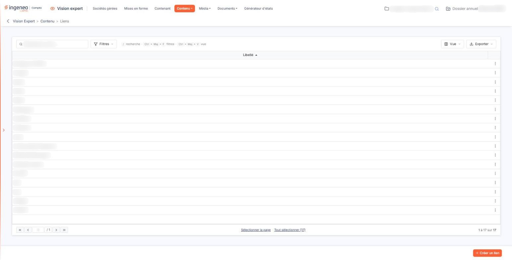
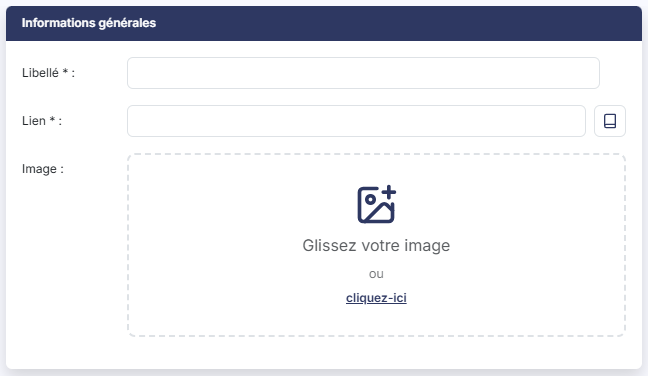
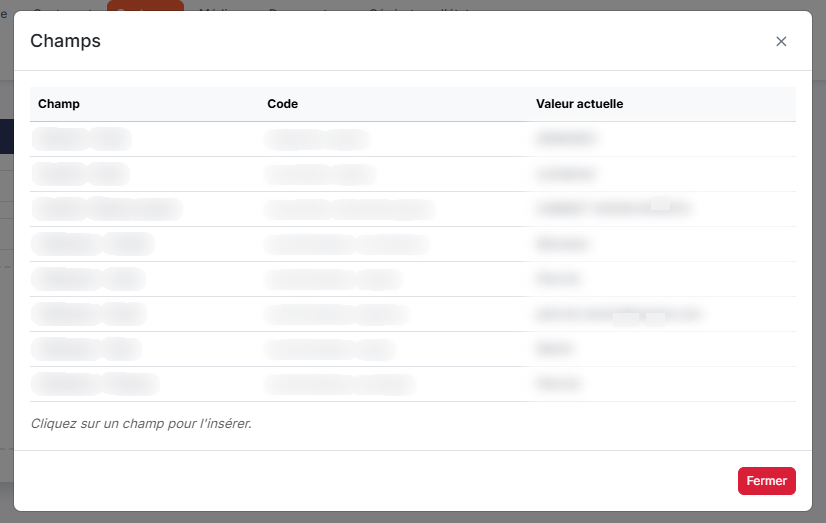

# Liens


**Où le trouver :** Menu **Contenu › Liens**



**En bref** — Cet écran liste les sites Internet que vous pouvez proposer dans un pavé du tableau de bord ; ils s'ouvrent dans un nouvel onglet.

* Pour ajouter un lien : bouton \[Créer un lien], renseignez le libellé et l'adresse complète, puis bouton \[Enregistrer].
* Pour adapter l'adresse à chaque utilisateur : pictogramme « Insérer un champ » à droite du champ Lien, cliquez sur un champ, puis bouton \[Fermer].


Les liens correspondent à la liste des sites Internet qui pourront figurer dans un pavé du tableau de bord. Il s'agit donc d'adresses URL qui seront ouvertes dans de nouveaux onglets.

<figure><figcaption>
Écran « Liens » de la nouvelle interface
</figcaption></figure>

La grille présente tous les liens déclarés pour le cabinet, quel que soit le collaborateur qui les a créés. Elle n'en présente qu'une seule colonne, le **Libellé** : deux liens portant le même libellé ne se distinguent donc pas dans la liste, et il faut ouvrir chaque fiche pour savoir vers quelle adresse ils pointent. Donnez pour cette raison un libellé qui vous permette de les reconnaître.

Au-dessus de la grille, le champ « Rechercher un lien… » filtre les lignes affichées ; le bouton **\[Filtres]**, le bouton **\[Vue]** et le bouton **\[Exporter]** fonctionnent comme sur toutes les listes : voir la page « Les listes ».

Au survol d'une ligne, deux pictogrammes apparaissent à droite, dont l'infobulle vous rappelle la fonction : « Modifier » (un crayon) et « Dupliquer » (deux feuilles superposées) ; le pictogramme « Autres actions » (trois points) propose « Supprimer ».

Un clic sur une ligne la sélectionne ; les liens « Sélectionner la page » et « Tout sélectionner » placés sous la grille sélectionnent plusieurs lignes à la fois. Dès qu'une ligne est sélectionnée, le bas de l'écran propose le bouton **\[Supprimer]**, qui supprime les liens sélectionnés, et le bouton **\[Tout désélectionner]**.

Pour créer un nouveau lien, cliquez sur le bouton **\[Créer un lien]** et renseignez les trois champs de la rubrique "Informations générales".

| Champ       | Ce qu'il faut savoir                                                                                                                                       |
| ----------- | ---------------------------------------------------------------------------------------------------------------------------------------------------------- |
| **Libellé** | Il permet d'identifier le lien dans la liste de tous ceux que vous allez créer.                                                                            |
| **Lien**    | Il faut indiquer l'adresse complète, protocole compris, par exemple https://www.teogest.com.                                                               |
| **Image**   | C'est l'image qui sera affichée dans le pavé du tableau de bord. Lorsque vous rouvrez la fiche d'un lien, l'image enregistrée est présentée sous le champ. |

Cliquez sur le bouton **\[Enregistrer]** pour finaliser la création de votre lien, ou sur la flèche « Revenir en arrière » placée à gauche du fil d'Ariane pour y renoncer.

### Insérer un champ dans l'adresse

Le pictogramme placé à droite du champ **Lien**, dont l'infobulle est « Insérer un champ », ouvre la fenêtre « Champs ». Celle-ci présente en trois colonnes — **Champ**, **Code** et **Valeur actuelle** — les huit informations du contexte de connexion que vous pouvez insérer dans l'adresse : le code de l'abonné, le code et la raison sociale de la société, puis la civilité, le code, l'e-mail, le nom et le prénom de l'utilisateur. Pour chacune, la colonne **Code** donne le code à employer et la colonne **Valeur actuelle** la valeur qu'elle prend pour vous en ce moment.

La fenêtre vous invite d'ailleurs à le faire : « Cliquez sur un champ pour l'insérer. » Cliquez donc sur un champ pour l'insérer, puis fermez la fenêtre par le bouton **\[Fermer]**. L'adresse ainsi construite conduit chaque utilisateur sur la page qui le concerne, sans que vous ayez à créer un lien par société ou par utilisateur.

## Autres vues de l'écran

<figure><figcaption>
Informations générales
</figcaption></figure>

<figure><figcaption>
Insérer un champ dans l'adresse
</figcaption></figure>
