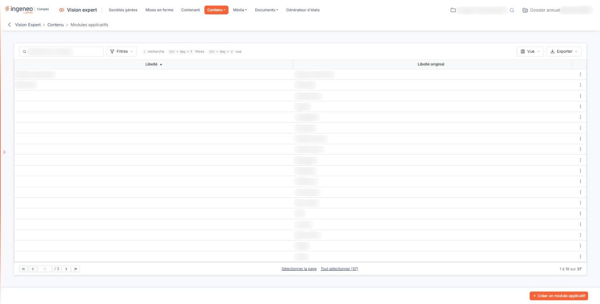
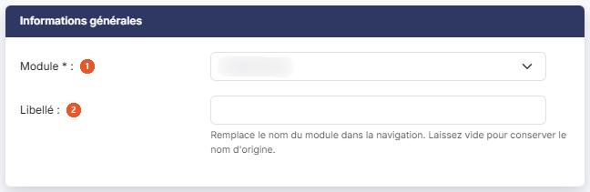

# Modules applicatifs


**Où le trouver :** Menu **Contenu › Modules applicatifs**



**En bref** — Cet écran permet de renommer les modules applicatifs de votre abonnement ; le nouveau libellé remplace leur nom dans la navigation.

* Pour renommer un module : bouton \[Créer un module applicatif], choisissez le module, saisissez son libellé, puis bouton \[Enregistrer].
* Pour rendre son nom d'origine à un module : ouvrez-le, bouton \[Supprimer la personnalisation], puis bouton \[Enregistrer].


La grille affiche la liste des modules applicatifs (logiciels) de votre abonnement qui font déjà l'objet d'une personnalisation. Vous avez la possibilité d'en modifier le libellé. Un module qui n'est pas encore personnalisé ne figure pas dans la grille : il vous est proposé dans la liste déroulante **Module** après un clic sur le Bouton \[Créer un module applicatif], en bas d'écran.

<figure><figcaption>
Écran « Modules applicatifs » de la nouvelle interface
</figcaption></figure>

Deux colonnes composent la grille : **Libellé**, qui porte le nom que vous avez éventuellement donné au module et qui reste vide tant que vous n'en avez pas personnalisé le libellé, et **Libellé original**, qui porte le nom d'origine du module.

Au-dessus de la liste, la zone « Rechercher un module… » filtre les lignes au fil de la saisie. Le Bouton \[Filtres] ouvre un volet où vous ajoutez des critères, colonne par colonne ; le Bouton \[Vue] permet de choisir les colonnes affichées et d'enregistrer la présentation de la liste ; le Bouton \[Exporter] propose l'aperçu, l'impression, l'export Excel ou PDF et l'envoi de la liste par e-mail.

Au survol d'une ligne apparaissent, à droite, le pictogramme « Modifier », qui ouvre la personnalisation du module, et le pictogramme « Autres actions » (trois points), qui porte « Supprimer ». Un clic sur une ligne la sélectionne ; les liens « Sélectionner la page » et « Tout sélectionner », sous la liste, en sélectionnent davantage. Dès qu'une ligne est sélectionnée, un bandeau en bas d'écran rappelle le nombre de modules retenus et porte le lien « Tout désélectionner » et le Bouton \[Supprimer], qui supprime les personnalisations sélectionnées.

Seul le libellé d'un module est personnalisable : son pictogramme, ses couleurs, sa taille et sa forme ne se paramètrent plus.

## Informations générales

<figure><figcaption>
Rubrique « Informations générales »
</figcaption></figure>

| Champ          | Ce qu'il faut savoir                                                                                                                                                                                                                                                                                                                                                                                                                                                                                                                                                                   |
| -------------- | -------------------------------------------------------------------------------------------------------------------------------------------------------------------------------------------------------------------------------------------------------------------------------------------------------------------------------------------------------------------------------------------------------------------------------------------------------------------------------------------------------------------------------------------------------------------------------------- |
| 1. **Module**  | 
Choisissez dans la liste déroulante le module applicatif que vous souhaitez personnaliser. Il s'agit du nom par défaut du module applicatif tel qu'il était lors de votre abonnement. En modification, le module n'est plus modifiable et les informations de traçabilité connues s'affichent en dessous : <strong>Créé par</strong>, <strong>Créé le</strong>, <strong>Modifié par</strong> et <strong>Modifié le</strong>. Elles ne sont pas toutes présentes sur tous les modules : certains n'affichent que <strong>Modifié par</strong> et <strong>Modifié le</strong>.
 |
| 2. **Libellé** | Entrez ici le nouveau nom que vous souhaitez donner au module ; il remplace le nom du module dans la navigation. Si vous ne le renseignez pas, c'est le nom par défaut qui sera utilisé.                                                                                                                                                                                                                                                                                                                                                                                               |

bouton **\[Supprimer la personnalisation]**

Ce bouton ne supprime rien immédiatement : il vide le champ **Libellé**. Cliquez ensuite sur le Bouton \[Enregistrer] pour que cette remise à zéro soit conservée ; si vous quittez la fiche sans enregistrer, la personnalisation reste en place.

Cliquez sur le Bouton \[Enregistrer] pour valider votre personnalisation, ou sur la flèche « Revenir en arrière », à gauche du fil d'Ariane, pour abandonner.
