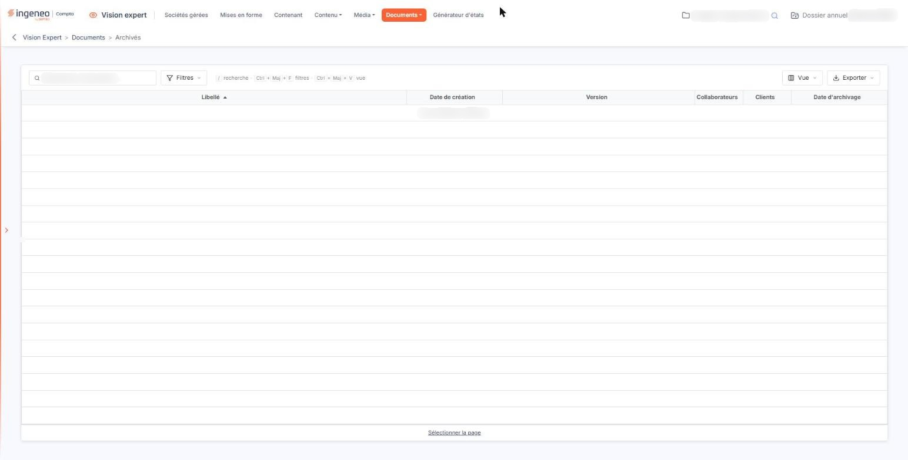

# Archivés


**Où le trouver :** Menu **Documents › Archivés**



**En bref** — Cet écran conserve l'historique des documents archivés et permet de consulter les validations faites par les utilisateurs ; l'archivage est définitif.

* Pour consulter les validations d'un document : ouvrez sa fiche, puis bouton \[Suivi des validations numériques] ou \[Suivi des validations papier].


L'archivage est définitif : le logiciel ne propose pas de ramener un document archivé parmi les documents en cours. Pour soumettre à nouveau le même document, créez-en un nouveau.

<figure><figcaption>
Écran « Archivés » de la nouvelle interface
</figcaption></figure>

Cette option conserve l'historique de tous les documents qui ont été archivés.

La liste présente les mêmes colonnes que celle des documents en cours — **Libellé**, **Date de création**, **Version**, **Collaborateurs** et **Clients** — et une colonne supplémentaire, **Date d'archivage**. Tant qu'aucun document n'a été archivé, le logiciel affiche « Aucun élément à afficher. ».

Au-dessus de la grille, le champ « Rechercher un document… » filtre les lignes affichées ; le bouton **\[Filtres]** restreint la liste par des critères posés sur ses colonnes, le bouton **\[Vue]** choisit les colonnes affichées, et le bouton **\[Exporter]** imprime ou exporte la liste.

Aucun bouton n'est proposé en bas de l'écran : cet écran ne permet ni de créer, ni de supprimer un document.

La fiche d'un document archivé s'ouvre depuis la commande qui apparaît à droite de sa ligne, au survol. Vous y retrouvez ses caractéristiques, et vous pouvez consulter les validations qui ont été faites par les utilisateurs :

bouton **\[Suivi des validations numériques]**

bouton **\[Suivi des validations papier]**

Sur un document archivé, cette fenêtre est en consultation : elle ne porte ni colonne de cases à cocher ni bouton d'enregistrement, et ne permet donc pas d'enregistrer des validations papier ; seul le bouton « Imprimer la liste » reste proposé.

Reportez-vous à l'aide de l'option « En cours » de la présente rubrique pour le détail des rubriques et des champs de la fiche d'un document ; la fenêtre de suivi des validations papier y est décrite pour un document en cours, où elle permet d'enregistrer les validations reçues.
