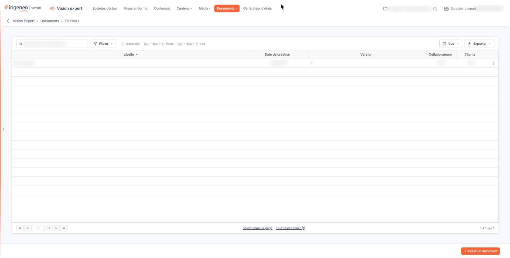
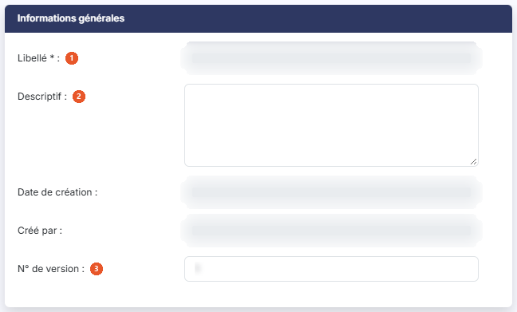
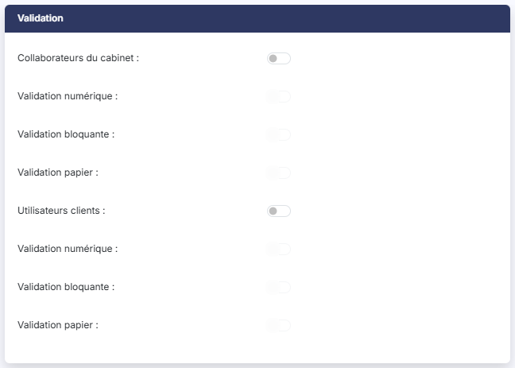
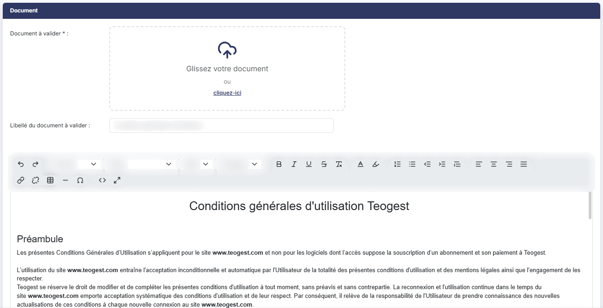
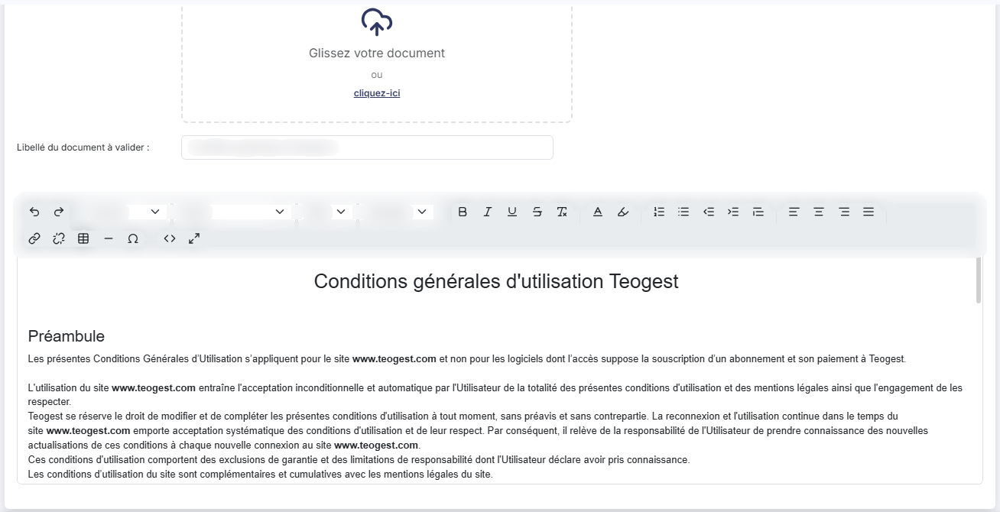
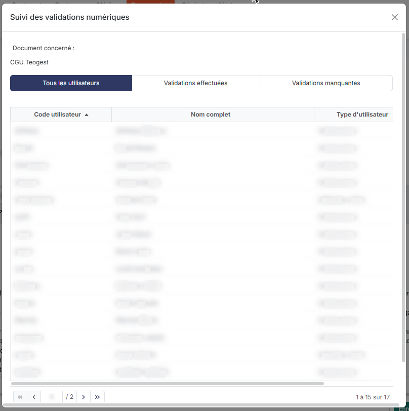
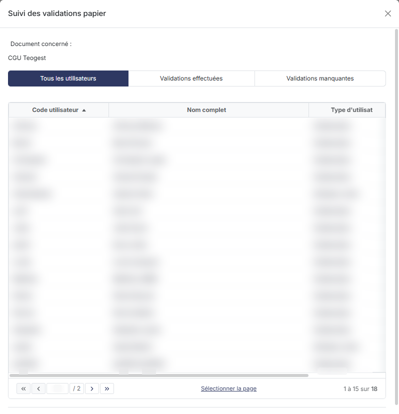

# En cours


**Où le trouver :** Menu **Documents › En cours**



**En bref** — Cet écran gère les documents présentés à chaque connexion aux utilisateurs qui ne les ont pas encore validés, et le suivi de leurs validations.

* Pour soumettre un document : bouton \[Créer un document], saisissez le libellé, réglez la validation, joignez le fichier ou rédigez-le, puis bouton \[Enregistrer].
* Pour enregistrer des validations papier : ouvrez le document, bouton \[Suivi des validations papier], cliquez sur la ligne de chaque utilisateur concerné, puis bouton \[Enregistrer].
* Pour ne plus présenter un document aux utilisateurs : ouvrez-le, puis bouton \[Archiver].


Les documents en cours sont les documents qui sont affichés aux utilisateurs qui ne les ont pas encore validés, chaque fois qu'ils se connectent à l'application.

<figure><figcaption>
Écran « En cours » de la nouvelle interface
</figcaption></figure>

Un document reste en cours tant qu'il n'a pas été archivé.

La liste présente un document par ligne, avec son **Libellé**, sa **Date de création**, sa **Version**, et deux colonnes **Collaborateurs** et **Clients** qui reprennent, sous la forme d'un Oui ou d'un Non, les interrupteurs « Collaborateurs du cabinet » et « Utilisateurs clients » de la rubrique « Validation » de la fiche du document.

Au-dessus de la liste, le champ « Rechercher un document » filtre les lignes affichées ; le bouton **\[Filtres]** restreint la liste par des critères posés sur ses colonnes, le bouton **\[Vue]** choisit les colonnes affichées, et le bouton **\[Exporter]** imprime ou exporte la liste.

Au survol d'une ligne, deux pictogrammes apparaissent à droite, dont l'infobulle vous rappelle la fonction : « Modifier » (un crayon) et « Dupliquer » (deux feuilles superposées) ; le pictogramme « Autres actions » (trois points) propose « Supprimer ».

Un clic sur une ligne la sélectionne ; les liens « Sélectionner la page » et « Tout sélectionner » placés sous la liste sélectionnent plusieurs lignes à la fois.

bouton **\[Créer un document]**

Il ouvre la fiche d'un nouveau document, dont les trois rubriques sont décrites ci-dessous. Seuls les champs marqués d'un astérisque y sont signalés comme obligatoires.

bouton **\[Supprimer]**

Il n'apparaît en bas de l'écran que lorsqu'une ligne au moins est sélectionnée, accompagné du bouton **\[Tout désélectionner]**. Il supprime les documents que vous avez sélectionnés dans la liste.

## Rubrique « Informations générales »

<figure><figcaption>
Rubrique « Informations générales »
</figcaption></figure>

| Champ                | Ce qu'il faut savoir                                                                                                                    |
| -------------------- | --------------------------------------------------------------------------------------------------------------------------------------- |
| 1. **Libellé**       | Il permet d'identifier le document dans la liste de tous ceux que vous allez créer. Il n'est plus modifiable une fois le document créé. |
| 2. **Descriptif**    | Champ facultatif.                                                                                                                       |
| 3. **N° de version** | Champ facultatif.                                                                                                                       |

Lorsque vous rouvrez un document existant, le logiciel affiche en plus, sans permettre de les modifier, sa **Date de création** et le nom de celui qui l'a créé (**Créé par**).

## Rubrique « Validation »

<figure><figcaption>
Rubrique « Validation »
</figcaption></figure>

Vous devez indiquer à qui le document est destiné, soit les collaborateurs du cabinet, soit les utilisateurs de sociétés gérées ou les deux.

Cette rubrique est faite de deux blocs symétriques : **Collaborateurs du cabinet** et **Utilisateurs clients**. Sous chacun d'eux, les trois mêmes interrupteurs « Validation numérique », « Validation bloquante » et « Validation papier » se répètent : seule leur position en retrait sous l'un ou l'autre bloc indique à qui ils s'appliquent. Lorsque vous désactivez un bloc, ses trois interrupteurs restent affichés mais deviennent grisés et se désactivent.

À l'intérieur d'un bloc activé, les interrupteurs ne s'ouvrent pas tous en même temps : « Validation numérique » et « Validation papier » deviennent accessibles aussitôt, tandis que « Validation bloquante » reste grisé tant que « Validation numérique » est désactivée. Activez donc d'abord la validation numérique si vous voulez la rendre bloquante.

À la création d'un document, le logiciel présente les deux blocs activés avec leur « Validation numérique » activée, et les « Validation bloquante » et « Validation papier » désactivées : sans intervention de votre part, le document est donc soumis à la validation numérique des collaborateurs du cabinet comme des utilisateurs clients.

Vous avez la possibilité de demander une validation numérique et/ou une validation papier.

La validation numérique se fait lors de la connexion de l'utilisateur ; l'utilisateur est redirigé vers une page qui présente chacun des documents à valider (libellé et version) ; il peut visualiser chaque document par le bouton « Visualiser le document ».

Les validations bloquantes permettent d'interdire l'accès à tout utilisateur qui n'a pas validé le document concerné. Cette option est à manier avec précaution pour les validations papier car cela implique qu'il faut attendre le délai d'envoi, de réception et de traitement pour enregistrer la validation, avant que l'utilisateur ne puisse de nouveau avoir accès à l'application.

## Rubrique « Document »

<figure><figcaption>
Rubrique « Document »
</figcaption></figure>

<figure><figcaption>
Rubrique « Document »
</figcaption></figure>

<figure><figcaption>
Bouton [Suivi des validations numériques]
</figcaption></figure>

<figure><figcaption>
Bouton [Suivi des validations papier]
</figcaption></figure>

Pour définir le document à faire valider, vous avez deux possibilités :

* soit le télécharger depuis votre poste dans la zone de dépôt du champ **Document à valider**, qui porte un astérisque : faites-y glisser le fichier, ou cliquez sur « cliquez-ici » pour le choisir (son libellé sera alors repris dans le champ **Libellé du document à valider**)
* soit le créer de toute pièce à l'aide de l'éditeur HTML présenté sous ces deux champs.

L'astérisque du champ **Document à valider** ne signifie pas qu'un fichier est toujours exigé : l'enregistrement est refusé seulement si ni fichier joint ni contenu de l'éditeur n'a été renseigné.

bouton **\[Enregistrer]**

Il enregistre le document et les réglages de validation que vous venez de définir.

bouton **\[Archiver]**

Ce bouton n'apparaît que lorsque vous rouvrez un document existant. Il archive le document, qui n'est alors plus présenté aux utilisateurs et rejoint l'option « Archivés » de la présente rubrique. Reportez-vous à l'aide de l'option « Archivés » pour la suite du circuit.

bouton **\[Suivi des validations numériques]**

Ce bouton n'apparaît que lorsque vous rouvrez un document existant. Il ouvre une fenêtre contenant la liste des utilisateurs avec la date de validation du document. Le libellé du document concerné est rappelé en tête de la fenêtre, et chaque ligne porte le **Code utilisateur**, le **Nom complet**, le **Type d'utilisateur** — « Collaborateur » ou « Utilisateur client » — et la **Date de validation**.

Vous avez la possibilité de filtrer la liste à l'aide des trois choix « Tous les utilisateurs », « Validations effectuées » et « Validations manquantes ».

Cette fenêtre est en consultation seule.

bouton **\[Imprimer la liste]** : il imprime la liste au format .PDF.

bouton **\[Annuler]** : il referme la fenêtre, tout comme la croix de son bandeau de titre.

bouton **\[Suivi des validations papier]**

Ce bouton n'apparaît que lorsque vous rouvrez un document existant. Il ouvre une fenêtre présentée comme celle des validations numériques, avec le même en-tête, les mêmes colonnes et les mêmes trois choix de filtre.

Elle s'en distingue par la sélection des lignes : c'est ici que s'enregistrent les validations papier reçues des utilisateurs. Pour ce faire, cliquez sur la ligne de chaque utilisateur pour lequel le document papier a été reçu (la ligne retenue est mise en évidence ; il n'y a plus de case à cocher), puis enregistrez. Le lien « Sélectionner la page », sous la liste, remplace la case d'en-tête de colonne.

bouton **\[Enregistrer]** : il enregistre les validations papier des utilisateurs que vous avez sélectionnés.

bouton **\[Imprimer la liste]** : il imprime la liste au format .PDF.

bouton **\[Annuler]** : il referme la fenêtre sans enregistrer, tout comme la croix de son bandeau de titre.

**Flèche « Revenir en arrière »**

Placée à gauche du fil d'Ariane, elle quitte la fiche sans enregistrer et vous ramène à la liste des documents en cours.
