# Contenant


**Où le trouver :** Menu **Contenant**



**En bref** — Cet écran active les fenêtres du tableau de bord et, pour certaines, paramètre leur contenu ; il permet aussi de créer vos propres fenêtres.

* Pour activer une fenêtre : crayon « Modifier » sur sa ligne, activez « Activer », puis bouton \[Enregistrer].
* Pour créer une fenêtre au contenu libre : bouton \[Créer un widget personnalisé], composez son contenu, puis bouton \[Enregistrer].
* Pour revenir au paramétrage d'origine d'une fenêtre livrée : bouton \[Supprimer la personnalisation].


| Champ                             | Ce qu'il faut savoir                                                                                                                                                                                                                                                |
| --------------------------------- | ------------------------------------------------------------------------------------------------------------------------------------------------------------------------------------------------------------------------------------------------------------------- |
| **Actualités**                    | Contient les informations issues des flux paramétrés.                                                                                                                                                                                                               |
| **Alertes**                       | Contient les informations des alertes déclenchées.                                                                                                                                                                                                                  |
| **Chiffres clés**                 | Contient les indicateurs graphiques fondés sur les données des autres modules ou des données importées via d'autres logiciels.                                                                                                                                      |
| **Contacts**                      | Contient les coordonnées des utilisateurs en relation avec l'utilisateur connecté.                                                                                                                                                                                  |
| **Demandes infos client**         | Contient les lignes d'écritures pour lesquelles le cabinet a une question à destination du client.                                                                                                                                                                  |
| **Dépôt de documents à océriser** | Contient une zone dans laquelle des documents peuvent être déposés pour être océrisés.                                                                                                                                                                              |
| **Everial Digital Expert**        | Contient des extraits du module GED de l'éditeur Everial™ (si vous êtes un de leurs abonnés).                                                                                                                                                                       |
| **Ged**                           | Contient des extraits du module "GED".                                                                                                                                                                                                                              |
| **Informations niveau 1**         | Contient les informations de niveau 1 issues de la fonction Média.                                                                                                                                                                                                  |
| **Informations niveau 2**         | Contient les informations de niveau 2 issues de la fonction Média.                                                                                                                                                                                                  |
| **Sites utiles**                  | Contient les liens vers les sites internet paramétrés.                                                                                                                                                                                                              |
| **Sharepoint**                    | Contient des extraits du module GED de l'éditeur Microsoft™ (si vous êtes un de leurs abonnés).                                                                                                                                                                     |
| **Supervision des alertes**       | Cette fenêtre n'est disponible que pour les collaborateurs du cabinet. Elle liste l'ensemble des alertes qui ont été activées pour au moins un dossier dont le collaborateur a la charge.                                                                           |
| **Synthèse du dossier**           | Cette fenêtre n'est disponible que pour les collaborateurs du cabinet. Elle permet de visualiser d'un seul coup d'œil les informations du dossier de la société gérée sur laquelle l'utilisateur est positionné.                                                    |
| **Fenêtre personnalisée**         | Contient ce que vous y avez saisi vous-même. Cinq fenêtres de ce type, "Fenêtre personnalisée 1" à "Fenêtre personnalisée 5", sont déjà présentes dans la grille ; elles portent les pictogrammes "Supprimer" et "Dupliquer" comme celles que vous créez vous-même. |

<figure>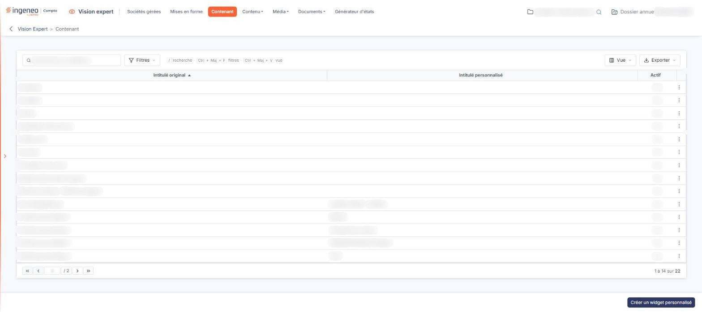<figcaption>
Écran « Contenant » de la nouvelle interface
</figcaption></figure>

La grille en présente deux autres, "Approbation des factures" et "Dépôt de mandats - Plateforme Agréée", plus récentes.

Le contenu des fenêtres se paramètre de manières différentes selon la fenêtre.

## Rubrique "Activation de la fenêtre"

<figure>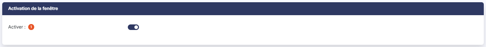<figcaption>
Rubrique « Activation de la fenêtre »
</figcaption></figure>

**Activer** : permet de définir si cette fenêtre sera affectable ou non aux utilisateurs.

Le titre, la police, l'encadrement, la hauteur et les couleurs des fenêtres livrées avec le logiciel ne se paramètrent plus ici : leur présentation est fixée par le logiciel. Seules les fenêtres personnalisées que vous avez créées font exception : leur nom se saisit ici (voir g).

## Rubrique "Informations de connexion"

<figure>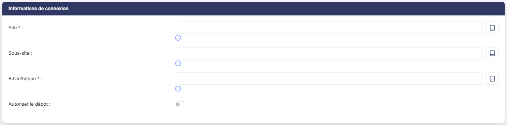<figcaption>
Rubrique « Informations de connexion »
</figcaption></figure>

Certaines fenêtres se connectant à des applications d'autres éditeurs ont besoin d'informations complémentaires pour fonctionner. Si tel est le cas, une rubrique dénommée "Informations de connexion" permet de les saisir. Les champs qu'elle propose dépendent de la fenêtre : la fenêtre "Sharepoint", par exemple, y demande "Site" et "Bibliothèque", tous deux obligatoires, "Sous-site" et "Autoriser le dépot".

## Rubrique "Options d'affichage"

<figure>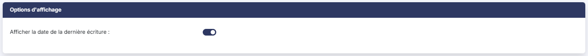<figcaption>
Rubrique « Options d'affichage »
</figcaption></figure>

De la même façon, certaines fenêtres portent une rubrique "Options d'affichage", qui rassemble les paramètres propres à leur contenu. La fenêtre "Chiffres clés", par exemple, y propose "Afficher la date de la dernière écriture".

## Bouton \[Supprimer la personnalisation]

<figure>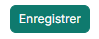<figcaption>
Bouton [Supprimer la personnalisation]
</figcaption></figure>

<figure>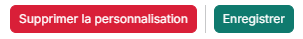<figcaption>
Bouton [Supprimer la personnalisation]
</figcaption></figure>

Ce bouton permet d'annuler les éventuelles modifications faites sur le paramétrage de la fenêtre et de revenir aux données par défaut.

Il n'est jamais proposé sur les fenêtres que vous avez créées, qui n'ont pas de paramétrage d'origine à rétablir. Sur les fenêtres livrées avec l'application, il n'apparaît pas non plus tant que la fenêtre est restée dans son état d'origine.

## Bouton \[Enregistrer]

<figure>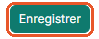<figcaption>
Bouton [Enregistrer]
</figcaption></figure>

Il enregistre le paramétrage de la fenêtre en cours.

## Revenir à la liste

La flèche "Revenir en arrière", à gauche du fil d'Ariane, quitte la fiche sans rien enregistrer.

## Cas particulier des fenêtres personnalisées

<figure>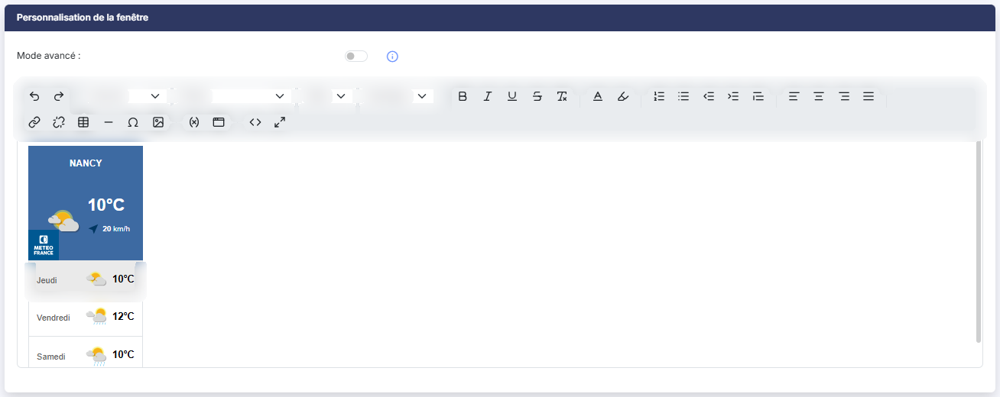<figcaption>
Rubrique « Cas particulier des fenêtres personnalisées »
</figcaption></figure>

<figure>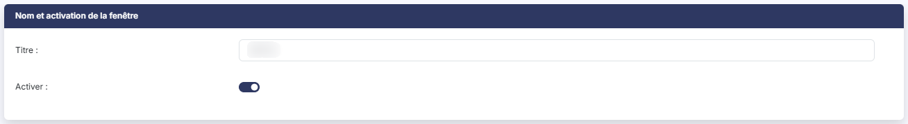<figcaption>
Rubrique « Cas particulier des fenêtres personnalisées »
</figcaption></figure>

<figure>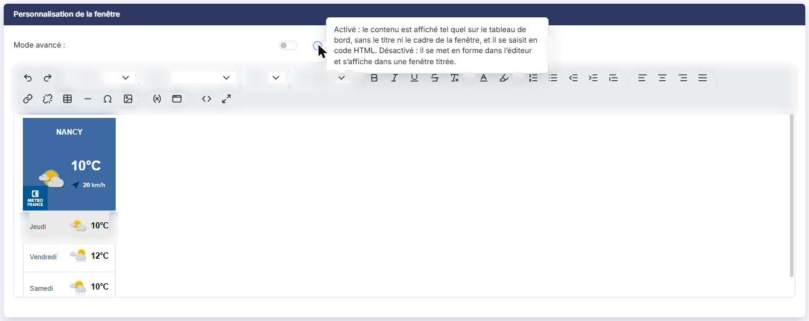<figcaption>
Rubrique « Cas particulier des fenêtres personnalisées »
</figcaption></figure>

Pour une fenêtre que vous avez créée, la première rubrique s'intitule "Nom et activation de la fenêtre" : en plus de **Activer**, elle porte un champ **Titre** (50 caractères au plus) qui donne son nom à la fenêtre. Elle porte aussi une rubrique "Personnalisation de la fenêtre". Celle-ci contient un éditeur de texte dans lequel vous composez librement le contenu de la fenêtre, ainsi qu'un paramètre "Mode avancé".

Le **Mode avancé** change la façon dont le contenu est affiché et saisi. Activé, le contenu est affiché tel quel sur le tableau de bord, sans le titre ni le cadre de la fenêtre, et il se saisit en code HTML (l'éditeur passe en mode source). Désactivé, il se met en forme dans l'éditeur et s'affiche dans une fenêtre titrée.

L'éditeur permet de saisir directement du code HTML, qui sera exécuté dans le tableau de bord : cet usage est réservé à des utilisateurs maîtrisant la programmation HTML.

Vous pouvez, par exemple, y afficher une partie du contenu de votre site internet.

Le code HTML peut également contenir des variables de session ; vous en trouverez ci-après la liste exhaustive ; cependant, en cas de besoin, nous pourrons mettre à votre disposition d'autres informations au travers de ces variables de session.

**Liste des variables de session**

Code abonné : \{{abonne.code\}}

Code Société gérée : \{{societe.code\}}

Raison sociale de la société gérée : \{{societe.raisonSociale\}}

Civilité de l'utilisateur : \{{utilisateur.civilite\}}

Code de l'utilisateur : \{{utilisateur.code\}}

Adresse e-mail de l'utilisateur : \{{utilisateur.email\}}

Nom de l'utilisateur : \{{utilisateur.nom\}}

Prénom de l'utilisateur : \{{utilisateur.prenom\}}

## Cas particulier de la fenêtre "Demandes infos client"

<figure>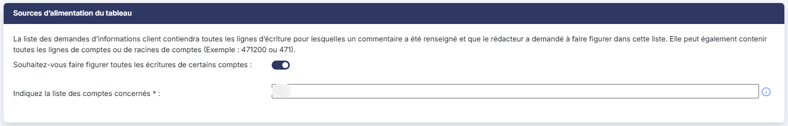<figcaption>
Rubrique « Cas particulier de la fenêtre "Demandes infos client" »
</figcaption></figure>

<figure>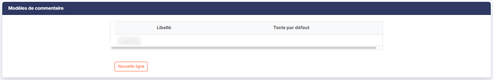<figcaption>
Rubrique « Cas particulier de la fenêtre "Demandes infos client" »
</figcaption></figure>

Cette fenêtre porte une rubrique "Sources d'alimentation du tableau". Comme l'annonce le texte affiché en tête de la rubrique, "la liste des demandes d'informations client contiendra toutes les lignes d'écriture pour lesquelles un commentaire a été renseigné et que le rédacteur a demandé à faire figurer dans cette liste. Elle peut également contenir toutes les lignes de comptes ou de racines de comptes (Exemple : 471200 ou 471)".

Vous avez donc la possibilité d'envoyer automatiquement toutes les lignes d'un compte ou d'une racine de compte dans cette fenêtre : activez l'interrupteur **Souhaitez-vous faire figurer toutes les écritures de certains comptes**, puis indiquez le compte ou la racine des comptes concernés dans le champ **Indiquez la liste des comptes concernés**, qui est alors obligatoire, 471200 ou 471 par exemple. S'il y a plusieurs comptes ou racines, séparez les par des points-virgules.

## Cas particulier de la fenêtre "Synthèse du dossier"

Cette fenêtre porte une rubrique "Paramètres des comptes pour la vérification des seuils". Comme l'annonce le texte affiché en tête de la rubrique, il s'agit de "renseigner les racines de comptes utilisées pour vérifier les obligations télédéclaratives pour les différentes taxes". Quatre champs sont proposés : **Impôts sur les sociétés**, **CVAE**, **RCM et IFU** et **Taxe sur les salaires**.

Ces racines valent pour l'ensemble des sociétés gérées ; le menu "Sociétés gérées" permet de les personnaliser société par société.

Cette fenêtre est aussi la seule à proposer un bouton supplémentaire.

bouton **\[Charger les valeurs par défaut]** : il remplace les racines saisies par celles que propose le logiciel.
