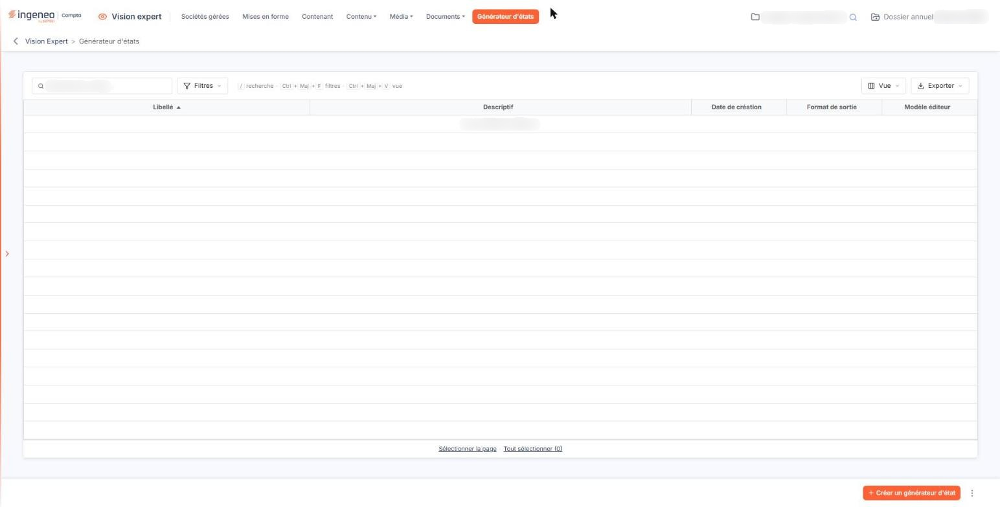

# Générateur d'états


**Où le trouver :** Menu **Générateur d'états**



**En bref** — L'aide du générateur d'états, commune à tous les modules où il est présent, se trouve dans le chapitre « Généralités » en tête de la présente aide.

* Pour utiliser le générateur d'états : reportez-vous au chapitre « Généralités » de l'aide.


<figure><figcaption>
Écran « Générateur d'états » de la nouvelle interface
</figcaption></figure>

L'aide en ligne concernant le générateur d'états d'édition, commune à tous les modules de l'application où il est présent, se trouve dans le chapitre « Généralités » en tête de la présente aide.
