# Mises en forme


**Où le trouver :** Menu **Mises en forme**



**En bref** — Cet écran personnalise l'aspect graphique de Vision : logo et couleurs du cabinet dans l'onglet « Identité », page sur laquelle vos utilisateurs se connectent dans l'onglet « Page de connexion ».

* Pour changer le logo : glissez votre image dans la zone « Glissez votre image », recadrez-la, puis bouton « Valider ».
* Pour changer la couleur du bandeau : cliquez sur la pastille de couleur, puis bouton \[Appliquer].
* Pour mettre en ligne votre page de connexion : réglez son contenu, contrôlez l'aperçu, puis bouton \[Publier] (ou \[Enregistrer le brouillon] pour la garder hors ligne).


## Onglet « Identité »

<figure>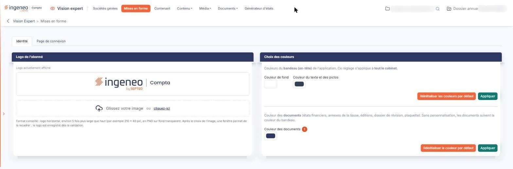<figcaption>
Écran « Mises en forme » de la nouvelle interface
</figcaption></figure>

## Rubrique « Logo de l'abonné »

<figure>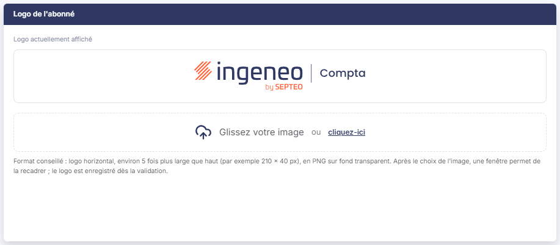<figcaption>
Rubrique « Logo de l'abonné »
</figcaption></figure>

Si vous n'avez pas téléchargé de logo, c'est le logo du produit qui est affiché.

Le logo actuellement en place est affiché en tête de la rubrique, sous « Logo actuellement affiché », sur la couleur actuelle du bandeau.

Pour charger un logo, glissez votre image dans la zone « Glissez votre image », ou cliquez sur « cliquez-ici » pour la rechercher sur votre ordinateur.

Une fois téléchargée, l'image est affichée deux fois dans la fenêtre « Recadrage de l'image » : « Image de base » à gauche, « Image recadrée qui sera affichée » à droite. Sélectionnez à la souris la partie de l'image de base que vous souhaitez conserver ; le bouton « Valider », au pied de la fenêtre, met l'image en place, tandis que « Annuler » ou la croix de l'en-tête referment la fenêtre sans valider.

Pour remplacer une image existante, il suffit d'en charger une nouvelle ; pour supprimer l'image existante sans remplacement, cliquez sur la croix "Supprimer l'image actuelle" de la zone de dépôt, proposée lorsqu'un logo personnalisé est en place.

Ce sera alors le logo du produit qui sera affiché.

## Rubrique « Choix des couleurs »

<figure>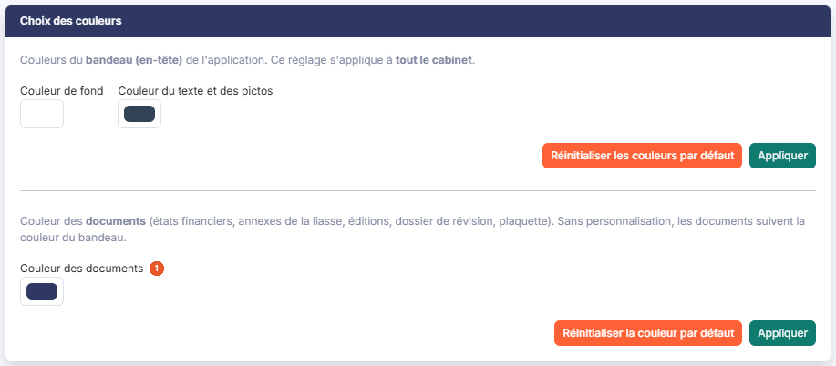<figcaption>
Rubrique « Choix des couleurs »
</figcaption></figure>

Pour choisir une couleur, cliquez sur la pastille de couleur placée sous son libellé.

| Champ                        | Ce qu'il faut savoir                                                                                                                                                                                                                                                                                                                                                                             |
| ---------------------------- | ------------------------------------------------------------------------------------------------------------------------------------------------------------------------------------------------------------------------------------------------------------------------------------------------------------------------------------------------------------------------------------------------ |
| 1. **Couleur des documents** | C'est la couleur des documents produits par le logiciel (états financiers, annexes de la liasse, éditions, dossier de révision, plaquette). Sans personnalisation, les documents suivent la couleur du bandeau.                                                                                                                                                                                  |
| **Couleurs du bandeau**      | 
Le bandeau est l'en-tête du logiciel. Vous choisissez sa "Couleur de fond" et sa "Couleur du texte et des pictos". Comme le rappelle l'écran, ce réglage s'applique à tout le cabinet. bouton <strong>[Appliquer]</strong>, sous ces deux couleurs : il les met en place. bouton <strong>[Réinitialiser les couleurs par défaut]</strong> : il rend au bandeau ses couleurs d'origine.
 |

bouton **\[Appliquer]**, sous cette couleur : il la met en place. bouton **\[Réinitialiser la couleur par défaut]** : il la retire.

Cet onglet ne porte pas de bouton d'enregistrement général : chaque réglage se valide par son propre bouton.

## Onglet « Page de connexion »

La page de connexion du logiciel est commune à tous : à droite, la carte de connexion ; à gauche, une colonne de présentation. L'option payante « Page de connexion personnalisée » vous permet de remplacer cette présentation par la vôtre, et de régler la carte de connexion. C'est la page que voient vos utilisateurs, et vos clients, avant même de se connecter.

## Rubrique « Page de connexion personnalisée »

<figure>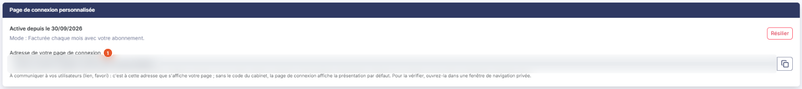<figcaption>
Rubrique « Page de connexion personnalisée »
</figcaption></figure>

Elle indique si l'option est active, depuis quand, et selon quel mode elle est facturée. Le bouton **\[Résilier]** y met fin ; la résiliation prend effet en fin de mois.

**Adresse de votre page de connexion** : c'est à cette adresse que s'affiche votre page. Communiquez-la à vos utilisateurs (lien, favori) : sans le code du cabinet, la page de connexion affiche la présentation par défaut. Le pictogramme "Copier l'adresse" placé à droite la copie. Pour vérifier votre page, ouvrez cette adresse dans une fenêtre de navigation privée.

## Rubrique « Aperçu de la page de connexion »

<figure>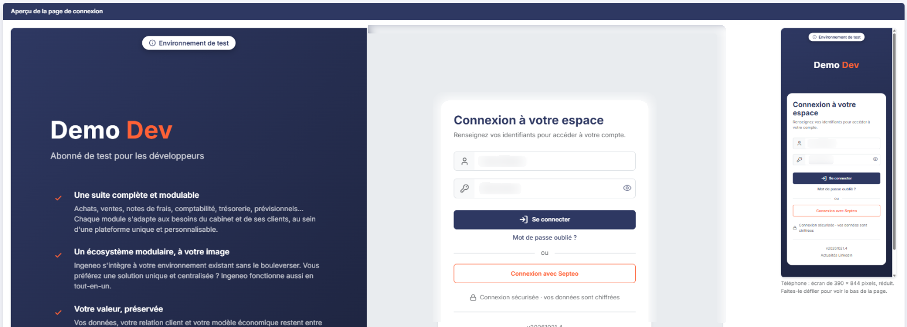<figcaption>
Rubrique « Aperçu de la page de connexion »
</figcaption></figure>

<figure>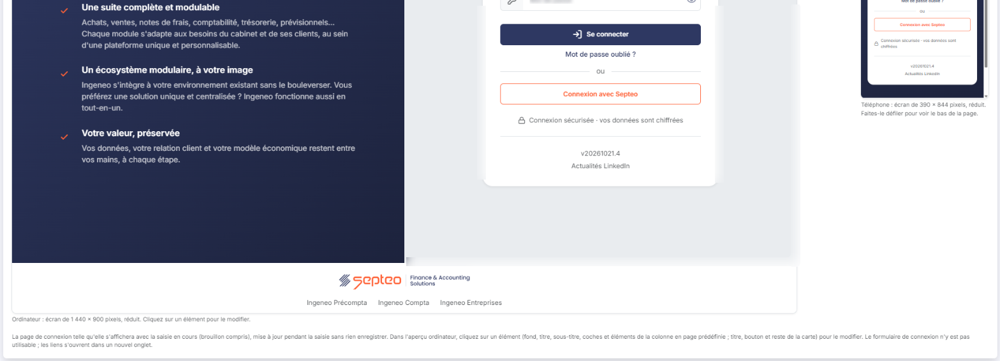<figcaption>
Rubrique « Aperçu de la page de connexion »
</figcaption></figure>

<figure>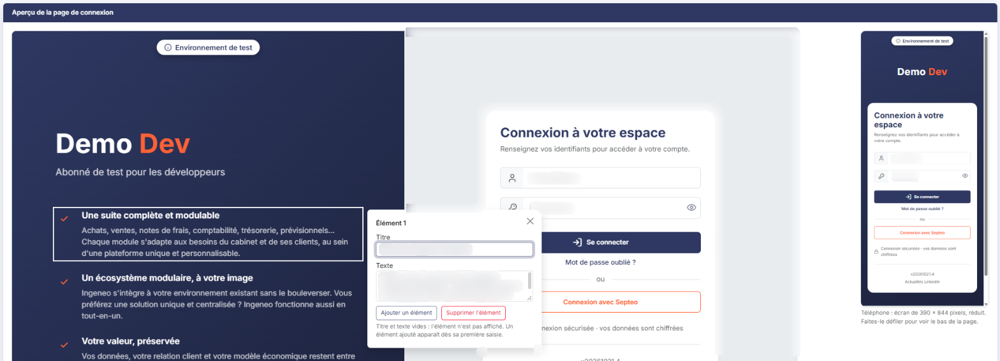<figcaption>
Rubrique « Aperçu de la page de connexion »
</figcaption></figure>

Deux aperçus réduits montrent la page de connexion telle qu'elle s'affichera avec la saisie en cours, brouillon compris : l'un sur un écran d'ordinateur, l'autre sur un téléphone. Ils se mettent à jour pendant la saisie, sans rien enregistrer. Le formulaire de connexion n'y est pas utilisable, et les liens s'y ouvrent dans un nouvel onglet.

Dans l'aperçu ordinateur, cliquez sur un élément pour le modifier : le fond, le titre, le sous-titre, les coches et les éléments de la colonne de présentation, ou le titre, le bouton et le reste de la carte de connexion. Dans la fiche d'un élément, les boutons « Ajouter un élément » et « Supprimer l'élément » permettent d'en ajouter ou d'en retirer directement depuis l'aperçu.

## Rubrique « Contenu »

<figure>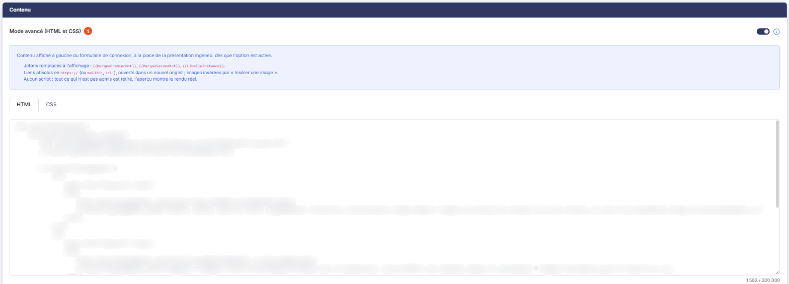<figcaption>
Rubrique « Contenu »
</figcaption></figure>

<figure>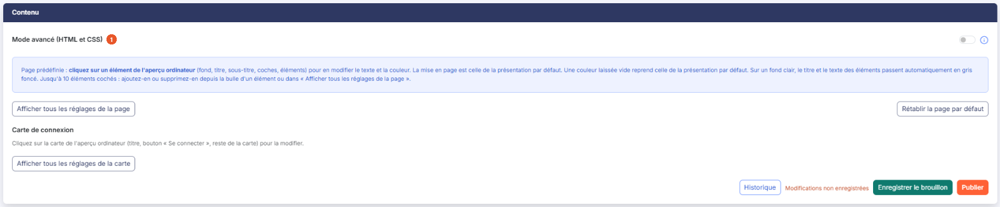<figcaption>
Rubrique « Contenu »
</figcaption></figure>

<figure>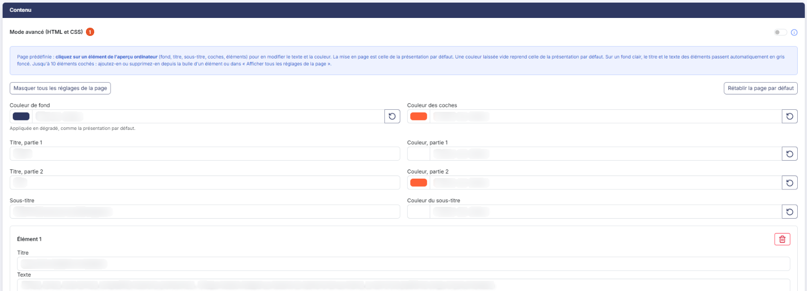<figcaption>
Rubrique « Contenu »
</figcaption></figure>

<figure>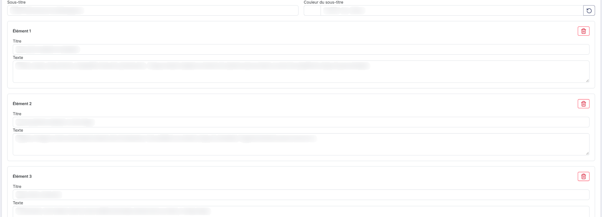<figcaption>
Rubrique « Contenu »
</figcaption></figure>

<figure>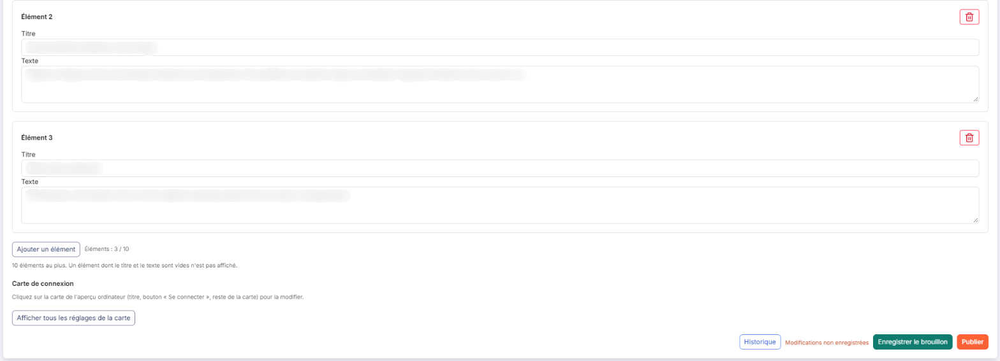<figcaption>
Rubrique « Contenu »
</figcaption></figure>

**Mode avancé (HTML et CSS)** : désactivé, vous réglez les textes et les couleurs d'une page prédéfinie, dont la mise en page est celle de la présentation par défaut ; activé, vous écrivez vous-même le HTML et le CSS de la colonne, à partir de la page prédéfinie.

En page prédéfinie, le lien "Afficher tous les réglages de la page" présente tous les réglages à la fois : la "Couleur de fond" de la colonne, appliquée en dégradé comme la présentation par défaut, la "Couleur des coches", le titre en deux parties ("Titre, partie 1" et "Titre, partie 2", chacune avec sa couleur), le "Sous-titre" et sa couleur, puis la liste des éléments cochés : de 0 à 10 éléments (trois par défaut), "Élément 1", "Élément 2", etc., chacun avec un "Titre" et un "Texte". Le bouton « Ajouter un élément » en crée un nouveau, jusqu'à 10 (le compteur « Éléments : n / 10 » indique où vous en êtes) ; la corbeille « Supprimer l'élément » retire un élément, et les suivants remontent d'un rang et changent de numéro. Vous pouvez supprimer tous les éléments : la liste à coches n'apparaît alors plus sur la page. Un élément dont le titre et le texte sont vides n'est pas affiché, y compris un élément tout juste ajouté tant que vous n'avez rien saisi. Une couleur laissée vide reprend celle de la présentation par défaut ; sur un fond clair, le titre et le texte des éléments passent automatiquement en gris foncé.

Le bouton **\[Rétablir la page par défaut]** remet les textes et les éléments de la présentation par défaut (les trois éléments d'origine : les ajouts sont supprimés, les éléments retirés reviennent) et retire les couleurs choisies.

En mode avancé, vous saisissez le "HTML de la page de connexion" et le "CSS de la page de connexion". Aucun script n'est admis : ce qui n'est pas autorisé est retiré, et l'aperçu montre le rendu réel. Le bouton **\[Insérer une image]** convertit une image PNG, JPEG ou GIF de 3 Mo au plus et l'insère dans le HTML, à la position du curseur ; le bouton **\[Charger le modèle par défaut]** remplace le HTML et le CSS saisis par un point de départ reproduisant la page de connexion par défaut.

## Rubrique « Carte de connexion »

<figure>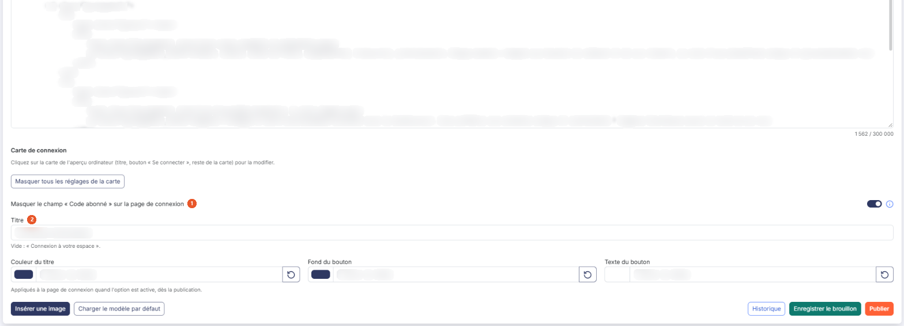<figcaption>
Rubrique « Carte de connexion »
</figcaption></figure>

Le lien "Afficher tous les réglages de la carte" présente ses réglages :

| Champ                                                            | Ce qu'il faut savoir                                                                                                                                                                   |
| ---------------------------------------------------------------- | -------------------------------------------------------------------------------------------------------------------------------------------------------------------------------------- |
| 1. **Masquer le champ « Code abonné » sur la page de connexion** | Votre code abonné est alors utilisé automatiquement, et le champ « Code abonné » n'apparaît pas sur votre page. À désactiver si vos utilisateurs doivent pouvoir saisir un autre code. |
| 2. **Titre**                                                     | Le titre de la carte. Laissé vide, c'est « Connexion à votre espace » qui s'affiche.                                                                                                   |

**Couleur du titre**, **Fond du bouton** et **Texte du bouton** : les couleurs du titre et du bouton « Se connecter ».

Ces réglages sont appliqués à la page de connexion quand l'option est active, dès la publication.

## Boutons de l'onglet

<figure>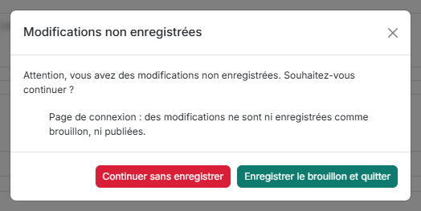<figcaption>
Boutons de l'onglet
</figcaption></figure>

bouton **\[Historique]** : il ouvre l'historique de la page de connexion, de l'opération la plus récente à la plus ancienne : activations, résiliations et modifications du contenu, avec pour chacune sa date, son origine, sa facturation, l'utilisateur qui l'a faite et son détail.

bouton **\[Enregistrer le brouillon]** : il enregistre votre travail sans le mettre en ligne. Votre page de connexion garde la version publiée, et vous retrouverez ce brouillon à votre prochaine visite.

bouton **\[Publier]** : il met le contenu en ligne sur votre page de connexion, d'ici 60 secondes au plus, et efface le brouillon.

Si vous quittez l'écran alors que la page de connexion n'est ni enregistrée en brouillon ni publiée, ou que des couleurs de l'onglet « Identité » ont été choisies sans avoir été appliquées, une fenêtre « Modifications non enregistrées » vous demande si vous souhaitez continuer. Le bouton **\[Continuer sans enregistrer]** quitte l'écran en perdant ces modifications ; le bouton **\[Enregistrer le brouillon et quitter]**, proposé seulement lorsque seule la page de connexion est concernée, enregistre le brouillon avant de partir. La croix, la touche Échap ou un clic à côté de la fenêtre vous laissent sur l'écran.
