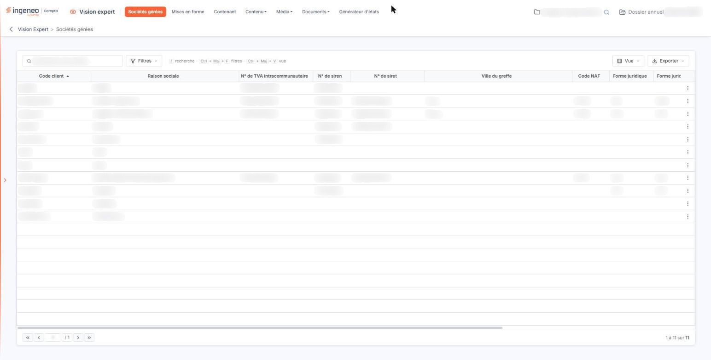
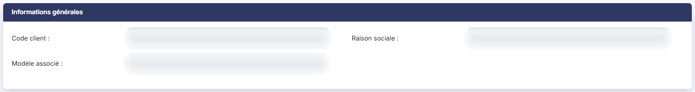
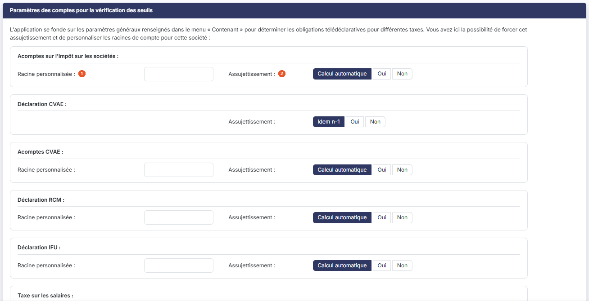
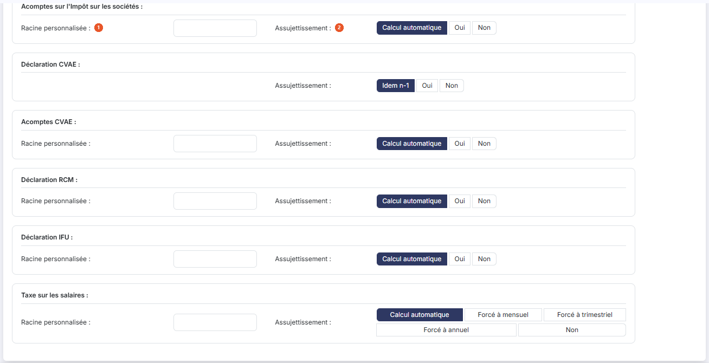
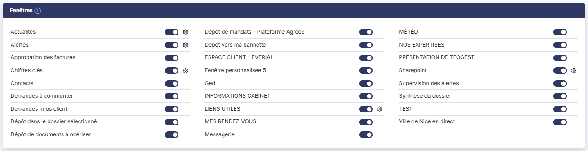
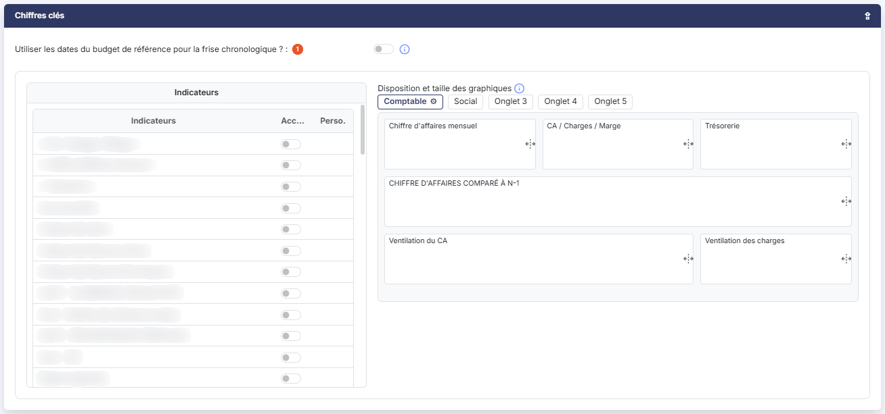

# Sociétés gérées


**Où le trouver :** Menu **Sociétés gérées**



**En bref** — Cet écran personnalise, société gérée par société gérée, les fenêtres, les indicateurs et les alertes accessibles dans son tableau de bord.

* Pour paramétrer une société : survolez sa ligne, cliquez sur le crayon « Modifier », réglez les fenêtres et les chiffres clés, puis bouton \[Enregistrer].
* Pour personnaliser une fenêtre pour cette seule société : cliquez sur la roue crantée qui suit son interrupteur.
* Pour abandonner vos modifications : quittez la fiche par la flèche « Revenir en arrière ».


## Rubrique "Informations générales"

<figure><figcaption>
Écran « Sociétés gérées » de la nouvelle interface
</figcaption></figure>

<figure><figcaption>
Rubrique « Informations générales »
</figcaption></figure>

Cette rubrique rappelle, en lecture seule, le "Code client" et la "Raison sociale" de la société, ainsi que le "Modèle associé" lorsqu'elle est rattachée à un modèle de tableau de bord.

Ces trois informations ne se modifient pas ici.

## Rubrique "Paramètres des comptes pour la vérification des seuils"

<figure><figcaption>
Rubrique « Paramètres des comptes pour la vérification des seuils »
</figcaption></figure>

<figure><figcaption>
Rubrique « Paramètres des comptes pour la vérification des seuils »
</figcaption></figure>

Comme l'annonce le texte affiché en tête de la rubrique, "l'application se fonde sur les paramètres généraux renseignés dans le menu « Contenant » pour déterminer les obligations télédéclaratives pour différentes taxes. Vous avez ici la possibilité de forcer cet assujetissement et de personnaliser les racines de compte pour cette société".

Vous n'avez donc rien à saisir ici tant que le paramétrage général convient à la société : cette rubrique ne sert qu'aux exceptions.

Un bloc est proposé par taxe : "Acomptes sur l'Impôt sur les sociétés", "Déclaration CVAE", "Acomptes CVAE", "Déclaration RCM", "Déclaration IFU" et "Taxe sur les salaires". Chaque bloc propose deux paramètres :

| Champ                       | Ce qu'il faut savoir                                                                                                                                                                                             |
| --------------------------- | ---------------------------------------------------------------------------------------------------------------------------------------------------------------------------------------------------------------- |
| 1. **Racine personnalisée** | Indiquez la racine de compte à utiliser pour cette société, si elle diffère de celle du paramétrage général. Le bloc "Déclaration CVAE" ne propose pas ce paramètre.                                             |
| 2. **Assujettissement**     | Laissez le choix proposé par défaut ("Calcul automatique", ou "Idem n-1" pour la déclaration CVAE) pour que l'application détermine elle-même l'assujettissement de la société, ou forcez-le à "Oui" ou à "Non". |

La "Taxe sur les salaires" fait exception : au lieu de "Oui", elle vous propose de forcer une périodicité, "Forcé à mensuel", "Forcé à trimestriel" ou "Forcé à annuel".

## Rubrique "Fenêtres"

<figure><figcaption>
Rubrique « Fenêtres »
</figcaption></figure>

La rubrique "Fenêtres" permet de choisir les fenêtres que vous voulez afficher pour cette société gérée dans le tableau de bord. Comme le rappelle son pictogramme d'information : "Choisissez les fenêtres accessibles sur la page d’accueil et configurez leur contenu." L'emplacement des fenêtres sur la page d'accueil n'est plus choisi ici : il est fixé par le logiciel.


Attention : ce tableau désigne chaque fenêtre par son intitulé personnalisé dès que vous en avez défini un dans le menu "Contenant". Une fenêtre que cette page appelle "Liens" peut donc y figurer sous le libellé que vous lui avez donné, "LIENS UTILES" par exemple.


Chaque fenêtre porte deux éléments :

**L'interrupteur** placé à droite de son nom : activez-le pour rendre la fenêtre disponible dans le tableau de bord de cette société.

| Champ               | Ce qu'il faut savoir                                                                                                                                                                                                                                                                                                                                                                                                                                                                                                                                                                                                                         |
| ------------------- | -------------------------------------------------------------------------------------------------------------------------------------------------------------------------------------------------------------------------------------------------------------------------------------------------------------------------------------------------------------------------------------------------------------------------------------------------------------------------------------------------------------------------------------------------------------------------------------------------------------------------------------------- |
| **La roue crantée** | 
Pour certaines fenêtres seulement ("Actualités", "Alertes", "Chiffres clés", "LIENS UTILES", "Sharepoint"), une roue crantée suit l'interrupteur. En cliquant sur cette roue, vous avez la possibilité de personnaliser les informations de la fenêtre concernée, pour cette société uniquement. Selon la fenêtre, cette roue ouvre une fenêtre de configuration sur place, ou vous renvoie vers l'écran où se fait cette configuration ; son infobulle vous l'indique. La roue crantée reste affichée même lorsque l'interrupteur de la fenêtre est désactivé, mais elle n'est alors utilisable que pour la fenêtre "Alertes".
 |
| **Cas particulier** | Si vous désactivez la fenêtre "Alertes", elle ne sera plus visible dans le tableau de bord de la société gérée, cependant, la roue crantée reste disponible pour que vous puissiez affecter des alertes qui seront disponibles dans la fenêtre "Supervision des alertes".                                                                                                                                                                                                                                                                                                                                                                    |

## Rubrique "Chiffres clés"

<figure><figcaption>
Rubrique « Chiffres clés »
</figcaption></figure>

Ce sont les graphiques qui, sur le tableau de bord, sont affichés dans la fenêtre "Chiffres clés".

Une question est posée au-dessus des indicateurs :

**Utiliser les dates du budget de référence pour la frise chronologique ?** : dans le tableau de bord, les indicateurs sont précédés d'une frise temporelle. Si vous l'activez, ses bornes de dates seront celles du budget de référence ; si vous le laissez désactivé, ou s'il n'existe pas de budget de référence, les dates seront celles de la période de saisie du dossier annuel.

Bien sûr, dans le tableau de bord, l'utilisateur aura tout loisir de modifier ces bornes de dates et de voir l'évolution des indicateurs graphiques en temps réel.

La liste de gauche contient tous les indicateurs :

* les indicateurs figés qui sont livrés avec l'application,
* des indicateurs personnalisés préparamétrés et livrés avec l'application,
* les indicateurs personnalisés que vous avez créés.

Sélectionnez ceux que vous souhaitez rendre disponibles pour la société en cours en activant l'interrupteur de la colonne "Accès".

Lorsque c'est possible, une roue crantée apparaît dans la colonne "Perso." pour signifier que vous pouvez personnaliser l'indicateur pour la société sur laquelle vous êtes positionné. En cliquant sur cette roue, vous avez accès aux seules informations personnalisables.

Si vous personnalisez un indicateur, un pictogramme « Dépersonnaliser » apparaît à côté de la roue crantée donnant accès à la personnalisation.

La partie droite de l'écran, "Disposition et taille des graphiques", vous permet de gérer la disposition des indicateurs que vous avez choisis. Elle est organisée en cinq onglets, ce qui vous permet de répartir les indicateurs par thème ; la roue crantée affichée à droite du nom de l'onglet sélectionné donne accès à son paramétrage.

Comme le rappelle le pictogramme d'information de la zone, "vous pouvez déplacer les graphiques à l'aide de la souris et changer leur taille en faisant glisser le bord latéral droit ou le bord inférieur".

Vous pouvez positionner plusieurs indicateurs sur la même ligne si vous en avez réduit les tailles.

## Bouton \[Enregistrer]

<figure><figcaption>
Bouton [Enregistrer]
</figcaption></figure>

Il enregistre la fiche de la société en cours.

## Revenir à la liste

La flèche "Revenir en arrière", à gauche du fil d'Ariane, quitte la fiche sans rien enregistrer. Pour abandonner vos modifications, quittez donc la fiche par cette flèche plutôt que par le bouton d'enregistrement.
