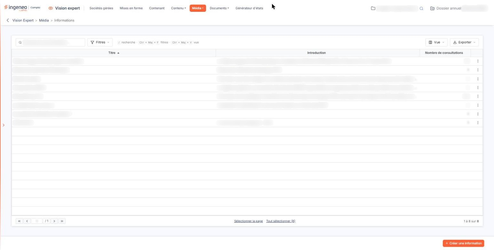
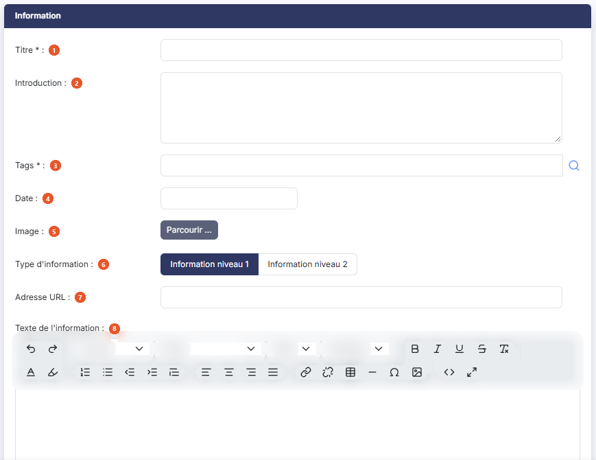
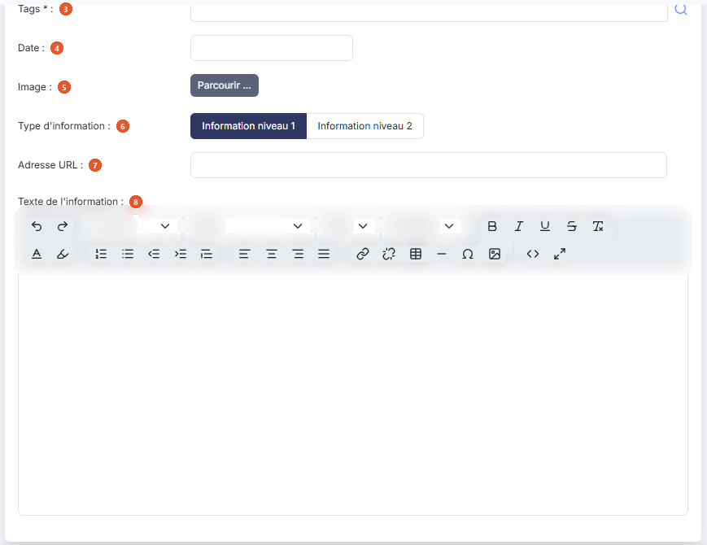
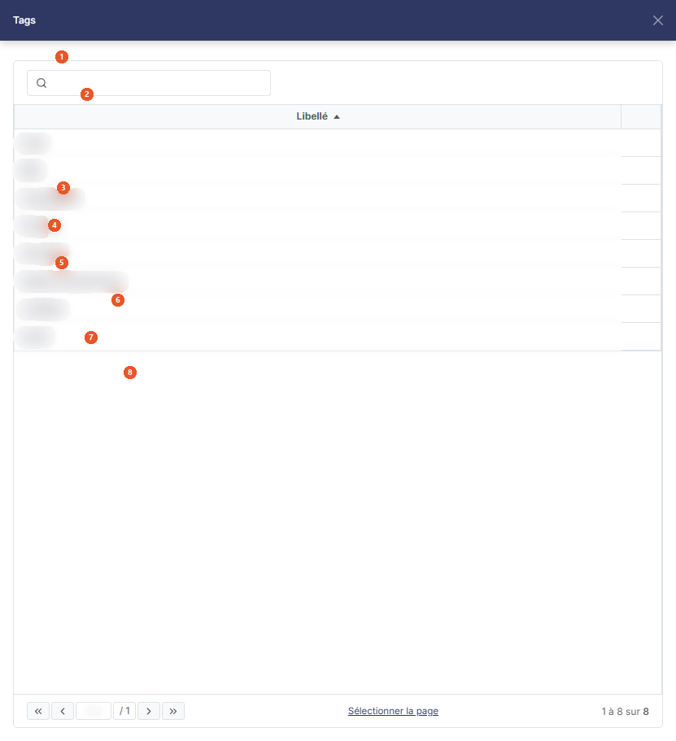
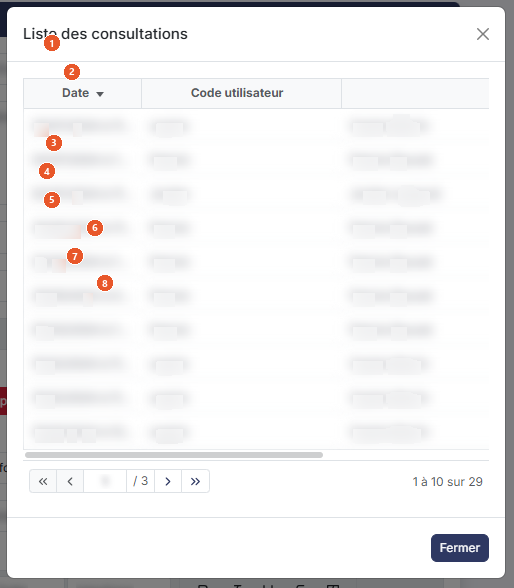

# Informations


**Où le trouver :** Menu **Média › Informations**



**En bref** — Cet écran rédige les informations affichées dans le tableau de bord des utilisateurs qui partagent au moins un de leurs tags.

* Pour créer une information : bouton \[Créer une information], saisissez le titre et les tags, rédigez le texte ou indiquez une adresse URL, puis bouton \[Enregistrer].
* Pour savoir qui a consulté une information : ouvrez-la, puis bouton \[Visualiser] à côté du nombre de consultations.


Les informations sont les contenus qui sont affichés dans les tableaux de bord des utilisateurs qui possèdent les mêmes tags dans leur fiche que ceux attribués à l'information.

<figure><figcaption>
Écran « Informations » de la nouvelle interface
</figcaption></figure>

Une information peut être créée de toute pièce ou correspondre à une redirection vers un autre site.

La grille présente les informations déjà créées, avec leur **Titre**, leur **Introduction** et leur **Nombre de consultations**. Au-dessus de la liste, la zone « Rechercher une information… » filtre les lignes au fil de la saisie. Le Bouton \[Filtres] ouvre un volet où vous ajoutez des critères, colonne par colonne ; le Bouton \[Vue] permet de choisir les colonnes affichées et d'enregistrer la présentation de la liste ; le Bouton \[Exporter] propose l'aperçu, l'impression, l'export Excel ou PDF et l'envoi de la liste par e-mail.

Au survol d'une ligne apparaissent, à droite, le pictogramme « Modifier », pour ouvrir l'information en modification, le pictogramme « Dupliquer », pour en créer une copie que vous n'aurez plus qu'à modifier, et le pictogramme « Autres actions » (trois points), qui porte « Supprimer ».

Pour créer une nouvelle information à diffuser, cliquez sur le Bouton \[Créer une information], en bas d'écran. Pour supprimer une ou plusieurs informations, sélectionnez-les d'un clic sur leur ligne (les liens « Sélectionner la page » et « Tout sélectionner », sous la liste, en sélectionnent davantage) : un bandeau en bas d'écran rappelle le nombre d'informations retenues et porte le lien « Tout désélectionner » et le Bouton \[Supprimer].

## Rubrique « Information »

<figure><figcaption>
Rubrique « Information »
</figcaption></figure>

<figure><figcaption>
Rubrique « Information »
</figcaption></figure>

<figure><figcaption>
Rubrique « Information »
</figcaption></figure>

<figure><figcaption>
Rubrique « Information »
</figcaption></figure>

| Champ                         | Ce qu'il faut savoir                                                                                                                                                                                                                                                                                                                                                                                                                                                                                                                                                                                                                                                                                                                                                                                                                                                                                                                                                                                                                                                                                                                                                                                   |
| ----------------------------- | ------------------------------------------------------------------------------------------------------------------------------------------------------------------------------------------------------------------------------------------------------------------------------------------------------------------------------------------------------------------------------------------------------------------------------------------------------------------------------------------------------------------------------------------------------------------------------------------------------------------------------------------------------------------------------------------------------------------------------------------------------------------------------------------------------------------------------------------------------------------------------------------------------------------------------------------------------------------------------------------------------------------------------------------------------------------------------------------------------------------------------------------------------------------------------------------------------ |
| 1. **Titre**                  | Champ obligatoire.                                                                                                                                                                                                                                                                                                                                                                                                                                                                                                                                                                                                                                                                                                                                                                                                                                                                                                                                                                                                                                                                                                                                                                                     |
| 2. **Introduction**           | Il s'agit du texte qui sera affiché dans le tableau de bord. C'est le titre ou un bref résumé de l'information.                                                                                                                                                                                                                                                                                                                                                                                                                                                                                                                                                                                                                                                                                                                                                                                                                                                                                                                                                                                                                                                                                        |
| 3. **Tags**                   | 
Champ obligatoire. Il s'agit des mots-clefs qui sont affectés à l'information et qui permettent d'opérer la sélection lors de l'affichage à un utilisateur. En effet, un utilisateur ne verra que les informations qui contiennent au moins un des tags qui lui ont été affectés à lui aussi. Une information doit contenir au moins un tag. Vous pouvez affecter plusieurs tags à la même information : saisissez-les directement dans le champ, ou cliquez sur le pictogramme « Loupe » pour ouvrir le panneau de sélection, qui s'ouvre à droite sous le titre « Tags ». Ce panneau présente d'emblée la liste des tags ; la zone de recherche « Rechercher par tags… » la restreint au fil de la saisie. Cliquez sur la ligne de chaque tag souhaité : un bandeau en bas du panneau indique le nombre de tags sélectionnés (« 1 tag sélectionné ») et porte le bouton « + Ajouter le tag », qui reporte la sélection dans le champ ; le lien « Tout désélectionner », sous la liste, la vide. Il n'y a ni Bouton [Valider] ni Bouton [Annuler] : la croix de l'en-tête referme le panneau sans rien reporter. Les tags proposés sont ceux que vous avez créés dans l'option « Tags ».
 |
| 4. **Date**                   | Champ facultatif. Il s'agit de la date de publication de l'information.                                                                                                                                                                                                                                                                                                                                                                                                                                                                                                                                                                                                                                                                                                                                                                                                                                                                                                                                                                                                                                                                                                                                |
| 5. **Image**                  | Il s'agit de la petite image qui s'affiche avec le titre et l'introduction dans le pavé du tableau de bord. Cliquez sur le Bouton \[Parcourir ...] pour la télécharger depuis votre ordinateur. Lorsqu'une image est déjà en place, elle est affichée en vignette et le Bouton \[Supprimer l'image actuelle] vous permet de la retirer.                                                                                                                                                                                                                                                                                                                                                                                                                                                                                                                                                                                                                                                                                                                                                                                                                                                                |
| 6. **Type d'information**     | Le logiciel permet de gérer deux types d'informations différents, « Information niveau 1 » et « Information niveau 2 », qui sont affichés dans deux pavés distincts du tableau de bord. Pour chaque information vous devez préciser à quel type vous l'affectez. À la création, le type « Information niveau 1 » est proposé par défaut.                                                                                                                                                                                                                                                                                                                                                                                                                                                                                                                                                                                                                                                                                                                                                                                                                                                               |
| 7. **Adresse URL**            | Cette adresse est à renseigner seulement si l'information est sur un autre site et que vous voulez rediriger l'utilisateur vers ce site.                                                                                                                                                                                                                                                                                                                                                                                                                                                                                                                                                                                                                                                                                                                                                                                                                                                                                                                                                                                                                                                               |
| 8. **Texte de l'information** | Cette zone n'est à renseigner que si vous n'avez pas indiqué d'adresse URL de redirection. C'est ce texte qui sera alors visible lorsque l'utilisateur cliquera sur l'information correspondante dans le tableau de bord.                                                                                                                                                                                                                                                                                                                                                                                                                                                                                                                                                                                                                                                                                                                                                                                                                                                                                                                                                                              |
| **Nombre de consultations**   | 
Ce champ n'apparaît pas à la création d'une information mais seulement après. Il indique le nombre d'utilisateurs de votre abonnement qui ont consulté l'information. Il n'est pas modifiable. Dès que ce nombre est supérieur à zéro, le Bouton [Visualiser] apparaît à côté : il ouvre la fenêtre "Liste des consultations", qui détaille chaque consultation avec sa <strong>Date</strong> (jour et heure), le <strong>Code utilisateur</strong> et le <strong>Nom</strong> de celui qui l'a consultée. Les trois colonnes sont triables. Le Bouton [Fermer] referme la fenêtre.
                                                                                                                                                                                                                                                                                                                                                                                                                                                                                                                                                                                                          |

Pour créer votre information vous disposez d'un grand nombre d'outils pour vous faciliter la mise en page : mise en forme des caractères et des paragraphes, listes, liens, tableaux, images, choix de la police, de la taille et des couleurs, aperçu du résultat. Vous pouvez également coller des textes qui viennent d'autres documents, y compris de Word, à l'aide des commandes de collage dédiées.

Cliquez sur le Bouton \[Enregistrer] pour valider votre saisie, ou sur la flèche « Revenir en arrière », à gauche du fil d'Ariane, pour abandonner.
