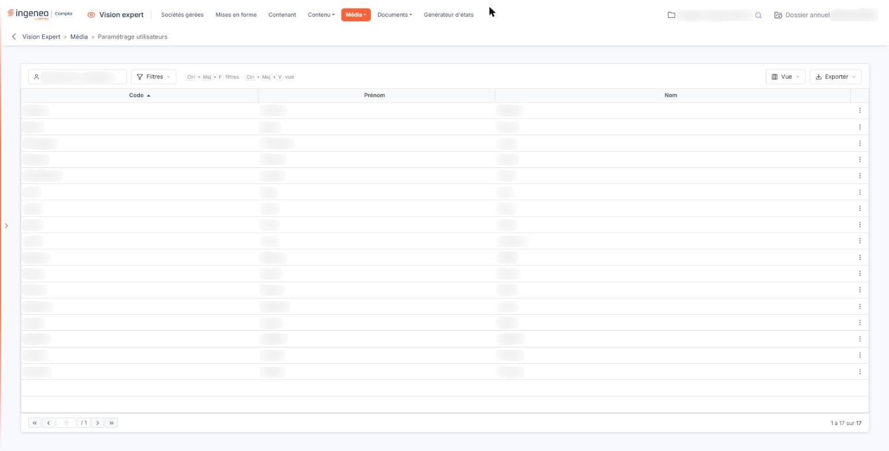
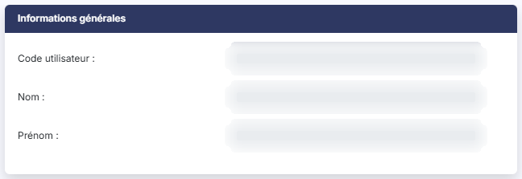
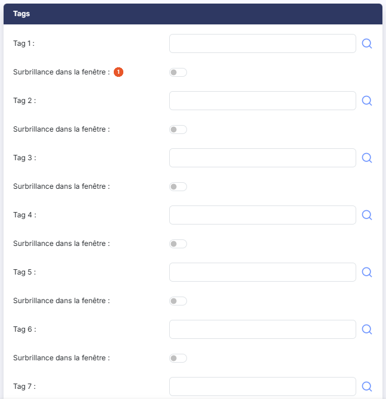
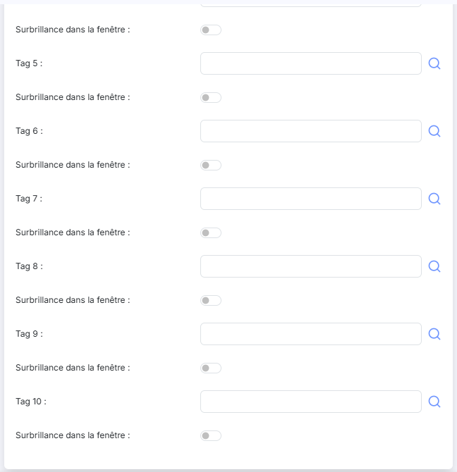
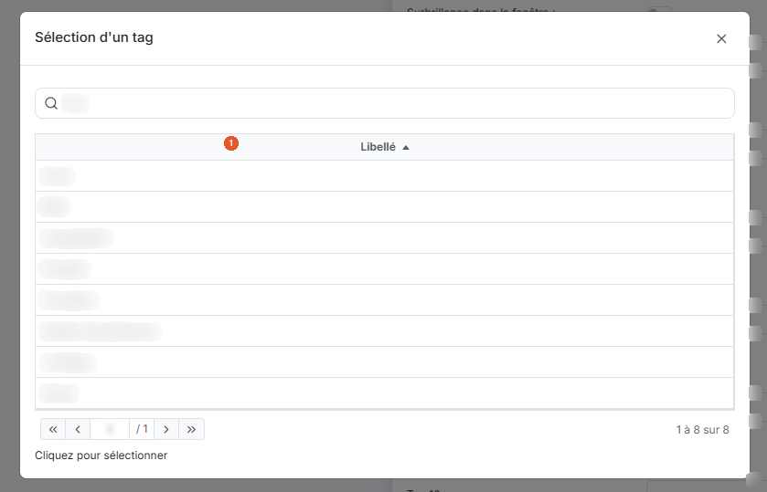

# Paramétrage utilisateurs


**Où le trouver :** Menu **Média › Paramétrage utilisateurs**



**En bref** — Cet écran affecte jusqu'à dix tags à chaque utilisateur existant, ce qui détermine les informations affichées dans son tableau de bord.

* Pour affecter des tags : crayon « Modifier » sur la ligne de l'utilisateur, renseignez les lignes Tag 1 à Tag 10, puis bouton \[Enregistrer].
* Pour mettre en avant les informations d'un tag : activez l'interrupteur « Surbrillance dans la fenêtre » de sa ligne.


La grille contient les utilisateurs, avec leur **Code**, leur **Prénom** et leur **Nom**. Cet écran ne crée ni ne supprime d'utilisateur : il ne fait que compléter le paramétrage de ceux qui existent déjà. Il ne comporte donc ni bouton de création, ni Bouton \[Supprimer], et la seule commande de ligne est le pictogramme « Modifier » (un crayon), qui apparaît à droite au survol d'une ligne et ouvre la fiche de l'utilisateur.

<figure><figcaption>
Écran « Paramétrage utilisateurs » de la nouvelle interface
</figcaption></figure>

Au-dessus de la grille, le champ « Rechercher un utilisateur… » filtre les lignes affichées ; le bouton **\[Filtres]** restreint la liste par des critères posés sur ses colonnes, le bouton **\[Vue]** choisit les colonnes affichées, et le bouton **\[Exporter]** imprime ou exporte la liste.

Pour chaque utilisateur, vous pouvez paramétrer jusqu'à 10 tags.

Les tags affectés aux utilisateurs vont déterminer les informations qui lui seront affichées dans le tableau de bord c'est-à-dire celles qui contiendront au moins un des tags affecté à l'utilisateur.

## Rubrique « Informations générales »

<figure><figcaption>
Rubrique « Informations générales »
</figcaption></figure>

Les champs **Code utilisateur**, **Nom** et **Prénom** rappellent l'utilisateur que vous êtes en train de paramétrer. Ils ne se saisissent pas.

## Rubrique « Tags »

<figure><figcaption>
Rubrique « Tags »
</figcaption></figure>

<figure><figcaption>
Rubrique « Tags »
</figcaption></figure>

<figure><figcaption>
Rubrique « Tags »
</figcaption></figure>

La rubrique présente dix lignes, de **Tag 1** à **Tag 10**. Le nombre de lignes est fixe et aucun tag n'est obligatoire : vous renseignez autant de lignes que nécessaire et laissez les autres vides.

Entrez le libellé du tag directement dans la cellule de saisie (le logiciel vous proposera les tags qui contiennent les premières lettres saisies) ou cliquez sur le pictogramme « Loupe » pour afficher la liste et le choisir. La fenêtre « Sélection d'un tag » présente d'emblée tous les tags existants ; le champ de recherche **Tag** restreint la liste au fur et à mesure de la saisie. Un seul tag se choisit à la fois : cliquez sur la ligne souhaitée, comme l'indique la mention « Cliquez pour sélectionner » sous la liste. La croix du bandeau referme la fenêtre.

**Surbrillance dans la fenêtre** : vous avez la possibilité pour un ou plusieurs tag(s) de faire afficher l'information qui le contiendra en surbrillance pour la mettre en avant dans le pavé du tableau de bord. Chaque ligne de tag porte son propre interrupteur, désactivé tant que vous ne l'activez pas.

Cliquez sur le Bouton \[Enregistrer] pour valider votre paramétrage, ou sur la flèche « Revenir en arrière », à gauche du fil d'Ariane, pour abandonner.
