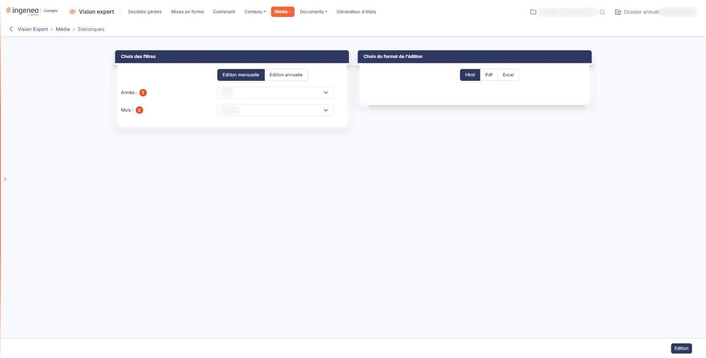

# Statistiques


**Où le trouver :** Menu **Média › Statistiques**



**En bref** — Cette édition présente le nombre de consultations des informations par les utilisateurs, par jour sur un mois ou par mois sur une année.

* Pour obtenir les statistiques : choisissez l'édition mensuelle ou annuelle, l'année, le mois et le format, puis bouton \[Edition].


Cette édition permet de visualiser le nombre de consultations des informations par les utilisateurs.

<figure><figcaption>
Écran « Statistiques » de la nouvelle interface
</figcaption></figure>

Cet écran ne présente aucune liste : vous y choisissez une période et un format, puis vous lancez l'édition.

## Rubrique « Choix des filtres »

| Champ                 | Ce qu'il faut savoir                                                                                                                                |
| --------------------- | --------------------------------------------------------------------------------------------------------------------------------------------------- |
| 1. **Année**          | Le logiciel propose une liste d'années. Cette liste ne comporte pas toujours l'année en cours ; vérifiez l'année retenue avant de lancer l'édition. |
| 2. **Mois**           | Les douze mois de l'année. Le logiciel retient par défaut le mois en cours. Ce champ n'est présenté que pour une édition mensuelle.                 |
| **Edition mensuelle** | Indiquez l'année et le mois ; vous obtiendrez le nombre de consultations de chaque information par jour.                                            |
| **Edition annuelle**  | Indiquez l'année, vous obtiendrez le nombre de consultations de chaque information par mois. Le champ **Mois :** disparaît alors de l'écran.        |

## Rubrique « Choix du format de l'édition »

Choisissez le format du document produit : **Html**, **Pdf** ou **Excel**. Le logiciel retient **Html** par défaut.

bouton **\[Edition]**

Il lance l'édition dans le format demandé. C'est le seul bouton d'action de cet écran : il n'y a ni bouton d'enregistrement, ni bouton de retour.
