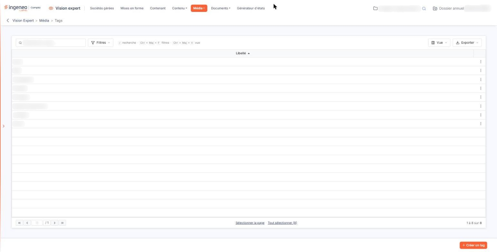
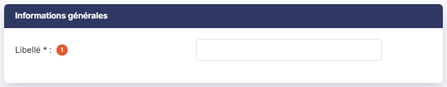

# Tags


**Où le trouver :** Menu **Média › Tags**



**En bref** — Cet écran crée les tags, mots-clefs affectés aux informations et aux utilisateurs pour choisir qui voit quoi dans le tableau de bord.

* Pour créer un tag : bouton \[Créer un tag], saisissez le libellé, puis bouton \[Enregistrer].
* Pour supprimer des tags : sélectionnez leurs lignes, puis bouton \[Supprimer].


Les tags sont des mots-clefs qui sont d'une part affectés à une information et d'autre part affectés à un utilisateur.

<figure><figcaption>
Écran « Tags » de la nouvelle interface
</figcaption></figure>

L'utilisateur visualisera seulement les informations qui ont un tag en commun avec ceux qui lui ont été affectés.

Un tag est donc un simple libellé.

La grille présente la liste des tags que vous avez créés, dans une colonne unique **Libellé**, triée par ordre alphabétique croissant à l'ouverture. Au-dessus de la liste, la zone « Rechercher un tag… » filtre les lignes au fil de la saisie ; le Bouton \[Filtres] ajoute des critères, le Bouton \[Vue] permet de choisir les colonnes affichées et d'enregistrer la présentation de la liste, et le Bouton \[Exporter] propose l'aperçu, l'impression, l'export Excel ou PDF et l'envoi de la liste par e-mail. Au survol d'une ligne apparaît, à droite, le pictogramme « Autres actions » (trois points), qui porte « Supprimer ».

Un tag existant ne se renomme pas depuis cet écran : la grille ne propose aucune commande de modification.

bouton **\[Créer un tag]**

Placé en bas d'écran, il ouvre la fiche de création d'un tag.

bouton **\[Supprimer]**

Sélectionnez les tags à supprimer d'un clic sur leur ligne (les liens « Sélectionner la page » et « Tout sélectionner », sous la liste, en sélectionnent davantage) : un bandeau en bas d'écran rappelle le nombre de tags retenus et porte le lien « Tout désélectionner » et ce bouton, qui supprime les tags sélectionnés.

## Rubrique « Informations générales »

<figure><figcaption>
Rubrique « Informations générales »
</figcaption></figure>

**Libellé** : obligatoire. C'est le mot-clef tel qu'il vous sera proposé lorsque vous affecterez des tags à une information (option « Informations ») et à un utilisateur (option « Paramétrage utilisateurs »). C'est le seul champ de la fiche.

Cliquez sur le Bouton \[Enregistrer] pour créer le tag, ou sur la flèche « Revenir en arrière », à gauche du fil d'Ariane, pour abandonner.
