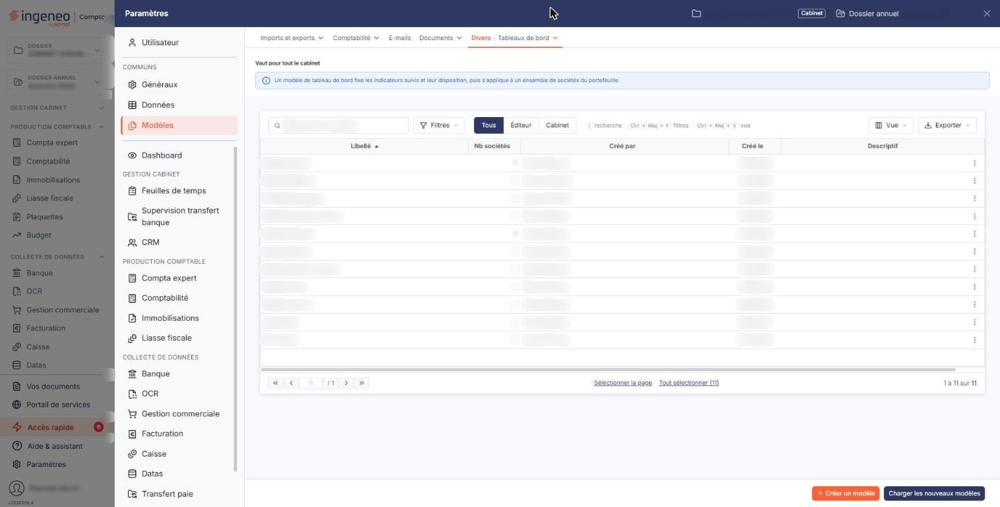
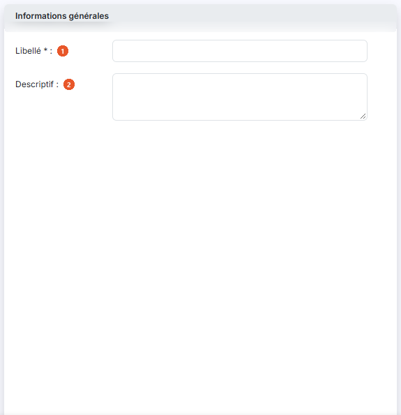
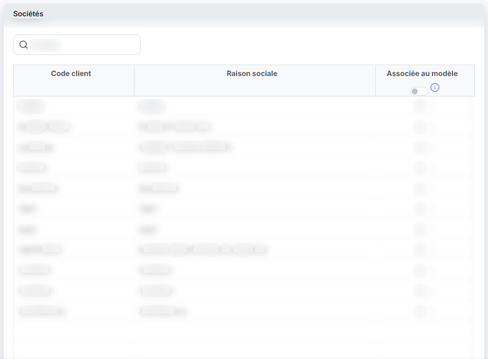
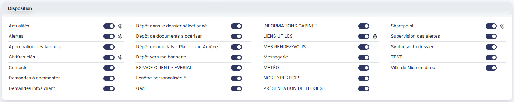
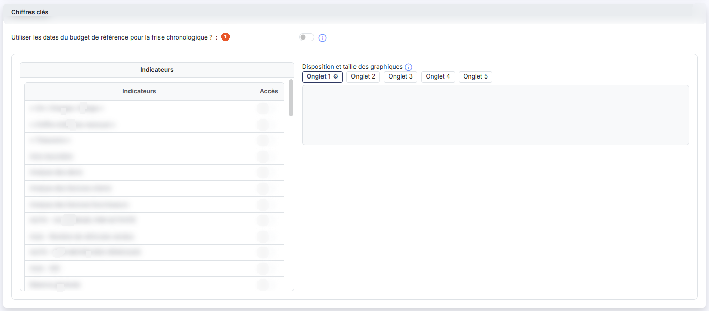

# Modèles


**Où le trouver :** Panneau **Paramètres**



**En bref** — Cet écran mémorise un paramétrage complet de tableau de bord sous forme de modèle, pour l'affecter à plusieurs sociétés gérées sans repartir de zéro.

* Pour créer un modèle : bouton \[Créer un modèle], saisissez le libellé, associez les sociétés, réglez fenêtres et chiffres clés, puis bouton \[Enregistrer].
* Pour charger les modèles mis en ligne par Ingeneo Compta : bouton \[Charger les nouveaux modèles], cochez ceux à charger, puis bouton \[Valider].


Les modèles de tableaux de bord permettent de mémoriser l'intégralité des paramétrages effectués pour le tableau de bord d'une société gérée puis de l'affecter à une ou plusieurs autres sociétés parce qu'elles ont, par exemple, la même activité.

<figure><figcaption>
Écran « Modèles » de la nouvelle interface
</figcaption></figure>

Les modèles évitent donc de repartir systématiquement de zéro pour établir le paramétrage d'une nouvelle société gérée.

Les modèles peuvent être créés de deux manières : soit directement dans le fichier modèle soit à l'aide de l'option « Enregistrer comme nouveau modèle » du Bouton \[Modèle], présent lors de la modification du paramétrage unitaire d'une société gérée. Au-dessus de la liste, trois boutons « Tous », « Éditeur » et « Cabinet » choisissent les modèles affichés : tous les modèles (choix proposé à l'ouverture), les seuls modèles livrés avec le logiciel, ou les seuls modèles créés par votre cabinet.

La grille présente, pour chaque modèle, son **Libellé**, le **Nb sociétés** auxquelles il est affecté, le nom de celui qui l'a créé (**Créé par**), sa date de création (**Créé le**) et son **Descriptif**. Chaque ligne propose, à droite, trois pictogrammes dont l'infobulle rappelle la fonction : le crayon « Modifier » pour ouvrir le modèle, les deux feuilles superposées « Dupliquer » pour en créer une copie et la corbeille « Supprimer » pour le supprimer.

Cliquez sur le Bouton \[Créer un modèle] pour créer un modèle. Pour en supprimer, cochez la case en tête des lignes concernées puis cliquez sur le Bouton \[Supprimer].

bouton **\[Charger les nouveaux modèles]**

Ce bouton permet de visualiser les nouveaux modèles mis en ligne par Ingeneo Compta ou les modèles existants qui ont été modifiés. Sélectionnez ceux que vous souhaitez charger à l'aide des boîtes à cocher et cliquez sur le Bouton \[Valider] ; le Bouton \[Annuler] referme la fenêtre sans rien charger.

## Rubrique "Informations générales"

<figure><figcaption>
Rubrique « Informations générales »
</figcaption></figure>

| Champ             | Ce qu'il faut savoir                                                                                           |
| ----------------- | -------------------------------------------------------------------------------------------------------------- |
| 1. **Libellé**    | C'est le libellé du modèle qui vous permettra de l'identifier dans la liste de tous ceux que vous allez créer. |
| 2. **Descriptif** | —                                                                                                              |

En modification, quatre informations de traçabilité s'ajoutent sous le descriptif : **Créé par**, **Date de création**, **Modifié par** et **Date de modification**.

## Rubrique "Sociétés"

<figure><figcaption>
Rubrique « Sociétés »
</figcaption></figure>

Ce tableau contient la liste de toutes les sociétés gérées, avec leur **Code client** et leur **Raison sociale**. Indiquez celles auxquelles vous souhaitez que le modèle en cours soit affecté en activant leur interrupteur **Associée au modèle** ; l'interrupteur placé dans l'en-tête de la colonne bascule toutes les lignes d'un seul geste. Pour retrouver une société, saisissez tout ou partie de son nom dans le champ **Société** placé au-dessus du tableau : le tableau se restreint au fil de la saisie.

## Rubrique "Disposition"

<figure><figcaption>
Rubrique « Disposition »
</figcaption></figure>

Cette rubrique fonctionne à l'identique que pour le paramétrage d'une société gérée. Reportez-vous à cette section de l'aide pour plus d'information.

Elle présente la liste des fenêtres, chacune avec un interrupteur qui commande son affichage ; en création, toutes les fenêtres proposées sont activées. La liste ne comprend que les fenêtres qui peuvent réellement s'afficher sur le tableau de bord : certaines fenêtres anciennes ou retirées de la nouvelle interface n'y figurent plus. L'emplacement des fenêtres sur la page d'accueil n'est plus choisi ici : il est fixé par le logiciel.

Pour certaines fenêtres, un pictogramme d'engrenage ouvre la configuration de la fenêtre : par exemple, pour la fenêtre "LIENS UTILES", la liste des liens de l'option "Liens" avec un interrupteur d'accès pour chacun. Pour la fenêtre "Chiffres clés", l'engrenage ne présente pas de fenêtre : son infobulle, « Aller à la configuration de «Chiffres clés». », l'annonce, il fait défiler la page jusqu'à la rubrique "Chiffres clés" décrite ci-dessous.

## Rubrique "Chiffres clés"

<figure><figcaption>
Rubrique « Chiffres clés »
</figcaption></figure>

Cette rubrique fonctionne à l'identique que pour le paramétrage d'une société gérée. Reportez-vous à cette section de l'aide pour plus d'information.

C'est ici que se configure le contenu de la fenêtre "Chiffres clés".

| Champ                                                                          | Ce qu'il faut savoir                                                                                                                                                                                                                                                                                  |
| ------------------------------------------------------------------------------ | ----------------------------------------------------------------------------------------------------------------------------------------------------------------------------------------------------------------------------------------------------------------------------------------------------- |
| 1. **Utiliser les dates du budget de référence pour la frise chronologique ?** | 
"Si vous choisissez « Oui » les bornes de dates de la frise chronologique seront celle du budget de référence. Si vous choisissez « Non » ou qu'il n'existe pas de budget de référence, les dates seront celles de la période de saisie du dossier annuel." Puis deux tableaux côte à côte.
 |
| **Indicateurs**                                                                | La liste des indicateurs que le logiciel sait présenter, chacun avec son interrupteur **Accès**. Dès que vous activez l'interrupteur d'un indicateur, sa vignette s'ajoute au tableau de droite.                                                                                                      |
| **Disposition et taille des graphiques**                                       | "Vous pouvez déplacer les graphiques à l'aide de la souris et changer leur taille en faisant glisser le bord latéral droit ou le bord inférieur." Les indicateurs retenus se répartissent sur cinq onglets.                                                                                           |

Cliquez sur le Bouton \[Enregistrer] pour valider le modèle, ou sur le chevron « Retour », à gauche de la barre d'onglets du panneau, pour abandonner.
