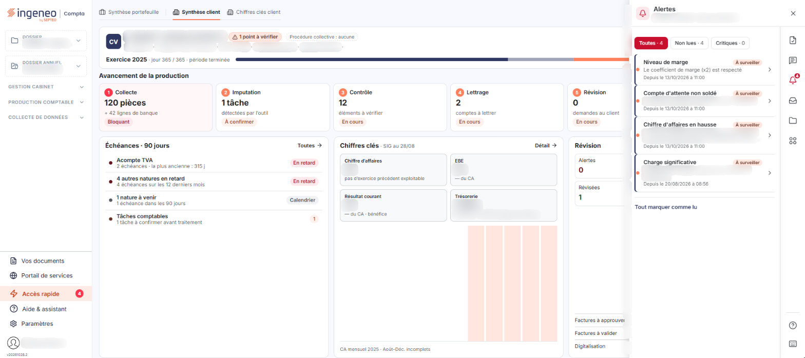
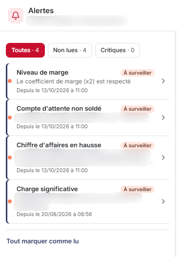
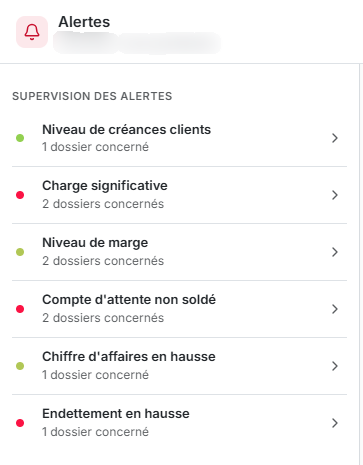

# Alertes


**Où le trouver :** **Tableau de bord** › panneau **Accès rapide**



**En bref** — Cet onglet du panneau « Aide & assistant » liste les alertes en cours sur le dossier, ou, sur la synthèse portefeuille, le nombre de dossiers concernés par type d'alerte.

* Pour afficher les alertes : cliquez sur le pictogramme « Alertes » du rail d'accès rapide du panneau.
* Pour restreindre la liste : choisissez « Toutes », « Non lues » ou « Critiques » dans le filtre au-dessus de la liste.
* Pour passer toutes les alertes en lues : bouton \[Tout marquer comme lu].


Le contenu de l'onglet dépend de l'onglet du tableau de bord qui est affiché lorsque vous ouvrez le panneau : « Synthèse client » ou « Synthèse portefeuille ».

<figure><figcaption>
Écran « Alertes » de la nouvelle interface
</figcaption></figure>

**Sur « Synthèse client »**, l'onglet présente les alertes du dossier en cours. Il porte le titre « Alertes », suivi de la mention « Dossier » et du nom du dossier. Au-dessus de la liste, un filtre propose trois choix, « Toutes », « Non lues » et « Critiques », qui indiquent chacun le nombre d'alertes qu'ils retiennent, par exemple « Toutes · 4 ». La liste affiche une ligne par alerte en cours. Chaque ligne comporte :

* l'intitulé de l'alerte, par exemple « Compte d'attente non soldé » ou « Endettement en hausse »,
* une étiquette qui donne la gravité de l'alerte, par exemple « À surveiller »,
* la date depuis laquelle l'alerte est en cours, sous la forme « Depuis le 20/08/2026 à 08:56 »,
* un texte explicatif, qui reprend les montants et les décomptes calculés par le logiciel.

L'onglet propose également le bouton \[Tout marquer comme lu].

**Sur « Synthèse portefeuille »**, l'onglet porte le titre « Alertes » et la mention « Périmètre : mon portefeuille ». Il ne présente plus les alertes d'un seul dossier, mais la liste « Supervision des alertes » : une ligne par type d'alerte, qui indique le nombre de dossiers concernés, par exemple « Compte d'attente non soldé » et « 2 dossiers concernés ». Chaque ligne porte une pastille de gravité et un chevron, et elle est cliquable.

Lorsque le dossier en cours n'a aucune alerte en cours, le logiciel affiche le message « Aucune alerte sur ce dossier. ».

L'onglet vous signale la situation ; pour la traiter, ouvrez l'écran concerné par le menu du module qui le porte.

## Autres vues de l'écran

<figure><figcaption>
Ce que présente l'onglet
</figcaption></figure>

<figure><figcaption>
Ce que présente l'onglet
</figcaption></figure>
