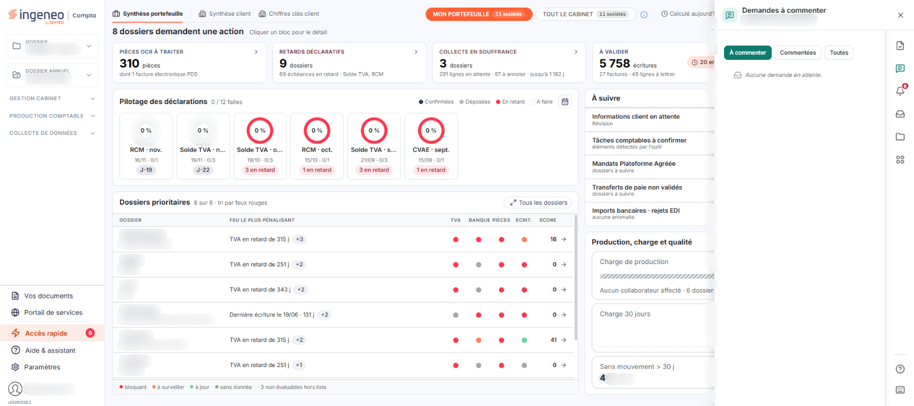
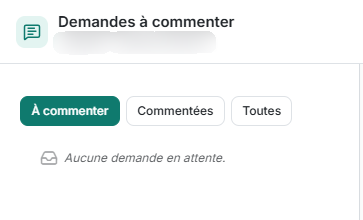

# Demandes à commenter – Présentation


**Où le trouver :** **Tableau de bord** › panneau **Accès rapide**



**En bref** — Cet onglet, utile en usage collaboratif avec le cabinet, présente les lignes d'écriture pour lesquelles une information complémentaire est demandée au client.

* Pour choisir les lignes affichées : cliquez sur « À commenter », « Commentées » ou « Toutes » au-dessus de la liste.
* Pour inclure les écritures déjà lettrées : positionnez l'interrupteur « Avec les écritures lettrées » sur « Oui ».


Cet onglet n'est utile que dans le cadre d'une utilisation collaborative entre un cabinet d'expertise comptable et ses clients.

<figure><figcaption>
Écran « Présentation » de la nouvelle interface
</figcaption></figure>

C'est l'onglet « Demandes à commenter » du panneau « Accès rapide », qui s'ouvre à droite du tableau de bord ; il ne se trouve pas dans le menu d'un module. Pour l'afficher, cliquez sur le pictogramme « Demandes à commenter » du rail d'accès rapide du panneau. Le sous-titre de l'onglet rappelle la société sur laquelle vous êtes positionné et le nombre de demandes en attente, par exemple « 0 en attente ».

**À quoi sert cet onglet**

Lorsque le cabinet a besoin d'une information complémentaire sur une ligne d'écriture, il enregistre sur cette ligne un commentaire qui décrit sa demande. La ligne apparaît alors dans cet onglet, où le client la retrouve, répond à son tour par un commentaire et peut rattacher un document à la ligne.

Lorsque l'échange est terminé, les lignes peuvent être retirées de l'onglet. La manipulation de l'onglet est décrite dans la sous-option « Utilisation ».

**Ce que présente l'onglet**

L'onglet présente la liste des lignes d'écriture pour lesquelles une demande d'information a été enregistrée.

**Choisir les lignes affichées**

Les lignes affichées se choisissent au-dessus de la liste :

**Filtrer les demandes**

Trois boutons, dont un seul est actif à la fois : « À commenter », actif à l'ouverture de l'onglet, « Commentées » et « Toutes ». Leur infobulle commune est « Filtrer les demandes ».

## Autres vues de l'écran

<figure><figcaption>
lignes affichées
</figcaption></figure>
