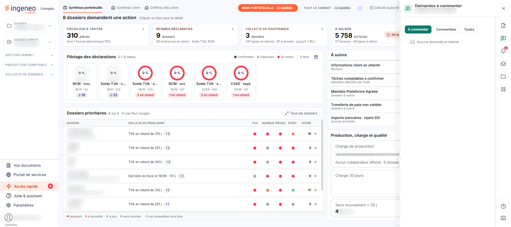
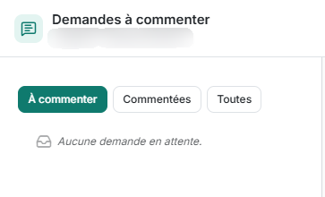

# Demandes à commenter – Utilisation


**Où le trouver :** **Tableau de bord** › panneau **Accès rapide**



**En bref** — Cet onglet liste les lignes d'écriture sur lesquelles votre cabinet demande une information : vous y répondez par un commentaire et pouvez joindre la pièce demandée.

* Pour répondre à une demande : pictogramme « Bulle » de la ligne, saisissez le « Nouveau commentaire », puis bouton \[Enregistrer et fermer].
* Pour commenter plusieurs lignes à la fois : cochez-en au moins deux, puis bouton \[Modification groupée].
* Pour clore l'échange : cochez les lignes, bouton \[Retirer], puis confirmez ; le retrait vaut pour tous les utilisateurs.


Cet onglet du panneau « Accès rapide » de Vision présente les lignes d'écriture pour lesquelles votre cabinet vous demande une information complémentaire : il vous permet de lui répondre par un commentaire et de joindre la pièce demandée.

<figure><figcaption>
Écran « Utilisation » de la nouvelle interface
</figcaption></figure>

C'est l'onglet « Demandes à commenter » : pour l'afficher, cliquez sur le pictogramme « Demandes à commenter » du rail d'accès rapide du panneau, qui s'ouvre à droite du tableau de bord. Sa présence dépend du paramétrage : il correspond au type de fenêtre « Demandes infos client ».

## Choisir les lignes affichées

<figure><figcaption>
Rubrique « lignes affichées »
</figcaption></figure>

Les lignes présentées se choisissent au-dessus de la liste.

**Filtrer les demandes** : trois boutons, dont un seul est actif à la fois, « À commenter », actif à l'ouverture de l'onglet, « Commentées » et « Toutes ». Le choix « Toutes » affiche les lignes d'écriture pour lesquelles le cabinet a demandé une information complémentaire dans un commentaire ; le choix « À commenter » n'affiche que les lignes dont le commentaire n'a pas encore été renseigné par le client.
