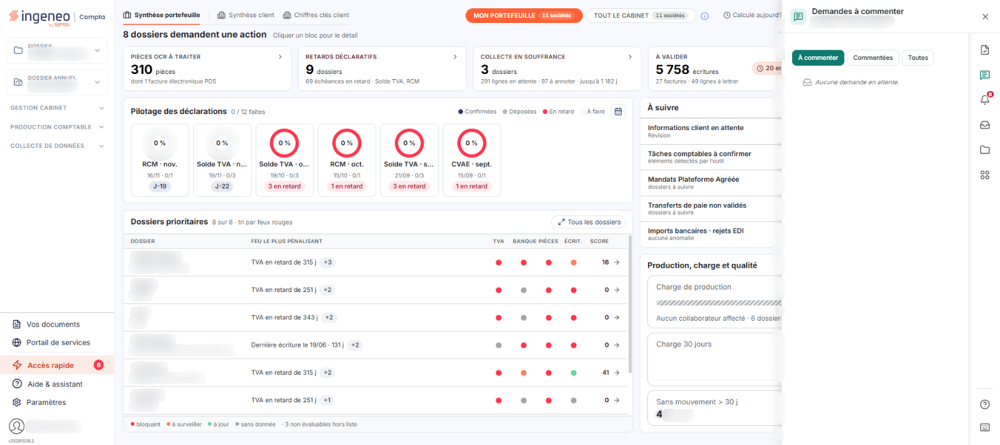
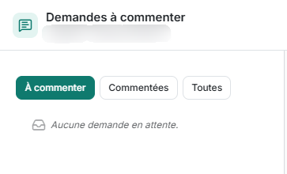

# Demandes informations client


**Où le trouver :** **Tableau de bord** › panneau **Accès rapide**



**En bref** — Cet onglet « Demandes à commenter » présente les lignes d'écriture sur lesquelles votre cabinet a demandé une information complémentaire, avec leur commentaire.

* Pour voir les lignes déjà traitées : choisissez « Commentées » ou « Toutes » au-dessus de la liste.
* Pour commenter plusieurs lignes : cochez-en au moins deux, puis bouton \[Modification groupée].
* Pour retirer des lignes : cochez-les, puis bouton \[Retirer] ; il n'est proposé que si votre cabinet l'a prévu.


Cet onglet du panneau « Accès rapide » présente les lignes d'écriture sur lesquelles votre cabinet a demandé une information complémentaire, en enregistrant un commentaire sur la ligne.

<figure><figcaption>
Écran « Demandes informations client » de la nouvelle interface
</figcaption></figure>

Il n'a pas d'option de menu : vous l'atteignez par le pictogramme « Demandes à commenter » du rail d'accès rapide du panneau, qui s'ouvre à droite du tableau de bord. Il porte le titre « Demandes à commenter » ; son sous-titre rappelle la société et le nombre de demandes en attente, par exemple « 0 en attente ».

## Le choix des lignes affichées

<figure><figcaption>
Rubrique « lignes affichées »
</figcaption></figure>

Les lignes affichées se choisissent au-dessus de la liste.

**Filtrer les demandes** : trois choix, dont un seul est actif à la fois : « À commenter », actif à l'ouverture de l'onglet, « Commentées » et « Toutes ». Le choix « Toutes » affiche les lignes d'écriture pour lesquelles le cabinet a demandé une information complémentaire dans un commentaire ; le choix « À commenter » n'affiche que les lignes dont le commentaire n'a pas encore été renseigné par le client.

## Ce que la liste présente

Tant qu'aucune demande n'est en attente sur votre dossier, et que le choix « À commenter » est actif, l'onglet affiche « Aucune demande en attente. ».
