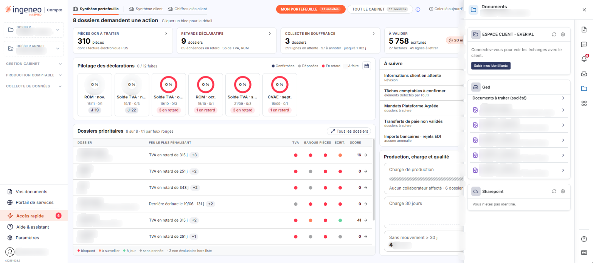
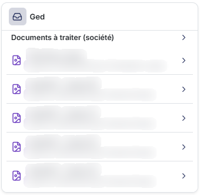
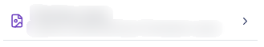
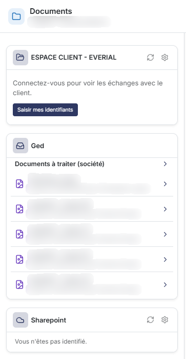

# Documents


**Où le trouver :** **Tableau de bord** › panneau **Accès rapide**



**En bref** — Cet onglet du panneau « Aide & assistant » liste les documents de la bannette de la société à classer, et propose les cartes « Espace client - Everial » et « Sharepoint ».

* Pour afficher les documents : cliquez sur le pictogramme « Documents » du rail d'accès rapide du panneau « Aide & assistant ».
* Pour ouvrir un document dans la GED : cliquez sur sa ligne, d'infobulle « Consulter le document dans la GED ».
* Pour voir les échanges avec le client : dans la carte « Espace client - Everial », bouton \[Saisir mes identifiants].


## La rubrique « Documents à traiter (société) »

<figure><figcaption>
Écran « Documents » de la nouvelle interface
</figcaption></figure>

<figure><figcaption>
Rubrique « La rubrique « Documents à traiter (société) » »
</figcaption></figure>

Cette rubrique présente les documents figurant dans la bannette de la société, visibles de tous les utilisateurs qui disposent des droits d'accès.

La rubrique se présente sous la forme d'une ligne repliable, marquée d'un chevron, sous laquelle les documents sont listés.

## Une ligne de document

<figure><figcaption>
Rubrique « Une ligne de document »
</figcaption></figure>

<figure><figcaption>
Rubrique « Les deux autres cartes »
</figcaption></figure>

Chaque ligne se compose de quatre éléments :

* le libellé du document, en gras. À défaut de libellé, le logiciel reprend le nom du fichier ;
* une ligne d'information rappelant la date d'intégration du document et son auteur, sous la forme « Ajouté le … par … » ;
* un pictogramme qui indique le format du document, par exemple une image ;
* un pictogramme « Chevron », à droite de la ligne. La ligne porte l'infobulle « Consulter le document dans la GED » : cliquez dessus pour ouvrir le document dans le module « GED ».

La carte n'affiche que les premiers documents de la rubrique, et elle ne comporte pas de pagineur.

Lorsqu'aucun document n'est à présenter, la carte affiche à la place des lignes le texte « Aucun document à afficher ».

La carte « Ged » ne comporte aucun bouton, aucun filtre et aucun onglet.

**Les deux autres cartes**

La carte « Espace client - Everial » invite à se connecter : elle affiche « Connectez-vous pour voir les échanges avec le client. » et propose le bouton **\[Saisir mes identifiants]**. La carte « Sharepoint » affiche « Vous n'êtes pas identifié. ». Chacune de ces deux cartes porte, dans son en-tête, un pictogramme « Actualiser » et un pictogramme « Roue dentée ».
