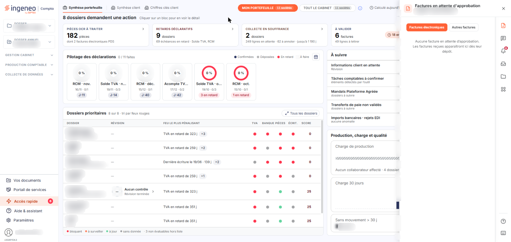
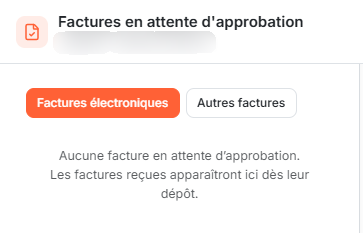
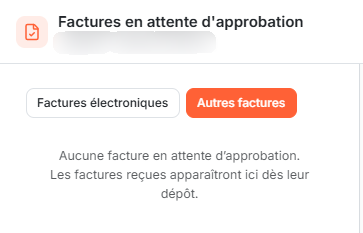

# Facture électronique


**Où le trouver :** **Tableau de bord** › panneau **Accès rapide**



**En bref** — Cet onglet contient les factures soumises à votre approbation, qu'elles soient électroniques ou non, avec leurs colonnes personnalisables et leurs actions groupées.

* Pour approuver plusieurs factures : cochez-les, puis bouton \[Approbation groupée].
* Pour changer de type de factures : choisissez « Factures électroniques » ou « Autres factures » ; le bouton \[Changer le statut] n'existe que sur « Factures électroniques ».
* Pour lire « Montant TTC » et « Statut » : pictogramme « Roue dentée », masquez ou réduisez des colonnes, puis bouton \[Appliquer].


Cet onglet du panneau « Accès rapide » contient les factures soumises à votre approbation.

<figure><figcaption>
Écran « Facture électronique » de la nouvelle interface
</figcaption></figure>

Il n'a pas d'option de menu : vous l'atteignez par le pictogramme « Factures en attente d'approbation » du rail d'accès rapide du panneau, qui s'ouvre à droite du tableau de bord.

## L'en-tête de l'onglet

<figure><figcaption>
Rubrique « L'en-tête de l'onglet »
</figcaption></figure>

L'onglet porte le titre « Factures en attente d'approbation ». Son sous-titre rappelle la société sur laquelle vous êtes positionné et le nombre de factures à approuver, par exemple « 0 à approuver ». La croix « Fermer le panneau » referme le panneau.

## Le choix des lignes à afficher

<figure><figcaption>
Rubrique « Le choix des lignes à afficher »
</figcaption></figure>

Au-dessus de la liste, un groupe de deux onglets, d'infobulle « Factures à afficher », vous propose deux choix, dont un seul est actif à la fois : « Factures électroniques », actif à l'ouverture, et « Autres factures ».

Le choix retenu ne change pas les colonnes de la liste. Il change en revanche les actions proposées : le bouton \[Changer le statut] n'est présent que sur le choix « Factures électroniques », et disparaît sur « Autres factures ».

## La liste des factures

La liste présente une facture par ligne. Cinq colonnes y sont affichées à l'ouverture : « Nom document », « Date réception », « Raison sociale émetteur », « Montant TTC » et « Statut ». Elles sont choisies dans un jeu d'une vingtaine de colonnes dont vous fixez vous-même la composition.

À l'ouverture, la liste est triée sur la colonne « Date réception », de la plus récente à la plus ancienne. Toutes les colonnes affichées sont triables : cliquez sur l'en-tête de l'une d'elles pour trier la liste dessus.

L'onglet est plus étroit que ce jeu de cinq colonnes : « Montant TTC » et « Statut » sont hors champ. Pour lire ces deux colonnes, masquez celles qui vous sont inutiles ou réduisez leur largeur, à l'aide de la personnalisation des colonnes décrite ci-dessous.

L'en-tête de la première colonne porte les commandes habituelles des grilles du logiciel : une case pour sélectionner toutes les lignes de la page affichée, une case pour étendre la sélection à toutes les pages, le pictogramme « Roue dentée », qui ouvre la personnalisation des colonnes, le pictogramme « Entonnoir », qui ouvre les filtres de la liste, et le pictogramme « Imprimante », qui imprime la liste.

## La personnalisation des colonnes

Le logiciel ouvre la fenêtre « Personnalisation de colonnes », qui présente la liste complète des colonnes disponibles. Pour chacune, un interrupteur indique si elle est visible et une zone de saisie porte sa largeur ; vous faites glisser les lignes de haut en bas pour changer l'ordre des colonnes.

La fenêtre se referme par l'un de ses trois boutons : bouton **\[Appliquer]**, bouton **\[Réinitialiser]** ou bouton **\[Annuler]**.

## Les actions

Les deux boutons du bas de l'onglet portent sur les factures que vous avez cochées dans la liste. Si vous n'en avez coché aucune, le logiciel affiche le message « Aucune ligne n'est sélectionnée, veuillez en choisir une s'il vous plaît. ».

bouton **\[Approbation groupée]**

Ce bouton vous est proposé quel que soit le choix retenu, « Factures électroniques » ou « Autres factures ».

bouton **\[Changer le statut]**

Ce bouton ne vous est proposé que lorsque le choix « Factures électroniques » est actif.
