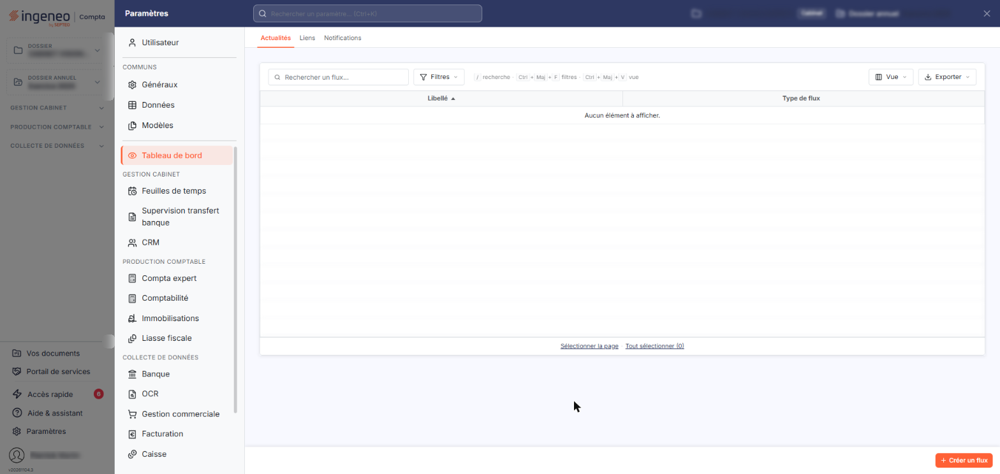
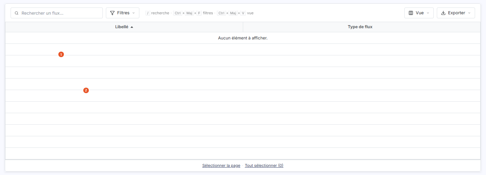
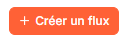
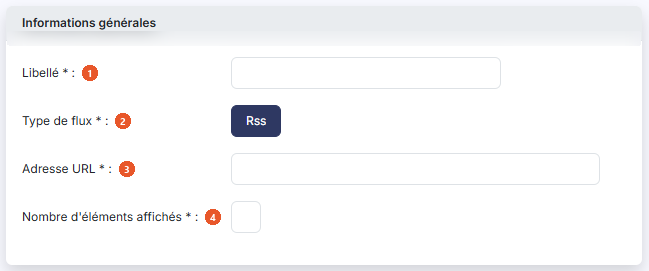
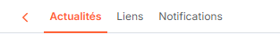

# Actualités – Paramétrage


**Où le trouver :** Panneau **Paramètres** › **Dashboard** › **Actualités**



**En bref** — Cet écran liste les flux d'actualités déclarés et permet d'en ajouter ou d'en supprimer ; ils alimentent le widget « Actualités » de l'onglet « Personnalisé ».

* Pour ajouter un flux : bouton \[Créer un flux], renseignez « Libellé », « Adresse URL » et « Nombre d'éléments affichés », puis bouton \[Enregistrer].
* Pour supprimer des flux : sélectionnez-les dans la liste, puis bouton \[Supprimer].
* Pour abandonner la saisie : chevron « Retour », qui ramène à la liste sans enregistrer.


Cet écran vous permet de constituer la liste des flux d'actualités dont les éléments sont présentés par le widget « Actualités » de l'onglet « Personnalisé » du panneau « Accès rapide ». Vous l'ouvrez par le panneau « Paramètres » (en bas de la barre latérale) : rubrique « Tableau de bord », onglet « Actualités ».

<figure><figcaption>
Écran « Actualités » de la nouvelle interface
</figcaption></figure>

Il se compose d'une seule grille, qui liste les flux déjà enregistrés. Au-dessus de la grille, la barre d'outils porte le champ « Rechercher un flux… » et les boutons \[Filtres], \[Vue] et \[Exporter].

## La liste des flux

<figure><figcaption>
Rubrique « La liste des flux »
</figcaption></figure>

<figure><figcaption>
Bouton [Créer un flux]
</figcaption></figure>

La grille comporte deux colonnes de données :

| Champ               | Ce qu'il faut savoir                |
| ------------------- | ----------------------------------- |
| 1. **Libellé**      | Le nom que vous avez donné au flux. |
| 2. **Type de flux** | La nature du flux.                  |

Le bouton \[Vue] permet de choisir les colonnes affichées. Le bas de la liste propose « Sélectionner la page » et « Tout sélectionner », qui étendent la sélection à la page affichée ou à toutes les lignes.

bouton **\[Créer un flux]**

Ce bouton, placé en bas à droite de l'écran, ouvre la fiche de création d'un flux, décrite ci-dessous.

bouton **\[Supprimer]**

Le logiciel supprime les flux que vous avez sélectionnés dans la liste.

## La fiche d'un flux

<figure><figcaption>
Rubrique « La fiche d'un flux »
</figcaption></figure>

<figure><figcaption>
Rubrique « Le chevron « Retour » »
</figcaption></figure>

La fiche ne comporte qu'une seule rubrique, « Informations générales », et quatre champs, tous obligatoires :

| Champ                             | Ce qu'il faut savoir                                                                    |
| --------------------------------- | --------------------------------------------------------------------------------------- |
| 1. **Libellé**                    | Il identifie le flux dans la liste.                                                     |
| 2. **Type de flux**               | Une seule valeur est proposée, « Rss », déjà sélectionnée à l'ouverture de la fiche.    |
| 3. **Adresse URL**                | Il s'agit de l'adresse du flux.                                                         |
| 4. **Nombre d'éléments affichés** | Il s'agit du nombre d'éléments de ce flux que la fenêtre de la page d'accueil présente. |

bouton **\[Enregistrer]**

Le logiciel enregistre le flux.

**Le chevron « Retour »**

Le chevron « Retour », dans la barre d'onglets du panneau « Paramètres », ramène à la liste sans enregistrer votre saisie.
