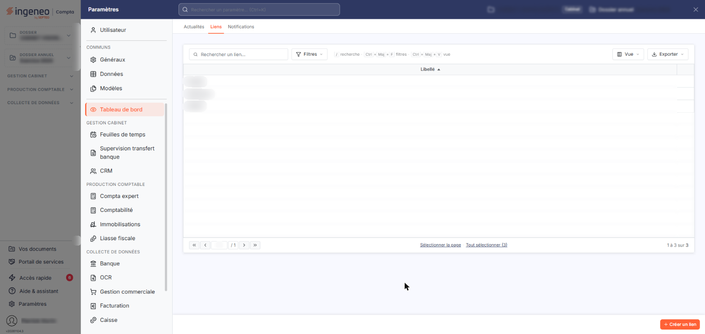
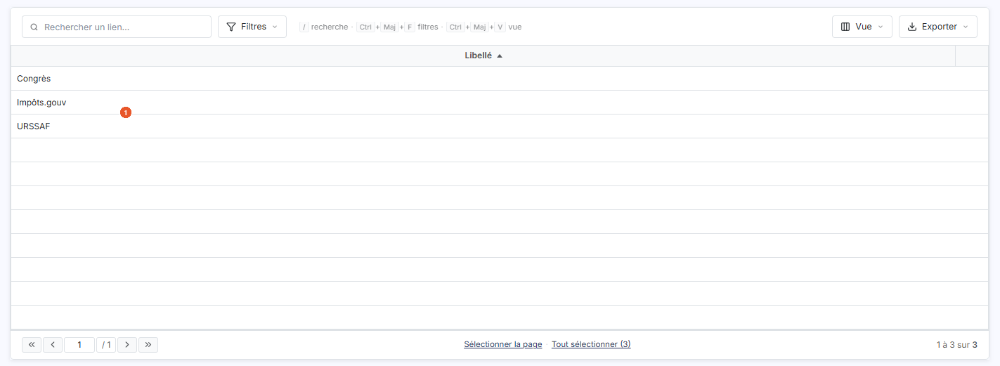
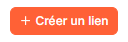
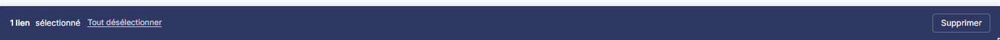
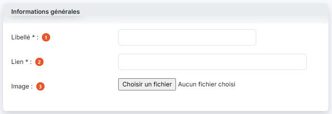
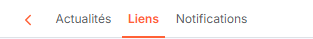

# Liens – Paramétrage


**Où le trouver :** Panneau **Paramètres** › **Dashboard** › **Liens**



**En bref** — Cet écran liste les liens vers des sites internet présentés dans le widget « Liens » et permet d'en créer ou d'en supprimer.

* Pour créer un lien : bouton \[Créer un lien], renseignez « Libellé » et « Lien » (obligatoires), « Image » (facultatif), puis bouton \[Enregistrer].
* Pour supprimer des liens : sélectionnez-les, puis bouton \[Supprimer] du bandeau de sélection ; seuls les liens que vous avez créés sont supprimables.
* Pour retrouver un lien : utilisez le champ « Rechercher un lien… » de la barre d'outils.


Cet écran vous permet de constituer la liste des liens vers des sites internet que le module Vision peut présenter dans un widget « Liens » de l'onglet « Personnalisé » du panneau « Accès rapide ».

<figure><figcaption>
Écran « Liens » de la nouvelle interface
</figcaption></figure>

Vous l'atteignez par le panneau « Paramètres » (en bas de la barre latérale) : rubrique « Tableau de bord », onglet « Liens ».

## La liste des liens

<figure><figcaption>
Rubrique « La liste des liens »
</figcaption></figure>

<figure><figcaption>
Bouton [Créer un lien]
</figcaption></figure>

<figure><figcaption>
Bouton [Supprimer]
</figcaption></figure>

L'écran est constitué de la seule grille des liens déjà enregistrés, sans rubrique au-dessus, mais avec sa barre d'outils : le champ « Rechercher un lien… » et les boutons \[Filtres], \[Vue] et \[Exporter]. Elle ne comporte qu'une colonne de données :

**Libellé** : le nom donné au lien. La grille est triée sur cette colonne.

La liste contient les liens que votre cabinet a mis en place pour votre société et ceux que vous avez créés vous-même. Les liens mis en place par votre cabinet sont en simple consultation : seuls les liens que vous avez créés vous-même peuvent être modifiés ou supprimés.

L'adresse du lien et son image ne sont pas reprises dans la liste : le libellé est la seule information affichée.

Le bouton \[Vue] permet de choisir les colonnes affichées. Un clic sur une ligne la sélectionne ; le bas de la liste propose « Sélectionner la page » et « Tout sélectionner », qui étendent la sélection. La dernière colonne de chaque ligne porte la commande « Autres actions » (trois points).

bouton **\[Créer un lien]**

Ce bouton, placé en bas à droite de l'écran, ouvre la fiche de création d'un lien, décrite ci-dessous.

bouton **\[Supprimer]**

Le logiciel supprime les liens que vous avez sélectionnés.

## La fiche de création d'un lien

<figure><figcaption>
Rubrique « La fiche de création d'un lien »
</figcaption></figure>

<figure><figcaption>
Rubrique « Le chevron « Retour » »
</figcaption></figure>

La fiche comporte une seule rubrique, « Informations générales », et trois champs :

| Champ          | Ce qu'il faut savoir                                                                                     |
| -------------- | -------------------------------------------------------------------------------------------------------- |
| 1. **Libellé** | Il identifie le lien dans la liste.                                                                      |
| 2. **Lien**    | C'est l'adresse du site vers lequel le lien conduit.                                                     |
| 3. **Image**   | Vous choisissez un fichier image sur votre poste, à l'aide du sélecteur de fichiers de votre navigateur. |

bouton **\[Enregistrer]**

Le logiciel enregistre le lien et vous ramène à la liste, où il apparaît désormais.

**Le chevron « Retour »**

Le chevron « Retour », dans la barre d'onglets du panneau « Paramètres », referme la fiche sans rien enregistrer et vous ramène à la liste.
