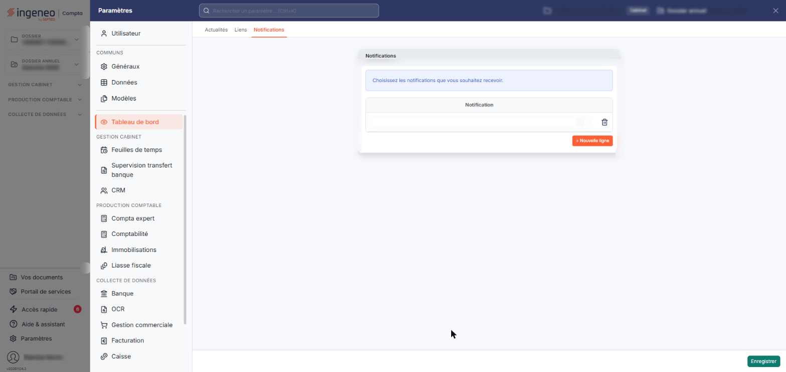
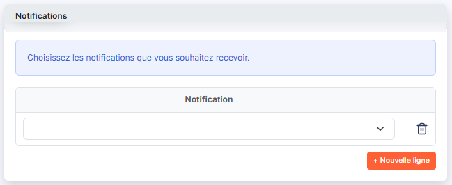
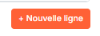

# Notifications


**Où le trouver :** Panneau **Paramètres** › **Dashboard** › **Notifications**



**En bref** — Cet écran vous permet de déclarer les notifications que vous souhaitez recevoir, par exemple les alertes levées sur votre dossier envoyées par courrier électronique.

* Pour déclarer une notification : bouton \[+ Nouvelle ligne], choisissez-la dans la liste « Notification », puis bouton \[Enregistrer].
* Pour retirer une notification : pictogramme « Corbeille » de sa ligne, sans confirmation.


Cet écran vous permet de constituer la liste des notifications que vous souhaitez recevoir.

<figure><figcaption>
Écran « Notifications » de la nouvelle interface
</figcaption></figure>

Vous l'atteignez par « Paramètres », en bas de la barre latérale : le panneau des paramètres s'ouvre, et vous choisissez la rubrique « Tableau de bord », puis l'onglet « Notifications ».

## La rubrique « Notifications »

<figure><figcaption>
Rubrique « La rubrique « Notifications » »
</figcaption></figure>

<figure><figcaption>
Bouton [+ Nouvelle ligne]
</figcaption></figure>

L'écran est constitué de cette seule rubrique, qui présente un tableau de saisie : vous y déclarez directement vos notifications, sans passer par une fiche. Il n'y a ni filtre, ni pagination, ni personnalisation des colonnes.

Tant que vous n'avez déclaré aucune notification, le tableau présente une ligne dont la liste déroulante est vide.

Le tableau comporte une colonne de données :

**Notification** : vous choisissez la notification dans une liste déroulante, qui présente les notifications proposées par le module en cours, ainsi qu'une entrée vide.

La notification « Alertes » vous inscrit à la réception, par courrier électronique, des alertes levées sur votre dossier dont le paramétrage prévoit un envoi par e-mail. Le logiciel les adresse à l'adresse électronique enregistrée sur votre fiche d'utilisateur.

À droite de la liste déroulante de chaque ligne, le pictogramme « Corbeille », dont l'infobulle est « Supprimer », retire la ligne du tableau, sans vous demander de confirmation.

Lorsque le tableau ne comporte plus qu'une seule ligne, ce pictogramme ne la retire pas : il vide seulement sa liste déroulante, et la ligne demeure affichée. Le tableau conserve ainsi toujours au moins une ligne.

bouton **\[+ Nouvelle ligne]**

Placé sous le tableau, dans la carte « Notifications », le bouton ajoute une ligne au tableau, avec sa propre liste déroulante. Vous pouvez ainsi déclarer plusieurs notifications à la suite.

bouton **\[Enregistrer]**

Le logiciel enregistre les notifications déclarées dans le tableau.

Ce bouton n'apparaît que si votre profil vous donne le droit d'enregistrer vos notifications.

C'est le seul bouton du pied de l'écran, en bas à droite.
