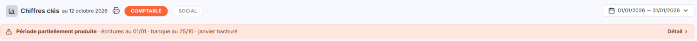
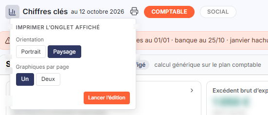
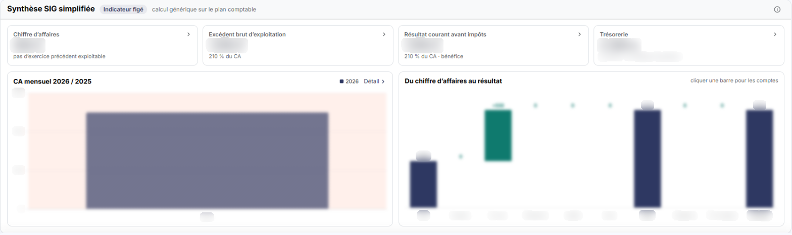
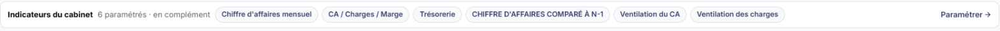

# Chiffres clés


**Où le trouver :** **Tableau de bord** (page d'accueil de la nouvelle interface)



**En bref** — Cet onglet affiche, sous forme de tuiles et de graphiques, la synthèse de gestion du dossier sélectionné et les indicateurs construits à partir des données de vos autres modules.

* Pour imprimer l'onglet : pictogramme « Imprimante », choisissez l'« Orientation » et les « Graphiques par page », puis bouton \[Lancer l'édition].
* Pour changer la période calculée : cliquez sur le bouton de période pour déplier la frise, puis déplacez ses deux poignées.
* Pour commenter un indicateur : pictogramme « Menu » du graphique, entrée « Commentaire », saisissez le texte, puis bouton \[Enregistrer].


Le module Vision présente ses chiffres clés dans l'onglet « Chiffres clés client » de son tableau de bord. Cet onglet affiche, sous forme de tuiles et de graphiques, une synthèse de gestion du dossier sélectionné et les indicateurs construits à partir des données de vos autres modules.

<figure><figcaption>
Écran « Présentation » de la nouvelle interface
</figcaption></figure>

Le choix des indicateurs du cabinet et leur disposition ne se font pas dans cet onglet ; la rubrique « Indicateurs du cabinet » porte d'ailleurs un lien « Paramétrer → ».

## La zone de titre

<figure><figcaption>
Rubrique « La zone de titre »
</figcaption></figure>

<figure><figcaption>
Rubrique « La zone de titre »
</figcaption></figure>

Le logiciel affiche, à la suite du titre de la fenêtre, la date de dernière mise à jour des données, sous la forme « au _jour mois année_ » : pour les indicateurs alimentés par la comptabilité, c'est la date de la dernière écriture créée ou modifiée. Cette date peut donc être antérieure à la date du jour.

À droite du titre figure un pictogramme « Imprimante », dont l'infobulle indique « Imprimer l’onglet affiché (PDF) ». Il ouvre, juste sous le pictogramme, un petit ticket « Imprimer l'onglet affiché », qui vous propose deux choix :

| Champ                   | Ce qu'il faut savoir                                      |
| ----------------------- | --------------------------------------------------------- |
| **Orientation**         | « Portrait » ou « Paysage » (choix retenu à l'ouverture). |
| **Graphiques par page** | « Un » (choix retenu à l'ouverture) ou « Deux ».          |

Le bouton **\[Lancer l'édition]**, en bas du ticket, lance l'impression ; le ticket n'a ni Bouton \[Valider] ni Bouton \[Annuler] : un clic à côté le referme.

## La frise chronologique

Sous le titre, un bouton de période rappelle la période sur laquelle les graphiques sont calculés, sous la forme « jj/mm/aaaa → jj/mm/aaaa ». La frise chronologique n'est plus affichée en permanence : elle se déplie lorsque vous cliquez sur ce bouton. C'est une bande portant une borne de date à chaque extrémité, l'année au centre, et deux poignées déplaçables à la souris.

C'est cette frise qui délimite la période sur laquelle les graphiques sont calculés. À l'ouverture, ses bornes correspondent à la période de saisie de votre dossier annuel.

## Les onglets

Les graphiques sont répartis sur des onglets, placés à droite du titre de la fenêtre (« COMPTABLE » et « SOCIAL » dans le dossier relevé), dont les noms sont ceux qui leur ont été donnés lors du paramétrage. Cliquez sur un onglet : le logiciel remplace entièrement la liste des graphiques affichés par ceux qui lui sont rattachés.

Un onglet auquel aucun graphique n'est rattaché n'apparaît pas dans cette fenêtre.

## L'en-tête d'un graphique

Chaque graphique porte son titre, et à droite de celui-ci jusqu'à trois pictogrammes.

Un pictogramme « Information » n'apparaît que si l'indicateur possède un descriptif. Survolez-le : le logiciel affiche ce descriptif, suivi du module d'origine des données, sous la forme « Source : Module … ».

Le pictogramme « Menu » ouvre un menu déroulant de quatre entrées, dans cet ordre : « Recharger », « Plein écran », « Imprimer » et « Commentaire ».

La dernière de ces entrées ouvre la fenêtre « Commentaire de l'indicateur ». Cette fenêtre rappelle la date et l'auteur de création et de modification du commentaire (« Créé le … par … · modifié le … par … »), puis présente la zone de saisie « Commentaire visible sur l'indicateur », dotée d'un compteur de caractères sur 1024. Elle se referme par le bouton **\[Enregistrer]**, le bouton **\[Supprimer]** ou le bouton **\[Annuler]**. Un commentaire est propre à un indicateur, pour une société et un dossier annuel donnés.

## Le corps d'un graphique

Selon le type de l'indicateur, le logiciel présente :

* un tracé, avec ses axes gradués et, sous lui, une légende associant une couleur à chaque série de données ;
* ou une valeur unique, précédée d'un sous-titre qui en précise la date.

Lorsque les données nécessaires au calcul font défaut, le graphique n'est pas tracé : le logiciel affiche à sa place, et à son emplacement habituel, le message « Impossible d'afficher ce graphique car il ne contient pas de données. ».

## La synthèse SIG

<figure><figcaption>
Rubrique « La synthèse SIG »
</figcaption></figure>

L'onglet comporte une rubrique « Synthèse SIG simplifiée », qui reprend les soldes intermédiaires de gestion. Elle porte la pastille « Indicateur figé », la mention « calcul générique sur le plan comptable » et un pictogramme « Information » dont l'infobulle indique « À propos de la synthèse SIG ».

Elle présente quatre tuiles : « Chiffre d’affaires », « Excédent brut d’exploitation », « Résultat courant avant impôts » et « Trésorerie ». Chaque tuile donne un montant et, en dessous, une précision : comparaison à l'exercice précédent, part du chiffre d'affaires ou date d'arrêté de la trésorerie.

Deux graphiques suivent : « CA mensuel », qui porte un lien « Détail », et « Du chiffre d’affaires au résultat », un graphique en cascade accompagné de l'indication « cliquer une barre pour les comptes ».

Un bandeau « Période partiellement produite » indique jusqu'à quelle date les écritures et la banque sont produites, et renvoie à un lien « Détail ».

## Les indicateurs du cabinet

<figure><figcaption>
Rubrique « Les indicateurs du cabinet »
</figcaption></figure>

La rubrique « Indicateurs du cabinet » indique le nombre d'indicateurs paramétrés, puis les nomme (par exemple « Trésorerie » ou « Ventilation du CA »), suivis d'un repère « + N autres ». Elle porte le lien « Paramétrer → ».
