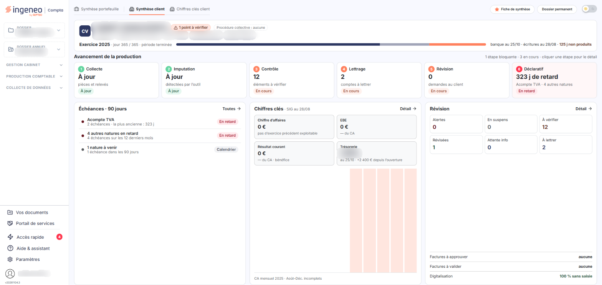
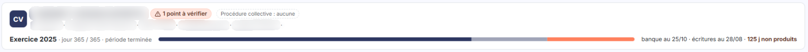

# Contacts


**Où le trouver :** **Tableau de bord** (page d'accueil de la nouvelle interface)



**En bref** — Cette page explique que le tableau de bord n'a plus de fenêtre « Contacts » et décrit à la place le bandeau d'identité du dossier, en tête de l'onglet « Synthèse client ».

* Pour identifier le dossier : ouvrez l'onglet « Synthèse client », dont le bandeau rappelle le nom, le code, le dirigeant, le code NAF et le capital.
* Pour suivre l'état de l'exercice : lisez le bouton d'exercice du bandeau et sa frise à trois segments.


Le bandeau présente :

<figure><figcaption>
Écran « Contacts » de la nouvelle interface
</figcaption></figure>

* une pastille portant les initiales du dossier, ou son logo s'il en possède un ;
* le nom du dossier, en titre ;
* un bouton qui indique le nombre de points à vérifier sur le dossier, par exemple « 1 point à vérifier » ;
* la mention « Procédure collective », suivie de l'état du dossier ;
* des puces qui rappellent le code du dossier, le dirigeant, le code NAF, le nombre d'établissements et le capital ;
* un bouton d'exercice, qui donne l'exercice, le jour atteint sur le nombre de jours de l'exercice et l'état de la période (par exemple « période terminée »). Il est suivi d'une frise de l'exercice à trois segments et des mentions « banque au … », « écritures au … » et du nombre de jours non produits.

Le bandeau ne comporte ni bouton de messagerie, ni bouton d'appel, ni adresse de courrier électronique : il décrit le dossier, pas les personnes qui le suivent.

## Autres vues de l'écran

<figure><figcaption>
Ce que présente le bandeau
</figcaption></figure>
