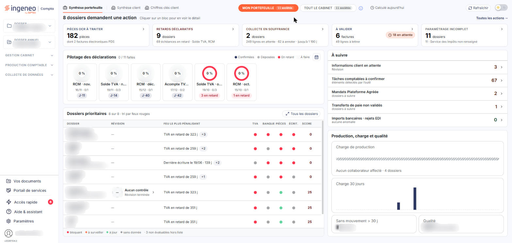
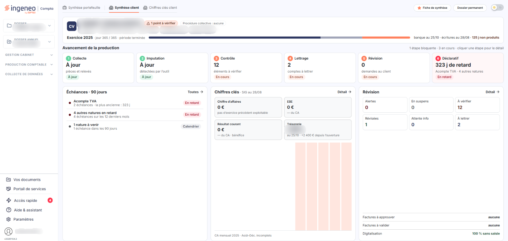
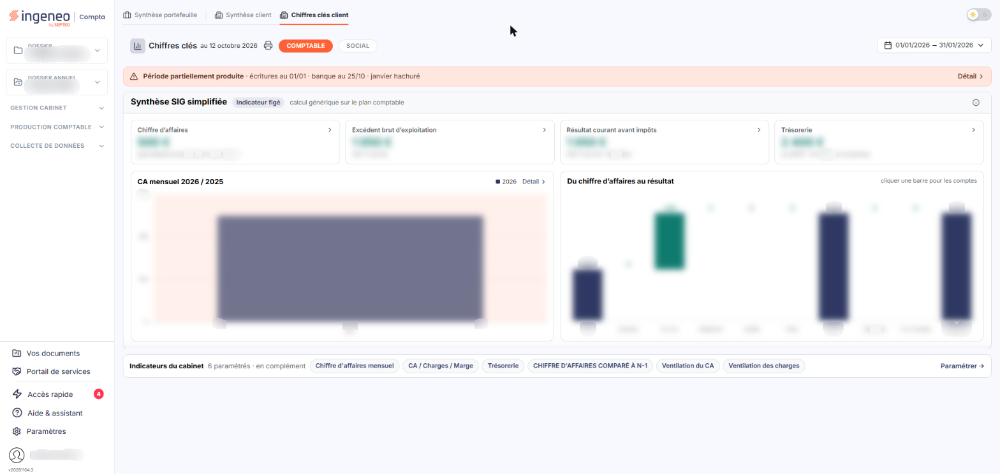
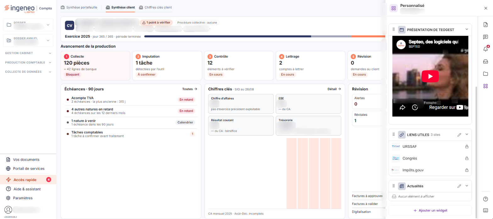

# Présentation générale


**Où le trouver :** **Tableau de bord** (page d'accueil de la nouvelle interface)



**En bref** — Cette page présente la page d'accueil de Vision, son tableau de bord : trois onglets de synthèse et le panneau « Accès rapide », qui regroupe alertes, documents et demandes.

* Pour revenir au tableau de bord : cliquez sur le pictogramme « Maison » de la barre supérieure, quel que soit le module.
* Pour changer de périmètre dans « Synthèse portefeuille » : choisissez « MON PORTEFEUILLE » ou « TOUT LE CABINET », puis bouton \[Rafraîchir].
* Pour consulter un dossier : sélectionnez-le dans l'en-tête, ouvrez « Synthèse client », puis bouton \[Fiche de synthèse] ou bouton \[Dossier permanent].


Vous ouvrez la page d'accueil en cliquant sur le pictogramme « Maison » de la barre supérieure, quel que soit le module dans lequel vous vous trouvez.

<figure><figcaption>
Écran « Présentation générale » de la nouvelle interface
</figcaption></figure>

Cette page est composée de trois **onglets** : « Synthèse portefeuille », « Synthèse client » et « Chiffres clés client ». À sa droite, le panneau « Accès rapide », que vous ouvrez par son rail, regroupe les alertes, les documents, les widgets personnalisés, les demandes à commenter et les factures en attente d'approbation.

**Synthèse portefeuille.** Cet onglet porte sur l'ensemble de votre portefeuille. La barre d'onglets porte, à droite, deux boutons radio, « MON PORTEFEUILLE » et « TOUT LE CABINET », chacun suivi du nombre de sociétés, puis la mention « Calculé aujourd’hui » et le bouton **\[Rafraîchir]**. L'onglet s'ouvre sur le bloc « … dossiers demandent une action », composé de cinq tuiles : « Pièces OCR à traiter », « Retards déclaratifs », « Collecte en souffrance », « À valider » et « Paramétrage incomplet » ; le texte « Cliquer sur un bloc pour en voir le détail » précise leur usage, et le lien « Toutes les actions → » les regroupe. Viennent ensuite « Pilotage des déclarations » (les campagnes de déclaration, avec leur échéance et leur avancement, et une légende Confirmées, Déposées, En retard, À faire), « Dossiers prioritaires » (un tableau aux colonnes Dossier, Révision, Feu le plus pénalisant, TVA, Banque, Pièces, Écrit. et Score, avec le lien « Tous les dossiers » ; la colonne Révision affiche « — » quand aucun dossier de révision n'est en cours, sinon un anneau et l'état du contrôle, par exemple « Aucun contrôle / Révision terminée » ; la ligne elle-même n'est plus cliquable : le code et la raison sociale du dossier, et chaque pastille, sont des liens distincts), « À suivre » et « Production, charge et qualité ».

**Synthèse client.** Cet onglet porte sur le dossier sélectionné dans l'en-tête. Il s'ouvre sur un bandeau d'identité du dossier (voir la page « Contacts »). La barre d'onglets porte, à droite, le bouton **\[Fiche de synthèse]** et le bouton **\[Dossier permanent]**. L'onglet présente « Avancement de la production », en six étapes : Collecte, Imputation, Contrôle, Lettrage, Révision et Déclaratif, puis trois cartes : « Échéances · 90 jours », « Chiffres clés » et « Révision ».

**Chiffres clés client.** Cet onglet présente les chiffres clés du dossier sélectionné : il est décrit à la page « Chiffres clés ».

Le panneau s'ouvre à droite du tableau de bord, par son rail. Ses onglets sont notamment « Alertes », « Documents », « Personnalisé », « Demandes à commenter » et « Factures en attente d'approbation ». Plusieurs font l'objet d'une page d'aide : voir les pages « Alertes », « Documents », « Liens », « Actualités », « Demandes d'informations client » et « Facture électronique ».

L'emplacement et l'intitulé des blocs ne se règlent plus : ils sont identiques pour tous les utilisateurs. En revanche, certains blocs peuvent être absents de votre tableau de bord selon votre profil, vos droits ou le dossier sélectionné : un bloc décrit dans cette aide peut donc ne pas figurer chez vous.

Les réglages propres à Connect se font dans le panneau Paramètres, rubrique « Tableau de bord » : « Actualités », « Liens » et « Notifications ».

Le tableau de bord ne présente plus vos modules sous forme de liste ou de tuiles : vous y accédez par la barre latérale. Le module n'a pas de barre de menus.

## Autres vues de l'écran

<figure><figcaption>
Les trois onglets
</figcaption></figure>

<figure><figcaption>
Les trois onglets
</figcaption></figure>

<figure><figcaption>
Le panneau « Aide &#x26; assistant »
</figcaption></figure>
