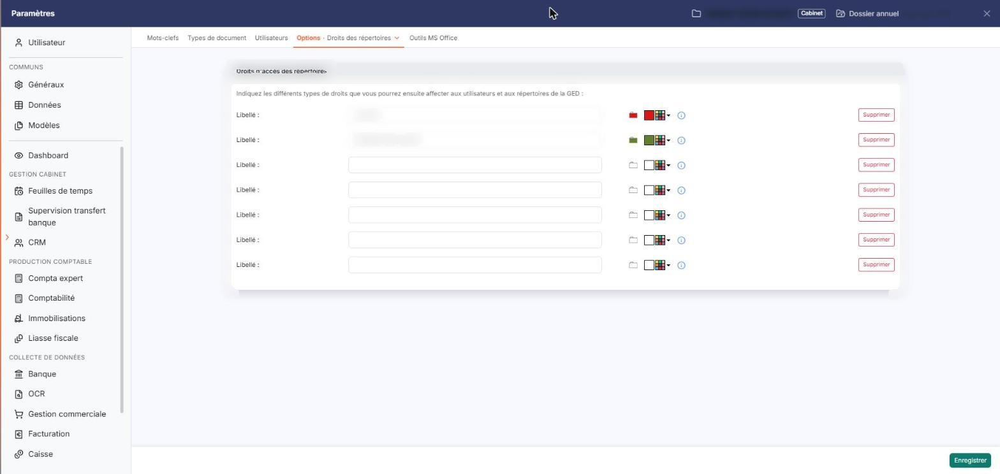
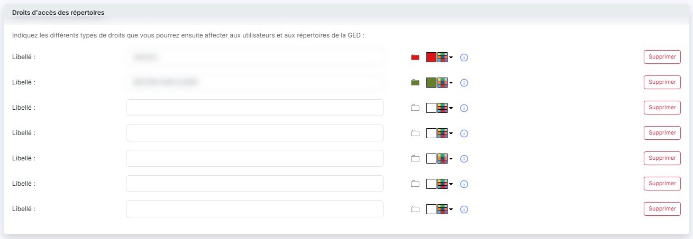

# Droits des répertoires


**En bref** — Cet écran définit, avec une couleur chacun, les droits d'accès (sept au maximum) que vous affectez ensuite aux répertoires et aux utilisateurs de la GED.

* Pour créer un droit : renseignez le « Libellé » d'une ligne vide, choisissez sa couleur par le bouton palette « Personnaliser la couleur », puis bouton \[Enregistrer].
* Pour retirer un droit : bouton \[Supprimer] de sa ligne, puis bouton \[Oui] dans la fenêtre « Confirmation » ; l'enregistrement est alors immédiat.
* Pour donner ce droit à un utilisateur : ouvrez « Paramètres > Vos documents > Utilisateurs ».


Cette option vous permet de définir les droits d'accès que vous affecterez ensuite aux utilisateurs et aux répertoires de la GED : un répertoire porteur d'un droit n'est visible que des utilisateurs auxquels ce droit a été accordé. L'affectation d'un droit à un utilisateur se fait dans « Paramètres > Vos documents > Utilisateurs ».

<figure><figcaption>
Écran « Droits des répertoires » de la nouvelle interface
</figcaption></figure>

Chaque droit reçoit également une couleur, qui teinte le pictogramme des répertoires porteurs de ce droit : c'est votre repère visuel dans l'arborescence de l'option "Dossiers clients".

Le logiciel présente une rubrique unique, "Droits d'accès des répertoires", introduite par la phrase « Indiquez les différents types de droits que vous pourrez ensuite affecter aux utilisateurs et aux répertoires de la GED : », puis une pile de sept lignes identiques. Les droits déjà enregistrés occupent les premières lignes ; les lignes suivantes sont vides et restent à votre disposition. Vous disposez donc au maximum de sept droits.

## Composition d'une ligne

<figure><figcaption>
Rubrique « Composition d'une ligne »
</figcaption></figure>

Toutes les lignes se présentent de la même façon, qu'elles soient renseignées ou vides. De gauche à droite :

## Créer un droit

<figure><figcaption>
Rubrique « Créer un droit »
</figcaption></figure>

<figure><figcaption>
Bouton [Enregistrer]
</figcaption></figure>

L'option ne comporte aucun bouton d'ajout : pour créer un droit, vous renseignez le libellé de l'une des lignes vides proposées, vous lui choisissez une couleur, puis vous enregistrez. Les autres utilisateurs de la GED ne reçoivent ce droit que si vous le leur affectez dans « Paramètres > Vos documents > Utilisateurs ».

Le libellé et la couleur vont de pair et ne se répètent pas d'un droit à l'autre : le logiciel refuse un libellé déjà utilisé, une couleur déjà utilisée, une couleur choisie sans libellé, ainsi que le blanc, qui est la couleur d'une ligne vide. Dans chacun de ces cas, un message s'affiche sous la ligne concernée et l'enregistrement n'est pas effectué — par exemple « Le blanc ne peut pas être sélectionné » ou « Un libellé est requis avec la couleur que vous avez choisi ».

bouton **\[Supprimer]**

Présent à la fin de chaque ligne, y compris des lignes vides, il retire le droit de la ligne.

Sur une ligne portant un droit enregistré, le logiciel ouvre une fenêtre "Confirmation" qui vous avertit que « Si vous confirmez cette suppression, les répertoires concernés deviendront immédiatement accessibles à tous les utilisateurs. » : la suppression retire en effet le droit des répertoires qui le portaient et des autorisations de tous les utilisateurs. Cette fenêtre vous propose deux commandes. Le bouton **\[Oui]** supprime le droit immédiatement et enregistre l'ensemble des lignes de l'option, sans que vous ayez à utiliser le bouton \[Enregistrer]. Le bouton **\[Non]** laisse la ligne en place.

bouton **\[Enregistrer]**

Seul bouton du pied de page, il enregistre l'ensemble des lignes de l'option, et non la seule que vous venez de modifier. Le logiciel confirme par le message « Vos modifications ont bien été enregistrées ».

Le bouton n'est proposé qu'aux utilisateurs auxquels le droit d'enregistrement des droits des répertoires a été accordé. Si vous ne l'avez pas, l'option reste consultable mais son pied de page est vide.
