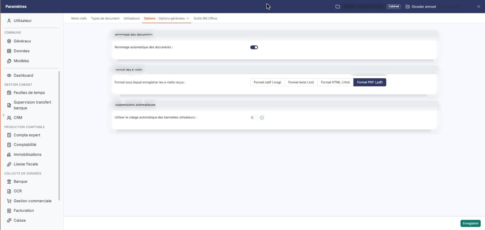
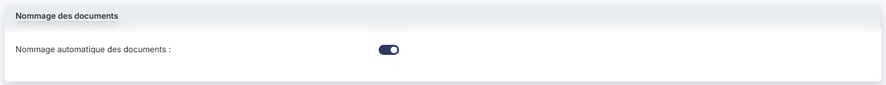
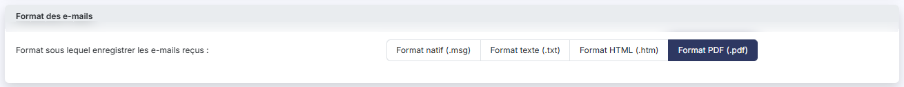
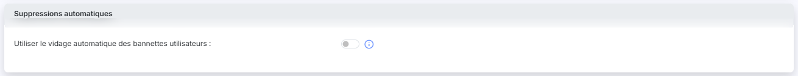
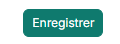
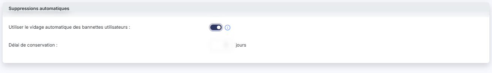

# Options générales


**En bref** — Cet écran règle, pour tout le cabinet, le nommage des documents, le format d'enregistrement des e-mails reçus et le vidage automatique des bannettes utilisateurs.

* Pour que le logiciel construise le nom des documents : activez « Nommage automatique des documents » (le libellé devient obligatoire), puis bouton \[Enregistrer].
* Pour choisir le format des e-mails reçus : retenez « Format natif (.msg) », « Format texte (.txt) », « Format HTML (.htm) » ou « Format PDF (.pdf) », puis bouton \[Enregistrer].
* Pour vider automatiquement les bannettes : activez « Utiliser le vidage automatique des bannettes utilisateurs », précisez le « Délai de conservation » en jours, puis bouton \[Enregistrer].


L'option « Options générales » vaut pour l'ensemble du cabinet et pour tous ses utilisateurs, par opposition à l'option « Options utilisateur », que chacun règle pour lui-même.

<figure><figcaption>
Écran « Options générales » de la nouvelle interface
</figcaption></figure>

Trois rubriques s'y affichent, dans cet ordre : « Nommage des documents », « Format des e-mails » et « Suppressions automatiques ».

**a) Rubrique « Nommage des documents »**

| Champ                                                         | Ce qu'il faut savoir                                                                                                                                                                                                                                                                                                                                                                                                  |
| ------------------------------------------------------------- | --------------------------------------------------------------------------------------------------------------------------------------------------------------------------------------------------------------------------------------------------------------------------------------------------------------------------------------------------------------------------------------------------------------------- |
| **Nommage automatique des documents**                         | 
Quand un document arrive dans la GED, son nom reprend par défaut le nom du fichier, sans son extension, et vous pouvez ensuite le modifier. Si vous activez cet interrupteur, le logiciel construit lui-même le nom de chaque document, à partir de la date du document, de son libellé et de sa référence. Le libellé devient alors obligatoire. <strong>b) Rubrique « Format des e-mails »</strong>
 |
| **Format sous lequel enregistrer les e-mails reçus**          | 
Un e-mail envoyé dans une bannette y devient un document. Ce choix commande le format sous lequel le logiciel enregistre ce document. Quatre formats vous sont proposés, et l'un d'eux est toujours retenu : « Format natif (.msg) », « Format texte (.txt) », « Format HTML (.htm) » et « Format PDF (.pdf) ». <strong>c) Rubrique « Suppressions automatiques »</strong>
                                  |
| **Utiliser le vidage automatique des bannettes utilisateurs** | Si vous répondez non, les documents reçus dans les bannettes utilisateurs sont conservés indéfiniment. Si vous répondez oui, les documents présents dans les bannettes utilisateurs ne seront conservés que durant un délai que vous devez préciser. Cette explication est également disponible dans l'infobulle, à droite de l'interrupteur.                                                                         |
| **Délai de conservation**                                     | Ce champ, exprimé en jours, ne s'affiche que lorsque l'interrupteur ci-dessus est activé. Si vous désactivez de nouveau cet interrupteur, le champ disparaît et le délai est ramené à zéro.                                                                                                                                                                                                                           |

bouton **\[Enregistrer]**

Enregistre les trois rubriques. C'est le seul bouton de l'option : il n'y a ni bouton de retour, ni bouton d'annulation.

## Autres vues de l'écran

<figure><figcaption>
Nommage des documents
</figcaption></figure>

<figure><figcaption>
Format des e-mails
</figcaption></figure>

<figure><figcaption>
Suppressions automatiques
</figcaption></figure>

<figure><figcaption>
Bouton [Enregistrer]
</figcaption></figure>

<figure><figcaption>
Suppressions automatiques
</figcaption></figure>
