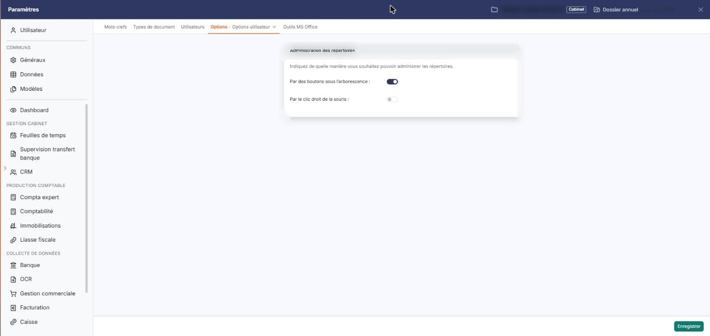
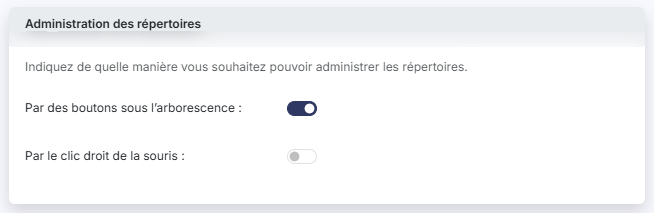
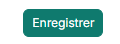

# Options utilisateur


**En bref** — Cet écran vous permet de choisir, pour vous seul, comment administrer les répertoires dans « Dossiers clients » : par des boutons sous l'arborescence, par le clic droit, ou par les deux.

* Pour afficher les commandes sous l'arborescence : activez l'interrupteur « Par des boutons sous l’arborescence », puis bouton \[Enregistrer].
* Pour les obtenir par un clic droit sur un répertoire : activez « Par le clic droit de la souris », puis bouton \[Enregistrer].


L'option « Options utilisateur » vous est propre : chaque utilisateur y règle son propre confort de travail, par opposition à l'option « Options générales », qui vaut pour tout le cabinet.

<figure><figcaption>
Écran « Options utilisateur » de la nouvelle interface
</figcaption></figure>

Une seule rubrique s'y affiche, « Administration des répertoires », précédée de la phrase « Indiquez de quelle manière vous souhaitez pouvoir administrer les répertoires. ».

**a) Rubrique « Administration des répertoires »**

Les deux interrupteurs sont indépendants : ce n'est pas l'un ou l'autre, vous pouvez activer les deux.

| Champ                                   | Ce qu'il faut savoir                                                      |
| --------------------------------------- | ------------------------------------------------------------------------- |
| **Par des boutons sous l’arborescence** | Tant que vous n'avez rien enregistré ici, cet interrupteur est activé.    |
| **Par le clic droit de la souris**      | Tant que vous n'avez rien enregistré ici, cet interrupteur est désactivé. |

bouton **\[Enregistrer]**

Enregistre votre choix. C'est le seul bouton de l'option : il n'y a ni bouton de retour, ni bouton d'annulation.

## Autres vues de l'écran

<figure><figcaption>
Administration des répertoires
</figcaption></figure>

<figure><figcaption>
Bouton [Enregistrer]
</figcaption></figure>
