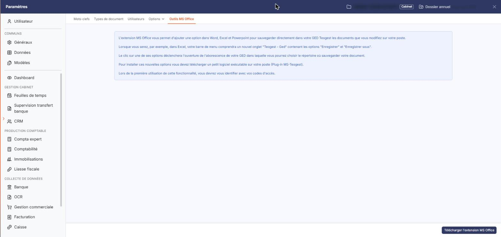

# Outils MS Office


**En bref** — Cet écran présente l'extension MS Office de la GED, qui permet d'enregistrer depuis Word, Excel ou PowerPoint un document directement dans votre GED, et la télécharge.

* Pour installer l'extension : bouton \[Télécharger l'extension MS Office], puis exécutez le fichier « Teogest\_Connecteur\_MS-Office.msi » sur votre poste.
* Pour envoyer un document dans la GED : dans l'onglet ajouté à Word, Excel ou PowerPoint, choisissez « Enregistrer » ou « Enregistrer sous », puis le répertoire de destination.


Cette option, qui s'ouvre dans le panneau Paramètres, rubrique « Vos documents », onglet « Outils MS Office », n'est pas un écran de saisie : elle vous présente l'extension MS Office de la GED et vous permet de la télécharger. Le logiciel affiche cinq paragraphes d'explication, et le pied de page porte un unique bouton.

<figure><figcaption>
Écran « Outils MS Office » de la nouvelle interface
</figcaption></figure>

L'extension ajoute dans Word, Excel et PowerPoint un onglet dont le nom reprend celui du logiciel, suivi de " - Ged", contenant les options "Enregistrer" et "Enregistrer sous" : elles vous permettent d'envoyer directement dans votre GED le document que vous êtes en train de modifier sur votre poste. Le clic sur l'une de ces options ouvre l'arborescence de votre GED, dans laquelle vous choisissez le répertoire où sauvegarder le document.

Pour en disposer, vous devez télécharger sur votre poste un logiciel exécutable, désigné à l'écran sous le nom "Plug-in MS-Ingeneo Compta", puis l'installer. Lors de la première utilisation de la fonctionnalité, vous devez vous identifier avec vos codes d'accès.

bouton **\[Télécharger l'extension MS Office]**

Seul bouton de l'option, il lance le téléchargement du programme d'installation de l'extension : un fichier d'installation Windows nommé "Teogest\_Connecteur\_MS-Office.msi". Vous l'exécutez ensuite sur votre poste et vous suivez la procédure d'installation. Le bouton n'est proposé qu'aux utilisateurs auxquels le droit de téléchargement de l'extension a été accordé.

## Autres vues de l'écran

<figure><figcaption>
Bouton [Télécharger l'extension MS Office]
</figcaption></figure>
