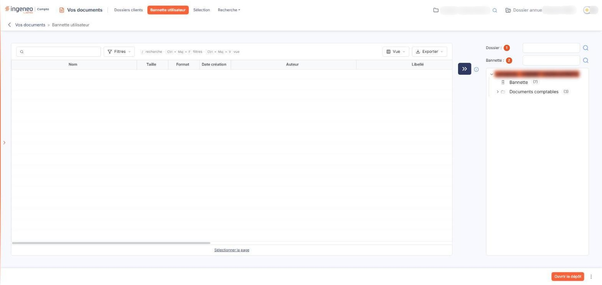
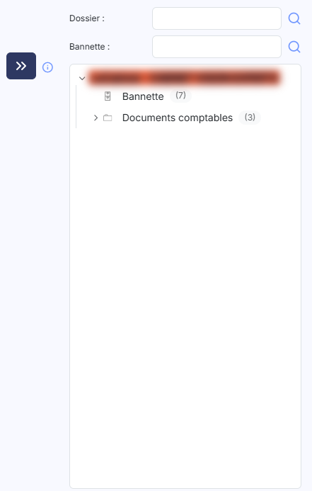
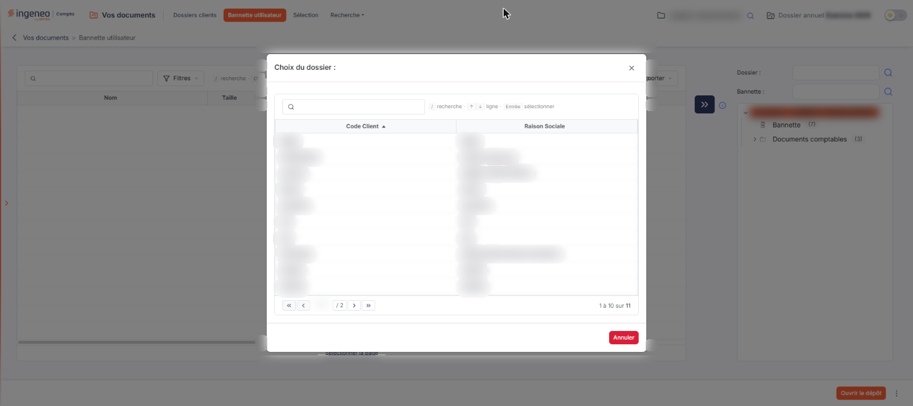

# Bannette utilisateur


**Où le trouver :** Menu **Bannette utilisateur**



**En bref** — Cet écran est votre espace de dépôt personnel : vous y chargez des documents, puis vous les classez dans l'arborescence d'un dossier ou les transmettez à la bannette d'un autre utilisateur.

* Pour classer des documents : cochez-les dans la liste de gauche, sélectionnez le dossier ou la bannette de destination à droite, puis cliquez sur la flèche bleu marine.
* Pour charger des fichiers dans votre bannette : bouton \[Téléchargement multiple] (zone de dépôt) ou bouton \[Téléchargement unitaire] (un seul fichier).
* Pour récupérer des documents en un fichier compressé : sélectionnez-les, bouton \[Extraire], renseignez le « Nom du fichier : », puis bouton \[Télécharger].


La bannette utilisateur est votre espace de dépôt personnel : vous y chargez des documents, puis vous les classez dans l'arborescence d'un dossier ou vous les transmettez à la bannette d'un autre utilisateur.

<figure><figcaption>
Écran « Bannette utilisateur » de la nouvelle interface
</figcaption></figure>

L'écran se lit en deux parties. À gauche, la liste des documents de votre bannette. À droite, l'arborescence de destination, c'est-à-dire l'endroit où vous voulez envoyer ces documents. Entre les deux, une **flèche bleu marine** à double chevron commande le transfert, et un pictogramme « Information » en rappelle la marche à suivre :

« Sélectionnez à gauche les documents de la bannette à l'aide des boîtes à cocher. Choisissez à droite un dossier ou la bannette d'un autre utilisateur. Cliquez sur la flèche pour transférer les documents de la bannette. »

La liste de gauche présente toujours les documents de **votre** bannette : choisir un nœud dans l'arborescence de droite ne la change pas, puisque cette arborescence ne sert qu'à désigner la destination du transfert. Tant que votre bannette est vide, la liste reste donc vide, y compris lorsqu'un nombre de documents figure à côté d'un nœud de l'arborescence : ce nombre compte les documents déjà rangés dans le répertoire du dossier, quel que soit l'utilisateur qui les y a mis, et non les documents de votre bannette.

## Le choix de la destination

<figure><figcaption>
Rubrique « Le choix de la destination »
</figcaption></figure>

Deux zones de saisie, placées au-dessus de l'arborescence, déterminent ce que celle-ci présente. Chacune porte un pictogramme « Loupe » et affiche l'indication « Rechercher... » tant qu'elle est vide.

| Champ           | Ce qu'il faut savoir                                                                                                                                                                       |
| --------------- | ------------------------------------------------------------------------------------------------------------------------------------------------------------------------------------------ |
| 1. **Dossier**  | Le dossier dont vous voulez voir l'arborescence. Saisissez les premiers caractères de son nom, ou cliquez sur la loupe pour ouvrir la fenêtre « Choix du dossier : » (voir la rubrique d). |
| 2. **Bannette** | L'utilisateur à la bannette duquel vous voulez transmettre les documents. Le logiciel propose les utilisateurs de la GED au fur et à mesure de votre saisie.                               |

Les deux zones s'excluent dans leur effet : l'arborescence de droite présente soit l'arborescence d'un dossier, soit la bannette de l'utilisateur choisi.

## La liste des documents de votre bannette

La liste présente, pour chaque document, son nom, sa taille, son format, sa date de création et son auteur, puis les informations de classement et de suivi : libellé, référence, date d'intégration et utilisateur qui l'a intégré, date de la dernière modification et utilisateur qui l'a modifiée, descriptif. Ces colonnes sont larges : selon la résolution de votre écran, vous atteignez les dernières en faisant défiler la liste horizontalement. Chaque colonne peut servir de critère de tri.

Tant que votre bannette ne contient aucun document, la liste affiche « Aucun élément à afficher. ».

**Rechercher un document…** : cette zone, placée au-dessus de la liste, à gauche, sert à ne conserver que les documents correspondant au texte saisi. Il n'y a plus de bouton \[Filtrer].

La barre placée au-dessus de la liste porte, à droite de la zone de recherche, le bouton bouton **\[Filtres]**, qui filtre la liste colonne par colonne, puis un rappel de raccourcis clavier (« / recherche », « Ctrl + Maj + F filtres », « Ctrl + Maj + V vue »), et, à droite, le bouton bouton **\[Vue]**, qui permet de choisir les colonnes affichées, et le bouton bouton **\[Exporter]**, qui édite la liste. Sous la liste, le lien « Sélectionner la page » sélectionne toutes les lignes de la page.

Chaque ligne porte ses propres pictogrammes de commande, décrits dans la page « Dossiers clients ». Ceux qui vous sont présentés dépendent de vos droits sur la GED : selon votre profil, l'aperçu, la duplication, le déplacement, l'envoi par courrier électronique ou la suppression peuvent ne pas vous être proposés.

## L'arborescence de destination

<figure><figcaption>
Rubrique « L'arborescence de destination »
</figcaption></figure>

L'arborescence s'ouvre sur la racine du dossier, qui est sélectionnée au chargement. Vous dépliez et repliez un niveau par le chevron placé à sa gauche.

Le nœud « Bannette » se distingue des répertoires par son pictogramme. Un nombre entre parenthèses suit certains libellés : c'est le nombre de documents rangés dans ce répertoire, sans ceux de ses sous-répertoires. Il n'apparaît pas lorsque le répertoire ne contient aucun document.

Sélectionnez le nœud de destination, sélectionnez les documents à transférer dans la liste de gauche, puis cliquez sur la flèche bleu marine.

## La fenêtre « Choix du dossier : »

<figure><figcaption>
Rubrique « La fenêtre « Choix du dossier : » »
</figcaption></figure>

Cette fenêtre présente les dossiers auxquels vous avez accès, avec leur code client et leur raison sociale. Le champ **Raison Sociale**, doté d'une loupe, restreint la liste au fur et à mesure de la saisie ; il n'y a plus de bouton \[Afficher]. La liste, présentée en deux colonnes « Code Client » et « Raison Sociale » avec sa pagination, affiche tous les dossiers dès l'ouverture de la fenêtre.

Cliquez sur une ligne pour retenir le dossier ; au-dessus de la liste, une aide rappelle les raccourcis (« / recherche · ↑ ↓ ligne · Entrée sélectionner »). Le bouton **\[Annuler]**, en bas de la fenêtre, et la croix du bandeau de titre referment la fenêtre sans rien retenir.

## Le pied de page et les commandes de la bannette

Dans la nouvelle interface, ces commandes ne sont plus dans une barre de boutons en bas de page : le pied de page ne porte plus que bouton **\[Ouvrir le dépôt]** et un bouton ⋮, présents même lorsque votre bannette est vide. Sur l'écran Dossiers clients, de même gabarit, elles figurent dans le bandeau de sélection qui apparaît quand une ligne est sélectionnée ; leur emplacement exact dans la bannette n'a pas pu être établi, la liste étant vide. Leurs libellés et leurs effets sont ceux d'avant la refonte. Chacun dépend d'un droit : selon votre profil, vous n'en voyez qu'une partie.

bouton **\[Téléchargement multiple]** — son libellé est précédé de deux chevrons. Il ouvre une zone de dépôt dans laquelle vous glissez les fichiers à charger dans votre bannette ; vous pouvez aussi cliquer dans cette zone pour ouvrir la fenêtre de choix des fichiers de votre poste. Deux boutons l'accompagnent : bouton **\[Vider]**, qui vide la zone de dépôt, et bouton **\[Annuler]**, qui la referme.

bouton **\[Téléchargement unitaire]** — charge un seul fichier, choisi sur votre poste.

bouton **\[Transférer]** — transfère les documents sélectionnés vers la destination retenue à droite.

bouton **\[Extraire]** — ouvre la fenêtre « Extraction », qui rassemble les documents sélectionnés dans un fichier compressé à télécharger. Renseignez le **Nom du fichier :** — le logiciel propose « extraction.zip » — et indiquez si vous souhaitez **Effacer les fichiers sources :**, c'est-à-dire supprimer de votre bannette les documents extraits. Le bouton **\[Télécharger]** lance l'extraction, le bouton **\[Annuler]** referme la fenêtre.

bouton **\[Supprimer]** — supprime les documents sélectionnés.

## Un cas particulier à connaître

Lorsque vous choisissez la bannette d'un autre utilisateur dans la zone **Bannette :**, l'arborescence de droite se recharge avec une racine intitulée « undefined » au lieu du nom de l'utilisateur. Le choix est bien pris en compte : seul le libellé est en défaut.
