# Dossiers clients


**Où le trouver :** Menu **Dossiers clients**



**En bref** — Cet écran est l'explorateur de documents du dossier en cours : vous parcourez l'arborescence des répertoires ou le classement thématique, puis vous agissez sur les documents.

* Pour déposer des fichiers : sélectionnez d'abord le répertoire dans l'onglet « Répertoire », puis bouton \[Ouvrir le dépôt].
* Pour agir sur des documents : cliquez sur leur ligne, puis utilisez le bandeau de sélection : bouton \[Supprimer], \[Déplacer], \[Dupliquer], \[Envoyer par mail], \[Ajouter à la sélection], \[Transférer] ou \[Extraire].
* Pour organiser les répertoires : cliquez sur le répertoire voulu, puis bouton \[Nouveau], \[Renommer] ou \[Droit d'accès] sous l'arborescence.
* Pour retrouver un document : champ « Rechercher un document… » (nom), ou bouton \[Filtres] pour poser des critères par colonne.


Cette option est le cœur du module : elle vous permet de parcourir les documents du dossier en cours, de les classer dans une arborescence de répertoires et d'agir sur eux.

<figure>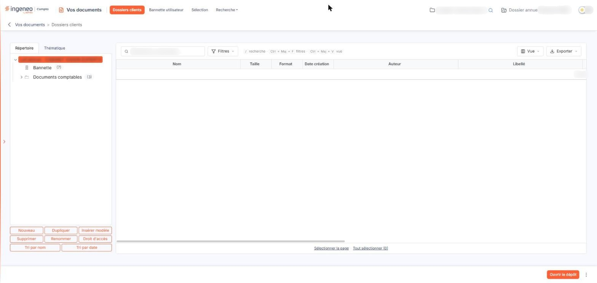<figcaption>
Écran « Dossiers clients » de la nouvelle interface
</figcaption></figure>

L'écran est partagé en deux. La partie gauche vous sert à choisir **où** vous cherchez vos documents : dans l'arborescence des répertoires du dossier, ou selon un classement thématique. La partie droite présente la liste des documents correspondant à ce choix. Sous les deux parties figure le pied de page, avec le bouton bouton **\[Ouvrir le dépôt]** ; les commandes qui agissent sur des documents s'affichent, au bas de l'écran, dans un bandeau de sélection dès qu'une ligne est sélectionnée.

Il n'y a aucun champ à renseigner sur cet écran, hormis la zone de recherche « Rechercher un document… » : c'est un explorateur de documents, pas un formulaire.

## Le panneau de gauche : les onglets « Répertoire » et « Thématique »

<figure>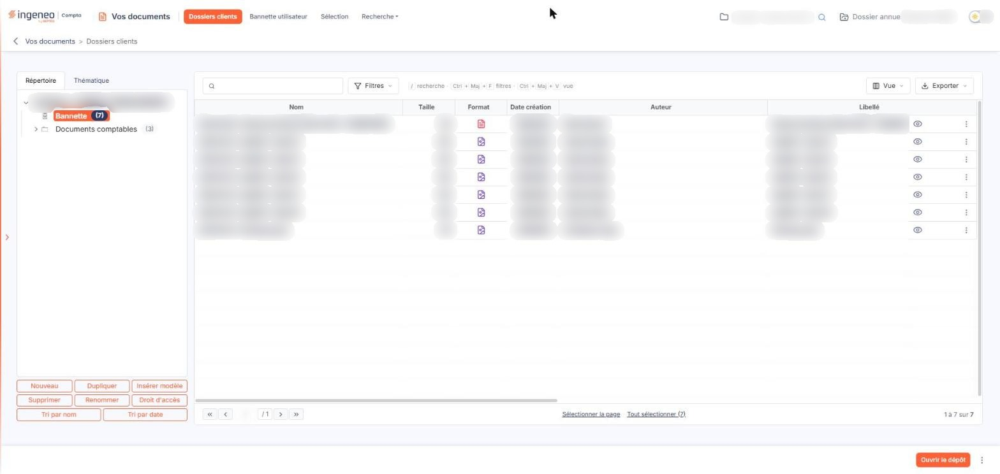<figcaption>
Rubrique « Le panneau de gauche : les onglets « Répertoire » et « Thématique » »
</figcaption></figure>

L'onglet « Répertoire » est actif à l'ouverture de l'écran. Il présente l'arborescence des répertoires du dossier, dont la racine porte le nom du dossier en cours et se trouve sélectionnée à l'ouverture.

Le nombre entre parenthèses affiché derrière le nom d'un répertoire est le nombre de documents qu'il contient. Un répertoire qui porte des sous-répertoires est précédé d'un chevron. Chaque répertoire est en outre précédé d'un pictogramme qui dépend de sa nature ; l'écran n'en affiche pas la légende.

Pour sélectionner un répertoire, cliquez sur son nom : il s'inscrit alors en inverse vidéo et devient le répertoire actif. Ce même clic déploie ses sous-répertoires et affiche ses documents dans la partie droite de l'écran. Un répertoire peut donc contenir à la fois des documents et des sous-répertoires.

L'arborescence ne présente que les répertoires auxquels vos droits vous donnent accès. Si des droits d'accès ont été posés par répertoire, ceux que vous n'avez pas le droit de consulter ne s'y affichent pas.

## Les boutons de gestion des répertoires

<figure>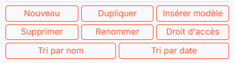<figcaption>
Rubrique « Les boutons de gestion des répertoires »
</figcaption></figure>

Les répertoires s'administrent de deux façons, au choix : par une série de boutons affichés sous l'arborescence, ou par le clic droit de la souris, qui ouvre alors un menu sur le répertoire pointé. Vous indiquez votre préférence dans le panneau Paramètres, rubrique « Vos documents », menu déroulant « Options », entrée « Options utilisateur ». Les explications qui suivent décrivent l'ergonomie par boutons.

Ces huit boutons portent tous sur le répertoire actif, c'est-à-dire celui que vous avez sélectionné dans l'arborescence. Selon les droits qui vous sont accordés, certains d'entre eux peuvent ne pas s'afficher.

bouton **\[Nouveau]**

Crée un sous-répertoire dans le répertoire actif. Vous saisissez son nom directement dans l'arborescence.

bouton **\[Dupliquer]**

Recopie le répertoire actif ailleurs dans l'arborescence. Le logiciel vous fait choisir le répertoire de destination dans une fenêtre.

bouton **\[Insérer modèle]**

Insère sous le répertoire actif un des modèles d'arborescence préparés dans le panneau Paramètres, onglet « Modèles », rubrique « Divers », écran « Mes documents » (les modèles d'arborescences).

bouton **\[Supprimer]**

Supprime le répertoire actif, ses sous-répertoires et les documents qu'ils contiennent.

bouton **\[Renommer]**

Rend le nom du répertoire actif modifiable directement dans l'arborescence.

bouton **\[Droit d'accès]**

Affecte au répertoire actif l'un des droits définis dans le panneau Paramètres, rubrique « Vos documents », menu déroulant « Options », entrée « Droits des répertoires ». Vous ne pouvez affecter qu'un droit auquel vous avez vous-même accès.

bouton **\[Tri par nom]**

Réordonne par ordre alphabétique les sous-répertoires du répertoire actif.

bouton **\[Tri par date]**

Réordonne les sous-répertoires du répertoire actif du plus ancien au plus récent.

Ces deux tris ne réorganisent l'affichage que pour le temps de votre consultation : l'ordre obtenu n'est pas conservé, et l'arborescence retrouve sa présentation habituelle au prochain affichage. La bannette, elle, reste toujours en tête.

## L'onglet « Thématique »

<figure>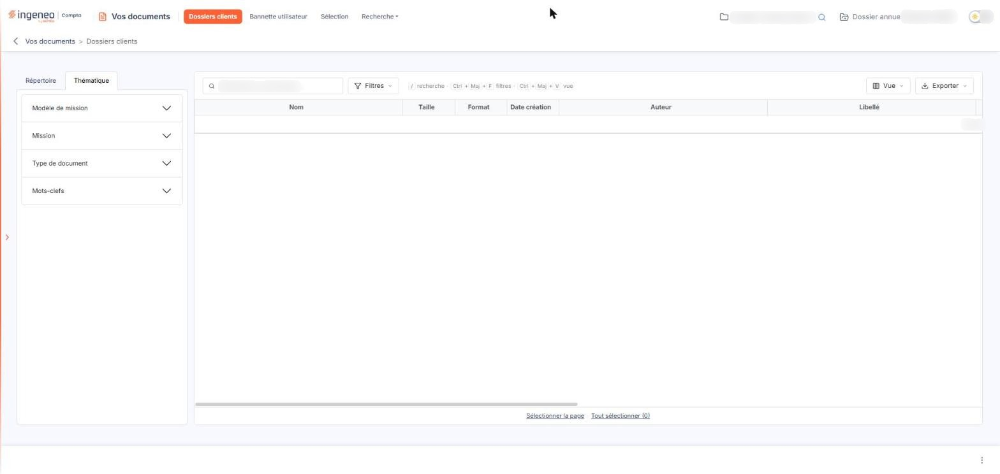<figcaption>
Rubrique « L'onglet « Thématique » »
</figcaption></figure>

Cet onglet remplace l'arborescence par un classement transversal : les documents n'y sont plus rangés par répertoire, mais selon les informations portées par leur formulaire. Les axes proposés sont, dans l'ordre : « Modèle de mission », « Mission », « Type de document » et « Mots-clefs ». Ils se présentent en accordéon : ouvrir un axe referme le précédent, de sorte qu'un seul est déployé à la fois.

Un axe ne présente que les valeurs effectivement rattachées à des documents du dossier : il reste vide tant qu'aucun document n'a été classé selon cet axe. Tant que vous n'avez rien choisi dans l'accordéon, la liste de droite affiche « Aucun élément à afficher. »

Deux points sont à connaître dans cet onglet : les huit boutons de gestion des répertoires disparaissent — le classement thématique ne se modifie pas ici, mais depuis le formulaire de chaque document —, et, dans le pied de page, bouton **\[Ouvrir le dépôt]** disparaît : il ne reste que le bouton ⋮.

## La recherche rapide

**Rechercher un document…** : cette zone se trouve au-dessus de la liste, à gauche. Saisissez tout ou partie du nom d'un document : la liste se restreint dès la saisie, sans bouton à actionner, aux documents du répertoire actif qui correspondent aux caractères saisis. Effacer le texte rétablit la liste complète. Un rappel de raccourci, « / recherche », est affiché à côté de la zone.

Ce filtre ne porte que sur le répertoire actif. Pour chercher dans tout le dossier ou sur d'autres critères, utilisez le bouton \[Filtres] (rubrique i) ou le menu « Recherche ».

## La liste des documents

<figure>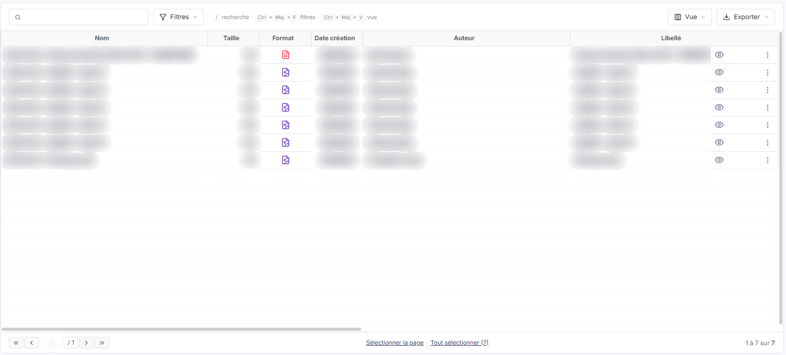<figcaption>
Rubrique « La liste des documents »
</figcaption></figure>

La partie droite de l'écran présente les documents du répertoire actif, ou ceux qui correspondent à l'élément thématique choisi.

Le tableau porte douze colonnes, toutes triables par un clic sur leur en-tête, et il défile horizontalement : **Nom**, **Taille**, **Format**, **Date création**, **Auteur**, **Libellé**, **Référence**, **Date intégration**, **Intégré par**, **Date modification**, **Modifié par** et **Descriptif**. Vous choisissez celles que vous voulez voir par le menu \[Vue] décrit plus bas.

Deux colonnes méritent une précision. **Format** n'affiche pas de texte mais le pictogramme du type de fichier, déduit de l'extension du document. **Nom** dépend de l'option de nommage automatique du menu « Options », sous-menu « Options générales » : lorsqu'elle est active, le nom du document est composé par le logiciel à partir de sa date, de son libellé et de sa référence, et la colonne **Libellé** n'en reprend que la partie libellé.

Lorsque le répertoire actif ne contient aucun document, le tableau affiche « Aucun élément à afficher. » et aucune pagination. Sinon, le pied du tableau porte la pagination habituelle — première page, page précédente, numéro de page saisissable, page suivante, dernière page — et le compte des lignes affichées.

Pour désigner un document, cliquez sur sa ligne : elle se colore et le bandeau de sélection apparaît au bas de l'écran (rubrique f). Sous le tableau, les liens « Sélectionner la page » et « Tout sélectionner (N) » étendent la sélection ; une fois des lignes sélectionnées, ils deviennent « Désélectionner la page » et « Tout désélectionner (N) ».

## La barre de la liste et le bandeau de sélection

<figure>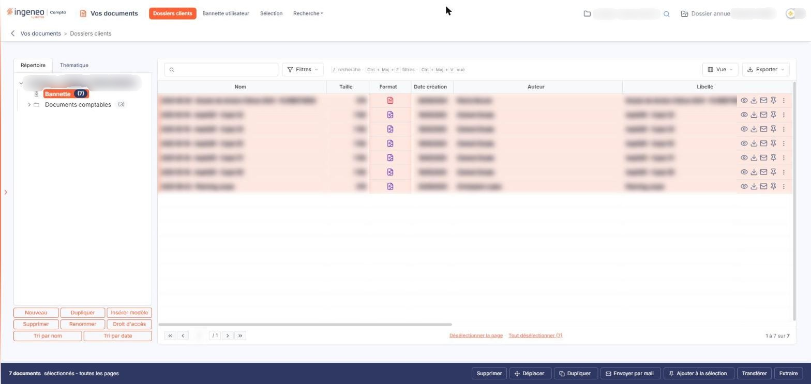<figcaption>
Rubrique « La barre de la liste et le bandeau de sélection »
</figcaption></figure>

<figure>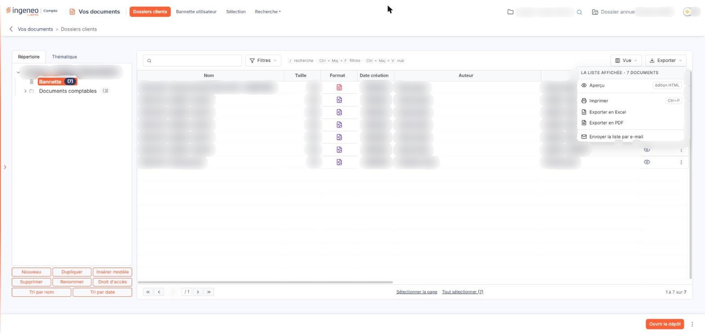<figcaption>
Bouton [Exporter]
</figcaption></figure>

Au-dessus du tableau, la barre de la liste porte, de gauche à droite : la zone « Rechercher un document… » (rubrique d), le bouton bouton **\[Filtres]** (rubrique i), un rappel des raccourcis clavier (« / recherche », « Ctrl + Maj + F filtres », « Ctrl + Maj + V vue »), puis, à droite, le bouton bouton **\[Vue]** (rubrique h) et le bouton bouton **\[Exporter]**. \[Exporter] ouvre un menu qui porte l'édition de la liste — aperçu, impression, export Excel ou PDF, envoi de la liste par e-mail — et rappelle le nombre de documents de la liste affichée ; ses entrées n'ont pas été actionnées.

Dès qu'une ligne est sélectionnée, un bandeau apparaît au bas de l'écran, à la place de la barre habituelle. À gauche, il indique le nombre de documents sélectionnés — l'écran affiche « 1 document sélectionnée » pour un seul — et propose le lien « Tout désélectionner ». À droite, il porte les boutons bouton **\[Supprimer]**, bouton **\[Déplacer]**, bouton **\[Dupliquer]**, bouton **\[Envoyer par mail]**, bouton **\[Ajouter à la sélection]**, bouton **\[Transférer]** et bouton **\[Extraire]**. Le bandeau n'est pas affiché tant qu'aucune ligne n'est sélectionnée.

Ces commandes portent sur les documents sélectionnés. Le bandeau a été vu avec une seule ligne sélectionnée : l'écran n'a pas été observé avec plusieurs lignes.

La commande « Ajouter à la sélection » demande une attention particulière : c'est **elle**, et elle seule, qui alimente le menu « Sélection ». Désigner la ligne d'un document ne l'y ajoute pas — cela ne fait que désigner les lignes sur lesquelles une commande va porter. Pour retrouver un document dans le menu « Sélection », il faut donc l'y avoir ajouté par cette commande.

## Les pictogrammes d'une ligne de document

<figure>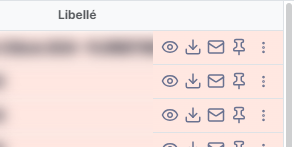<figcaption>
Rubrique « Les pictogrammes d'une ligne de document »
</figcaption></figure>

<figure>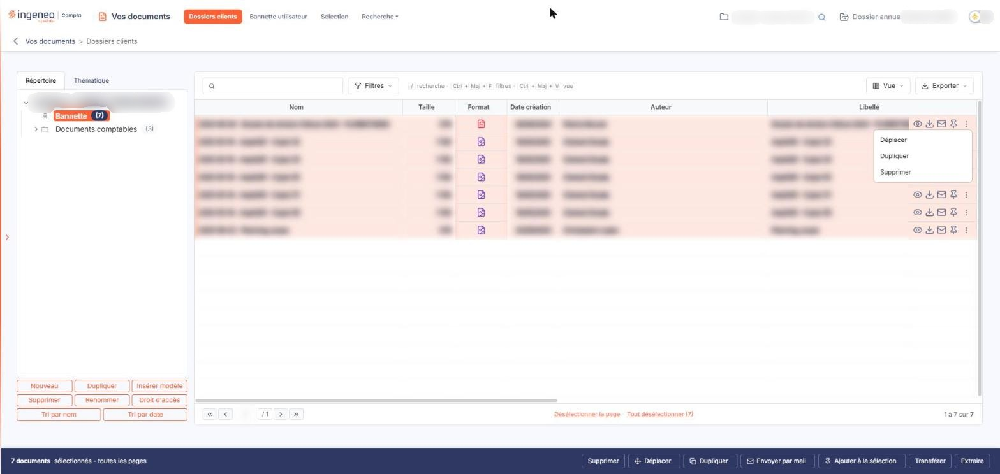<figcaption>
Rubrique « Les pictogrammes d'une ligne de document »
</figcaption></figure>

Chaque ligne porte, en dernière colonne, des commandes qui n'agissent que sur le document de cette ligne et qui portent une infobulle. Au repos, la ligne n'en affiche que deux : l'œil et le bouton ⋮. Au survol de la ligne, ou lorsqu'elle est sélectionnée, les autres apparaissent.

« Œil » (Afficher l'aperçu) : ouvre le tiroir « Aperçu du document », sur la droite de l'écran, qui présente le document et ses rubriques « Propriétés », « Classement thématique » et « Historique », en lecture seule, et donne aussi accès à son formulaire par bouton **\[Modifier le formulaire]**.

« Flèche vers le bas » (Télécharger) : récupère le document sur votre poste.

« Enveloppe » (Envoyer par mail) : envoie le document par courriel. Votre profil doit porter une adresse électronique valide, et le poids de l'envoi ne peut pas dépasser 10 Mo.

« Punaise » (Ajouter à la sélection) : épingle le document dans le menu « Sélection ». Une fois le document épinglé, le pictogramme change d'aspect et son infobulle devient « Supprimer de la sélection » : cliquez-le de nouveau pour retirer le document de votre sélection.

« Trois points » (Autres actions) : ouvre un menu qui propose « Déplacer », « Dupliquer » et « Supprimer ».

La suppression d'un document est définitive : il n'est pas placé dans une corbeille.

Selon les droits qui vous sont accordés, vous pouvez n'en voir qu'une partie : chaque pictogramme est soumis à son propre droit.

## Le menu \[Vue]

<figure>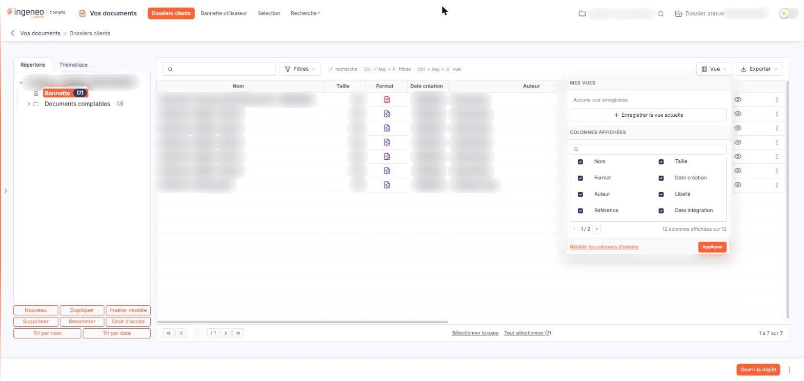<figcaption>
Rubrique « Le menu [Vue] »
</figcaption></figure>

Ouvert par le bouton \[Vue], il comporte deux blocs. Le bloc « Mes vues » indique « Aucune vue enregistrée. » tant que vous n'en avez pas, et propose bouton **\[Enregistrer la vue actuelle]**. Le bloc « Colonnes affichées » présente la liste des colonnes du tableau : une zone « Rechercher une colonne… » et, pour chaque colonne, une case à cocher qui affiche ou masque la colonne. La liste se feuillette (« 1/2 ») et un compteur indique « 12 colonnes affichées sur 12 ».

bouton **\[Appliquer]** reporte vos choix sur le tableau et bouton **\[Rétablir les colonnes d'origine]** rétablit la présentation d'origine.

## Le menu \[Filtres]

<figure>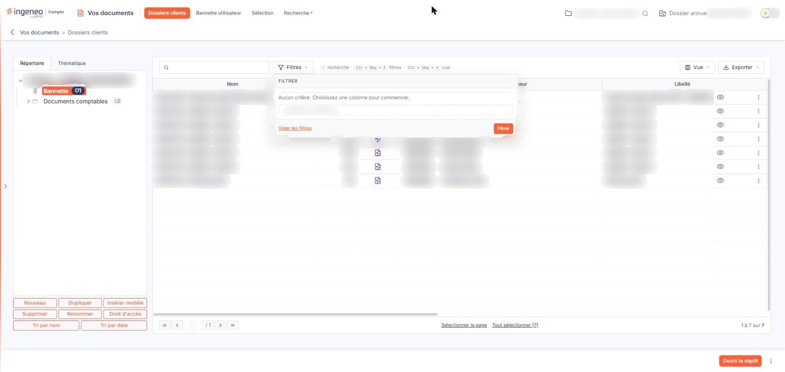<figcaption>
Rubrique « Le menu [Filtres] »
</figcaption></figure>

Ouvert par le bouton \[Filtres], il permet de filtrer la liste colonne par colonne, là où la zone « Rechercher un document… » ne porte que sur le nom. Il s'intitule « Filtrer » et affiche « Aucun critère. Choisissez une colonne pour commencer. » tant qu'aucun critère n'est posé. La liste « + Ajouter un critère sur… » vous fait choisir la colonne du tableau sur laquelle porte le critère.

bouton **\[Filtrer]** applique vos critères et bouton **\[Vider les filtres]** les efface tous.

## Le pied de page

<figure>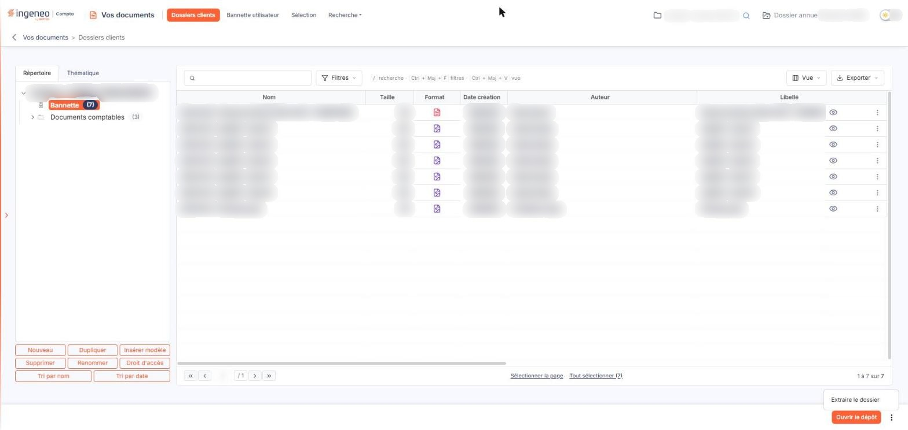<figcaption>
Rubrique « Le pied de page »
</figcaption></figure>

Le pied de page, sous la liste, porte à droite bouton **\[Ouvrir le dépôt]** — son infobulle indique « Déposer des fichiers dans le dossier sélectionné » : sélectionnez d'abord le répertoire où vous voulez déposer — et un bouton ⋮, auquel l'écran associe l'entrée « Extraire le dossier ». Les effets de ces deux commandes n'ont pas été observés.

La barre de boutons qui portait \[Transférer], \[Extraire] et \[Supprimer] a laissé la place au bandeau de sélection décrit à la rubrique f : ces trois commandes s'y trouvent désormais, avec bouton **\[Transférer]** qui transfère les documents sélectionnés.

Un point à connaître : dans l'onglet « Thématique », la liste se vide et bouton **\[Ouvrir le dépôt]** disparaît du pied de page, où il ne reste que le bouton ⋮.
