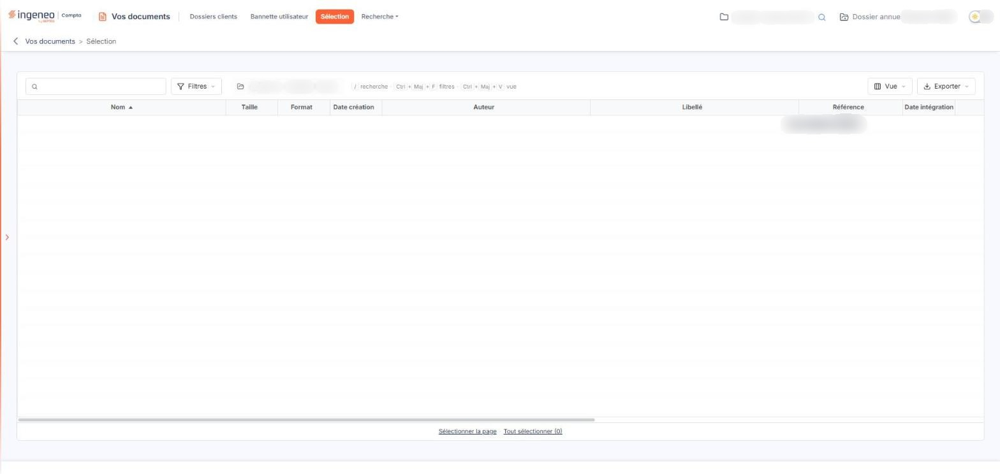

# Sélection


**Où le trouver :** Menu **Sélection**



**En bref** — Cet écran rassemble les documents que vous avez mis de côté dans la GED, pour le dossier en cours, afin de les traiter en une seule fois.

* Pour alimenter la sélection : cliquez sur le pictogramme « Punaise » (« Ajouter à la sélection ») d'une ligne de document, dans les autres listes de la GED.
* Pour envoyer des documents vers un autre module : cliquez sur leur ligne, puis bouton \[Transférer].
* Pour retirer des documents de cette liste sans les supprimer de la GED : cliquez sur leur ligne, puis bouton \[Supprimer de la sélection].


Cet écran rassemble les documents que vous avez mis de côté au cours de votre navigation dans la GED, pour les traiter ensuite en une seule fois. Il n'a pas de contenu propre : il est vide tant que vous n'y avez rien ajouté.

<figure><figcaption>
Écran « Sélection » de la nouvelle interface
</figcaption></figure>

C'est le pictogramme « Punaise » d'une ligne de document qui alimente cette liste : cliquez dessus, son infobulle indiquant « Ajouter à la sélection ». Le pictogramme fonctionne comme une bascule : sur un document déjà retenu, son infobulle devient « Supprimer de la sélection », et un nouveau clic le retire de la liste.

Sélectionner une ligne de document, en cliquant dessus, n'ajoute rien à cette liste : la sélection de lignes ne sert qu'aux actions groupées de l'écran où vous vous trouvez. Seule la punaise constitue la sélection.

La sélection est propre à vous et au dossier en cours, rappelé, dans la barre de la liste, par le champ en lecture seule **Dossier en cours**, qui n'est pas modifiable ici. Les documents que vous avez punaisés dans un autre dossier ne figurent donc pas dans cette liste : vous les retrouvez en revenant sur ce dossier. Le logiciel conserve votre sélection d'une visite à l'autre, jusqu'à ce que vous la vidiez.

## La liste des documents retenus

La liste présente, pour chaque document, son nom, sa taille, son format, sa date de création et son auteur, puis les informations de classement et de suivi : libellé, référence, date d'intégration et utilisateur qui l'a intégré, date de la dernière modification et utilisateur qui l'a modifiée, descriptif. Ce sont les mêmes colonnes que dans les autres listes de documents de la GED ; selon la résolution de votre écran, vous atteignez les dernières en faisant défiler la liste horizontalement, et chacune peut servir de critère de tri.

Tant que votre sélection est vide, la liste affiche « Aucun élément à afficher. ».

**Recherche** : saisissez tout ou partie du nom d'un document dans le champ « Rechercher un document… » de la barre de la liste pour ne conserver que les documents correspondants. Le bouton \[Filtres] ouvre le volet « Filtrer », qui permet de poser des critères sur les colonnes de la liste.

Au-dessus de la liste, la barre porte le champ « Rechercher un document… », le bouton \[Filtres], le champ en lecture seule « Dossier en cours », le bouton \[Vue], qui vous permet de choisir les colonnes affichées, et le bouton \[Exporter], dont le menu propose « Aperçu édition HTML », « Imprimer », « Exporter en Excel », « Exporter en PDF » et « Envoyer la liste par e-mail ». Sous la barre sont rappelés les raccourcis « / recherche · Ctrl+Maj+F filtres · Ctrl+Maj+V vue ». Il n'y a plus de case à cocher : un clic sur une ligne la sélectionne, et les liens « Sélectionner la page » et « Tout sélectionner (N) », sous la liste, sélectionnent les lignes de la page affichée ou l'ensemble des lignes.

## Les boutons de bas de page

bouton **\[Transférer]** — n'agit pas sur le classement de vos documents dans la GED : il ouvre la fenêtre « Transférer des documents vers un autre module de l'application », qui envoie les documents sélectionnés vers un autre module du logiciel. C'est pourquoi cet écran ne comporte ni arborescence ni sélecteur de dossier.

Cet écran ne comporte pas de bouton de téléchargement de documents depuis votre poste : la sélection ne se constitue que depuis les documents déjà présents dans la GED.
