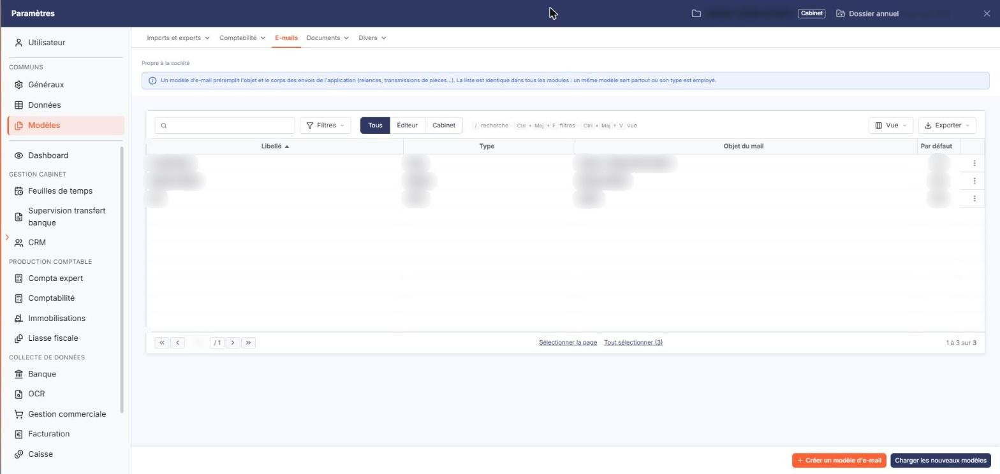
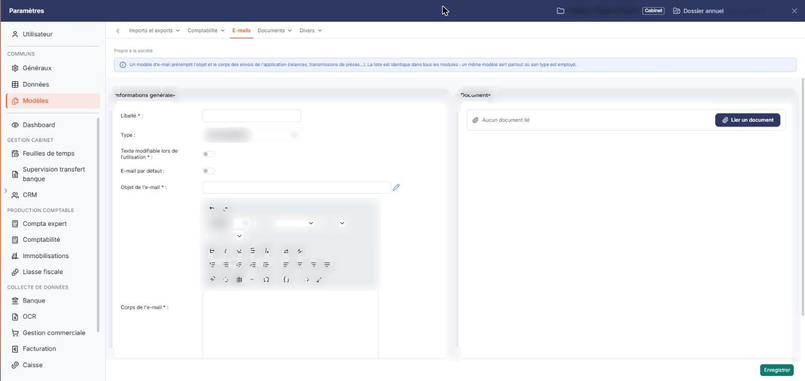
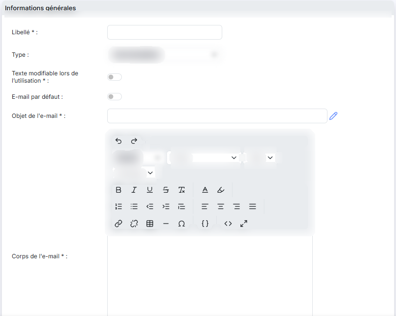
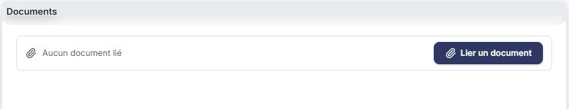
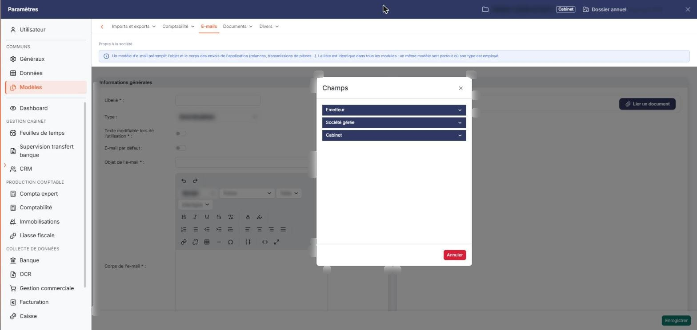
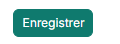
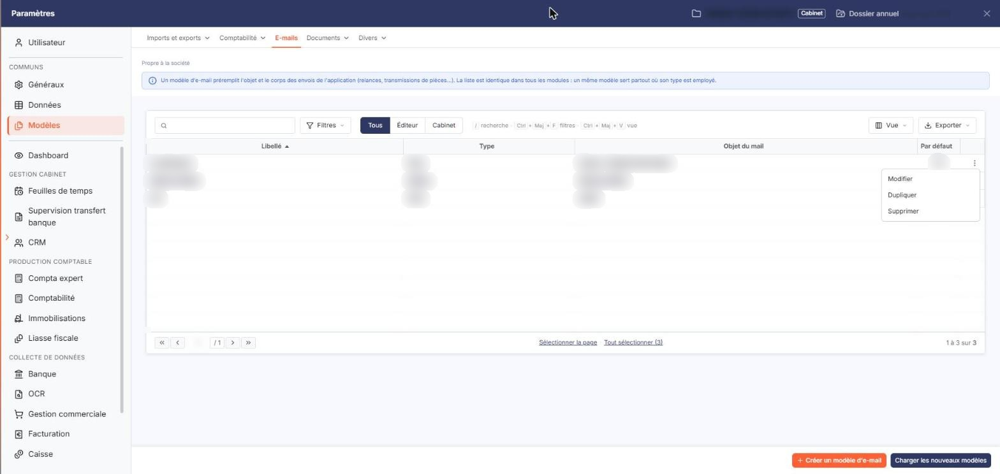
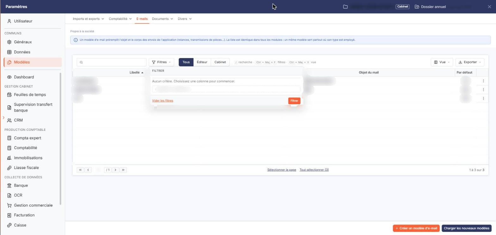

# E-mails


**Où le trouver :** Panneau **Paramètres** › **Modèles** › **E-mails**



**En bref** — Cet écran constitue la bibliothèque des modèles d'e-mails (objet, corps, pièces jointes) que le logiciel vous propose lors des envois de documents et des relances.

* Pour créer un modèle : bouton \[Nouveau], renseignez le « Libellé », l'« Objet de l'e-mail » et le « Corps de l'e-mail », puis bouton \[Enregistrer].
* Pour reprendre un modèle existant : pictogramme « Duplication » de sa ligne, adaptez la fiche, puis bouton \[Enregistrer].
* Pour insérer le nom du client ou une ville : pictogramme « Insérer un champ dynamique » à droite de l'objet, puis cliquez sur la ligne du champ.
* Pour obtenir les modèles livrés par l'éditeur : bouton \[Charger les nouveaux modèles].


Cette option permet de définir les objets et les textes des e-mails qui seront utilisés lors des envois de documents ou de pièces à vos clients, ainsi que dans les relances. Vous constituez ainsi une bibliothèque de modèles que le logiciel vous proposera au moment de l'envoi.

<figure><figcaption>
Écran « E-mails » de la nouvelle interface
</figcaption></figure>

Un modèle se compose d'un objet, d'un corps de message et, si vous le souhaitez, de pièces jointes. L'objet et le corps peuvent recevoir des **champs dynamiques** : le logiciel les remplace, à l'envoi, par les informations réelles du destinataire ou de la pièce concernée.

Cet écran est le même dans plusieurs modules du logiciel, et les modèles que vous enregistrez ici sont ceux que vous retrouvez depuis les autres modules qui envoient des e-mails. C'est pourquoi la liste peut contenir des modèles destinés à des envois qui ne relèvent pas de la GED : la colonne **Type** vous indique à quel envoi chaque modèle est destiné.

**a) La liste des modèles**

Le logiciel affiche l'ensemble des modèles déjà enregistrés, classés par libellé. Le tableau comporte les colonnes suivantes :

Chaque colonne peut être triée en cliquant sur son en-tête.

Dans la colonne **Type**, le logiciel affiche le code interne de la nature d'envoi et non son libellé : un modèle destiné à l'envoi de pièces apparaît ainsi sous la valeur « Piece ». La fiche du modèle et la fenêtre des filtres affichent, elles, le libellé complet.

Les commandes des lignes et les boutons de bas d'écran dépendent chacun d'un droit : selon votre profil, certains peuvent ne pas vous être proposés.

**Les commandes d'une ligne**

Le pictogramme « Crayon » (**Modifier**) ouvre la fiche du modèle, le pictogramme « Croix » (**Supprimer**) le supprime et le pictogramme « Duplication » (**Dupliquer**) ouvre une fiche pré-remplie avec le contenu du modèle d'origine, que vous pouvez adapter avant de l'enregistrer : le libellé y est proposé sous la forme « Copie de » suivi du libellé d'origine, et l'interrupteur **E-mail par défaut** est positionné sur « Non ». La copie n'existe qu'une fois cette fiche enregistrée.

bouton **\[Charger les nouveaux modèles]**

Ce bouton vous propose les modèles livrés par l'éditeur qui sont absents de votre fichier, ou qui y figurent déjà mais ont été mis à jour depuis : vous choisissez dans la liste ceux que vous souhaitez charger.

bouton **\[Exporter]**

Ce bouton exporte le contenu de la liste dans un tableur.

bouton **\[Supprimer]**

Ce bouton supprime les modèles que vous avez cochés dans la liste.

**b) La fiche d'un modèle**

La fiche se compose de deux rubriques : « Informations générales » et « Documents ».

**Rubrique « Informations générales »**

**Rubrique « Documents »**

Cette rubrique vous permet de joindre au modèle des documents qui accompagneront systématiquement l'e-mail. Le tableau indique, pour chaque document, sa **Description**, le **Nom du fichier**, la **Date** de son ajout et l'utilisateur qui l'a ajouté, sous l'intitulé **Créé par**. Tant qu'aucun document n'est joint, le tableau affiche « Liste vide ».

Trois boutons vous permettent de choisir la provenance du document à joindre : bouton **\[Nouveau doc depuis mon poste]**, bouton **\[Nouveau doc depuis la GED]** et bouton **\[Nouveau doc depuis l'OCR]**.

bouton **\[Enregistrer]**

Ce bouton enregistre le modèle.

bouton **\[Retour]**

Ce bouton revient à la liste des modèles.

**c) Insérer un champ dynamique**

Un champ dynamique est un code que vous placez dans l'objet ou dans le corps du message, et que le logiciel remplace au moment de l'envoi par l'information réelle : le nom du client, sa ville, la liste des pièces envoyées.

Le pictogramme placé à droite du champ **Objet de l'e-mail**, dont l'infobulle est « Insérer un champ dynamique », ouvre la fenêtre « Champs ». Cette fenêtre présente, sous l'onglet « Liste des champs », les champs disponibles regroupés en bandeaux que vous dépliez l'un après l'autre : un seul bandeau reste ouvert à la fois. Chaque bandeau présente deux colonnes, **Code** et **Libellé** : la première donne le code du champ, la seconde l'information qu'il représente.

Cliquez sur la ligne du champ souhaité : le logiciel ferme la fenêtre et insère son code, entre crochets, à l'endroit où se trouvait votre curseur. Le bouton **\[Annuler]** et la croix du bandeau de titre ferment la fenêtre sans rien insérer.

Les champs qui vous sont proposés **dépendent du module depuis lequel vous ouvrez cet écran**, car ce sont ceux du contexte d'envoi de ce module : la liste n'est donc pas la même partout. Depuis la GED, la fenêtre propose trois bandeaux : « Emetteur », les champs de l'émetteur du message ; « Client », ceux du client destinataire ; et « Pièces commerciales », qui ne contient que le champ reprenant la liste des pièces. Depuis la comptabilité ou la liasse fiscale, elle propose à la place les champs de la société gérée et ceux du cabinet. Pour certaines natures d'envoi, comme l'envoi d'un dossier CAC, la fenêtre restreint en outre sa proposition aux champs qui ont un sens pour cet envoi.

**d) Filtrer la liste**

La fenêtre « Filtres » vous permet de restreindre la liste sur le **Libellé**, le **Type**, l'**Objet du mail**, le **Par défaut**, le **Message**, le **Modèle éditeur** et le **Texte modifiable lors de l’utilisation**. Pour chaque critère, vous choisissez un opérateur et une valeur, et vous pouvez en combiner deux à l'aide des boutons **Et** et **Ou**. Le critère **Type** vous propose les natures d'envoi sous leur libellé complet, et non sous le code affiché dans la colonne de la liste, avec les deux opérateurs **Seulement** et **Sauf**.

Les boutons de la fenêtre sont les suivants. bouton **\[Filtrer]** applique les critères à la liste. bouton **\[Vider les filtres]** les efface tous. bouton **\[Fermer]** ferme la fenêtre.

## Autres vues de l'écran

<figure><figcaption>
La fiche d'un modèle
</figcaption></figure>

<figure><figcaption>
Rubrique « Informations générales »
</figcaption></figure>

<figure><figcaption>
Rubrique « Documents »
</figcaption></figure>

<figure><figcaption>
Insérer un champ dynamique
</figcaption></figure>

<figure><figcaption>
Bouton [Enregistrer]
</figcaption></figure>

<figure><figcaption>
Les commandes d'une ligne
</figcaption></figure>

<figure><figcaption>
Filtrer la liste
</figcaption></figure>

<figure><figcaption>
Bouton [Nouveau]
</figcaption></figure>
