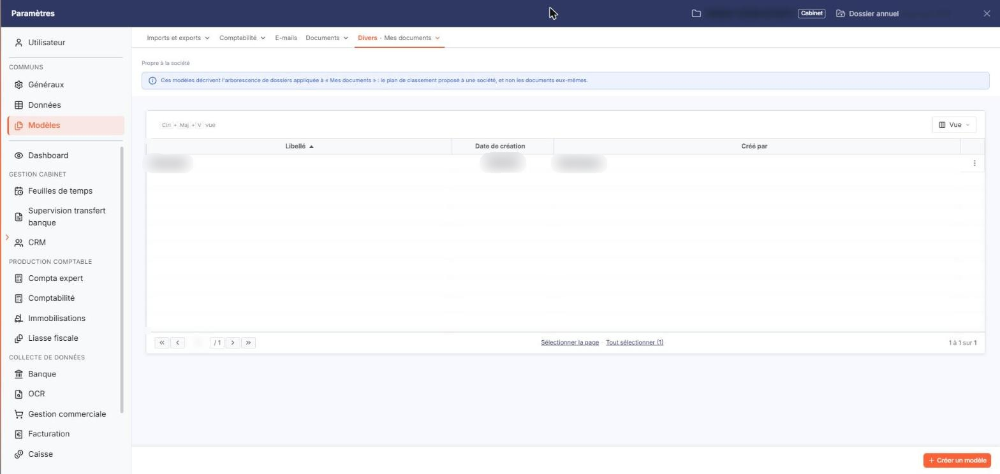
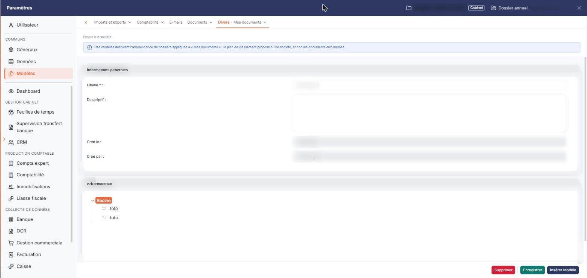
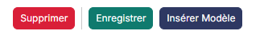

# Modèles d'arborescences


**Où le trouver :** Panneau **Paramètres**



**En bref** — Cet écran gère les modèles d'arborescences : des structures de répertoires préparées une fois, que vous réutilisez par type de client ou de mission.

* Pour créer un modèle : bouton \[Nouveau], saisissez le « Libellé », ajoutez des répertoires avec le bouton \[Nouveau dossier], puis bouton \[Enregistrer].
* Pour reprendre la structure d'un autre modèle : sélectionnez un répertoire dans la rubrique « Arborescence », puis bouton \[Insérer Modèle].
* Pour supprimer des modèles : cliquez sur leur ligne, puis bouton \[Supprimer].


Un modèle d'arborescences est une structure de répertoires que vous préparez une fois pour la réutiliser ensuite. Vous pouvez ainsi définir, par type de client ou par type de mission, une arborescence type plutôt que de recréer les mêmes répertoires dossier après dossier.

<figure><figcaption>
Écran « Modèles d'arborescences » de la nouvelle interface
</figcaption></figure>

Cet écran s'ouvre par « Paramètres > Modèles > Divers > Mes documents » : il présente la liste des modèles et vous permet de les créer, de les modifier et de les supprimer. Au-dessus de la liste, la mention « Propre à la société » et un encadré bleu précisent : « Ces modèles décrivent l'arborescence de dossiers appliquée à « Mes documents » : le plan de classement proposé à une société, et non les documents eux-mêmes. »

**a) La liste des modèles**

Chaque ligne correspond à un modèle et porte trois colonnes :

Il n'y a plus de case à cocher : un clic sur une ligne la sélectionne. Sous la liste, « Sélectionner la page » sélectionne toutes les lignes de la page affichée et « Tout sélectionner (N) » l'ensemble des lignes de toutes les pages (N est le nombre de lignes de la liste). La barre située au-dessus de la liste ne porte que le bouton **\[Vue]**, qui vous permet de choisir les colonnes que vous souhaitez voir : elle n'a ni zone de recherche, ni bouton de filtres, ni bouton d'export.

Sur chaque ligne, le bouton à trois points ouvre un menu de deux commandes qui agissent sur le modèle :

**b) Les boutons de la liste**

Les boutons \[Nouveau] et \[Exporter] se trouvent en bas à droite de l'écran ; le bouton \[Supprimer] apparaît dans le bandeau de sélection, au bas de l'écran, dès qu'une ligne est sélectionnée. Chacun de ces trois boutons dépend de vos droits d'utilisation : celui que votre profil ne vous accorde pas n'apparaît pas.

bouton **\[Nouveau]**

Ouvre une fiche vierge pour créer un modèle.

bouton **\[Exporter]**

Exporte les modèles que vous avez sélectionnés, par la fenêtre d'export du logiciel.

bouton **\[Supprimer]**

Supprime les modèles dont vous avez sélectionné la ligne.

**c) La fiche d'un modèle**

La fiche comporte deux rubriques, « Informations générales » et « Arborescence ».

Dans la rubrique « Informations générales » :

La rubrique « Arborescence » présente la structure du modèle sous forme d'arbre de répertoires. Le répertoire du haut s'appelle toujours « Racine ». Cliquez sur un répertoire pour le rendre actif : c'est sur ce répertoire actif qu'agissent le bouton \[Nouveau dossier], placé sous l'arbre, et les boutons du bas de l'écran qui portent sur l'arborescence.

**d) Les boutons de la fiche**

Trois de ces boutons portent sur l'arborescence, et non sur le modèle lui-même : le modèle, lui, se supprime depuis la liste.

Comme ceux de la liste, les quatre boutons de la fiche dépendent chacun de vos droits d'utilisation : celui que votre profil ne vous accorde pas n'apparaît pas.

bouton **\[Enregistrer]**

Enregistre le modèle.

bouton **\[Nouveau dossier]**

Crée un répertoire sous le répertoire actif.

bouton **\[Supprimer]**

Supprime le répertoire actif.

bouton **\[Insérer Modèle]**

Reprend l'arborescence d'un autre modèle et l'insère sous le répertoire actif.

**Revenir à la liste**

Cliquez sur le chevron « Retour » situé à gauche de la barre d'onglets du panneau Paramètres : il referme la fiche et revient à la liste.

## Autres vues de l'écran

<figure><figcaption>
Les boutons de la liste
</figcaption></figure>

<figure><figcaption>
La fiche d'un modèle
</figcaption></figure>

<figure><figcaption>
Les boutons de la fiche
</figcaption></figure>
