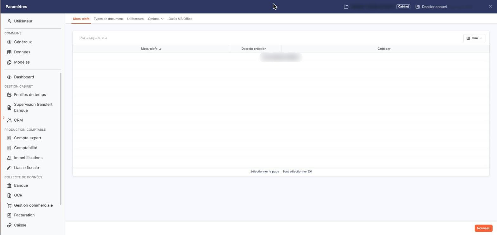
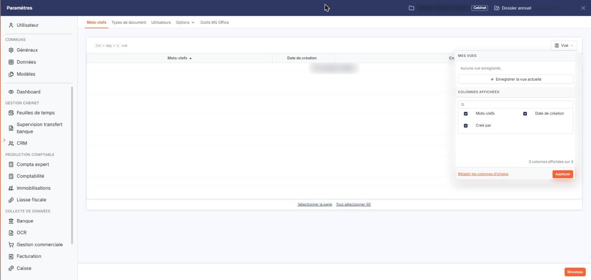
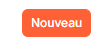
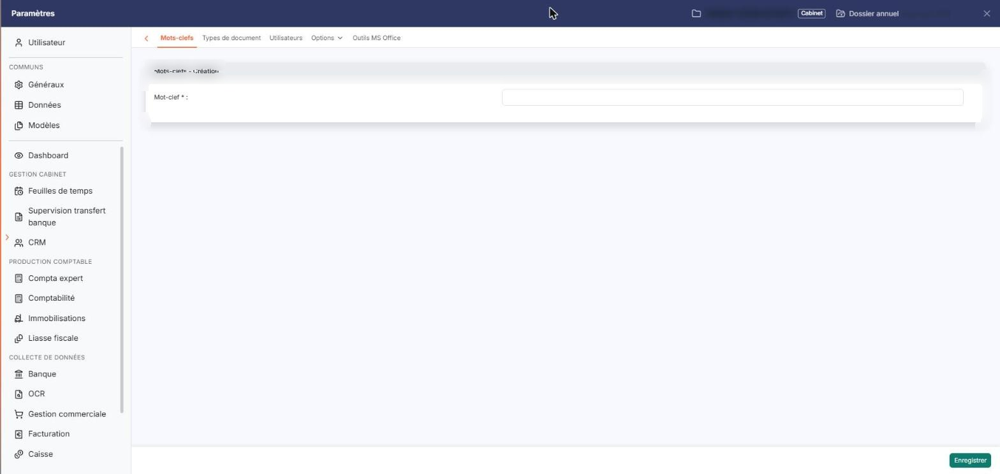
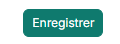

# Mots-clefs


**Où le trouver :** Panneau **Paramètres** › **Vos documents** › **Mots-clefs**



**En bref** — Cet écran liste et crée les mots-clefs d'un dossier, qui servent à classer les documents par thème et à les retrouver dans la recherche avancée.

* Pour créer un mot-clef : bouton \[Nouveau], saisissez le « Mot-clef » (obligatoire et unique), puis bouton \[Enregistrer].
* Pour supprimer des mots-clefs : cliquez sur leur ligne, puis bouton \[Supprimer] ; ils sont aussi retirés des documents concernés.
* Pour revenir à la liste sans enregistrer : chevron « Retour » à gauche de la barre d'onglets du panneau Paramètres.


Les mots-clefs vous permettent de classer vos documents par thème, indépendamment de l'endroit où ils sont rangés dans l'arborescence de la GED. Vous les créez dans cet écran. Le mot-clef devient alors un critère de recherche : vous le retrouvez dans la sous-option « Recherche avancée » du menu « Recherche ».

<figure><figcaption>
Écran « Mots-clefs » de la nouvelle interface
</figcaption></figure>

Vous pouvez créer autant de mots-clefs que vous le souhaitez.

Les mots-clefs sont propres au dossier dans lequel vous les créez : chaque dossier a sa propre liste, et un mot-clef créé sur un dossier n'est pas proposé sur un autre.

## La liste des mots-clefs

<figure><figcaption>
Bouton [Vue]
</figcaption></figure>

L'écran est d'une seule pièce : une liste, sans rubrique, sans onglet et sans filtre. Elle présente, pour chaque mot-clef, son libellé sous l'intitulé **Mots-clefs**, sa **Date de création** et l'utilisateur qui l'a créé sous l'intitulé **Créé par**. La liste est triée par libellé, dans l'ordre croissant, et vous pouvez la trier autrement en cliquant sur l'intitulé d'une colonne.

Tant qu'aucun mot-clef n'est enregistré, la liste affiche « Aucun élément à afficher. ».

Il n'y a plus de case à cocher : un clic sur une ligne la sélectionne. Sous la liste, « Sélectionner la page » sélectionne toutes les lignes de la page affichée et « Tout sélectionner (0) » étend la sélection à toutes les pages ; le nombre entre parenthèses est celui des lignes de la liste, donc zéro tant qu'aucun mot-clef n'est enregistré. La barre située au-dessus de la liste ne porte que le bouton **\[Vue]**, qui vous permet de choisir les colonnes affichées : elle n'a ni zone de recherche, ni bouton de filtres, ni bouton d'export.

## Les boutons de bas de page

<figure><figcaption>
Rubrique « Les boutons de bas de page »
</figcaption></figure>

Le bouton \[Nouveau], en bas à droite de l'écran, est présent en permanence, même lorsque la liste est vide ; le bouton \[Supprimer], lui, ne s'affiche pas tant que la liste est vide. Chacun dépend d'un droit : selon votre profil, ils peuvent ne pas vous être proposés.

bouton **\[Nouveau]** — ouvre la fiche de création d'un mot-clef.

bouton **\[Supprimer]** — supprime les mots-clefs dont vous avez sélectionné la ligne.

## La fiche de création

<figure><figcaption>
Rubrique « La fiche de création »
</figcaption></figure>

<figure><figcaption>
Bouton [Enregistrer]
</figcaption></figure>

La fiche ne comporte qu'une rubrique, intitulée « Mots-clefs - Création », et qu'un seul champ.

**Mot-clef** : le libellé du mot-clef. Il est obligatoire, comme l'indique l'astérisque placé à droite de son intitulé.

bouton **\[Enregistrer]** — enregistre le mot-clef et vous ramène à la liste.

Pour revenir à la liste sans rien enregistrer, cliquez sur le chevron « Retour » situé à gauche de la barre d'onglets du panneau Paramètres.
