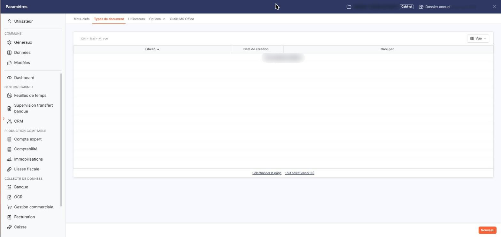
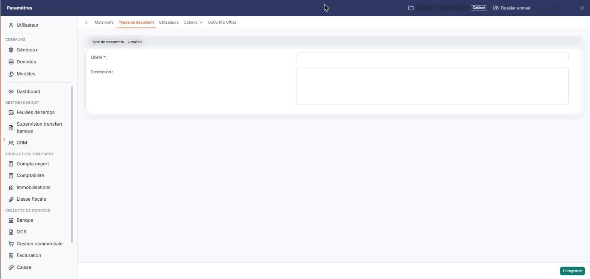
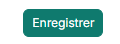

# Type de document


**Où le trouver :** Panneau **Paramètres**



**En bref** — Cet écran liste et crée les types de document du cabinet, qui décrivent la nature des documents et servent à les classer par thème.

* Pour créer un type : bouton \[Nouveau], saisissez le « Libellé » (obligatoire, différent des autres), puis bouton \[Enregistrer].
* Pour supprimer des types : cliquez sur leur ligne, puis bouton \[Supprimer] ; les documents concernés restent, sans type.
* Pour choisir les colonnes affichées : bouton \[Vue], puis bouton \[Appliquer].


Les types de document servent au classement thématique de vos documents : ils décrivent leur nature. Un document ne porte qu'un seul type, et il peut n'en porter aucun.

<figure><figcaption>
Écran « Type de document » de la nouvelle interface
</figcaption></figure>

L'écran « Types de document », que vous ouvrez dans le panneau Paramètres, rubrique « Vos documents », onglet « Types de document », présente la liste des types du cabinet et vous permet de les créer et de les supprimer.

**a) La liste des types de document**

Chaque ligne correspond à un type de document et porte trois colonnes :

Tant qu'aucun type n'a été créé, la liste affiche la seule mention « Aucun élément à afficher. ».

La barre de la liste ne porte que le bouton \[Vue], qui vous permet de choisir les colonnes que vous souhaitez voir (« Colonnes affichées », puis le bouton \[Appliquer]) ; cet écran n'a ni champ de recherche, ni bouton \[Filtres], ni bouton \[Exporter]. Il n'y a plus de case à cocher : un clic sur une ligne la sélectionne, et les liens « Sélectionner la page » et « Tout sélectionner (N) », sous la liste, sélectionnent les lignes de la page affichée ou l'ensemble des lignes.

bouton **\[Nouveau]**

Placé en bas à droite de l'écran, il ouvre la fiche de création d'un type de document.

bouton **\[Supprimer]**

Supprime les types de document dont vous avez sélectionné la ligne. Un type supprimé est également retiré de tous les documents auxquels il avait été affecté ; ces documents ne sont pas supprimés, ils n'ont simplement plus de type.

**b) La fiche d'un type de document**

La rubrique de création s'intitule « Type de document - Création » et comporte deux champs :

bouton **\[Enregistrer]**

Enregistre le type de document et revient à la liste.

**Flèche « Retour »**

Placée à gauche de la barre d'onglets du panneau, elle referme la fiche sans enregistrer et revient à la liste.

## Autres vues de l'écran

<figure><figcaption>
La fiche d'un type de document
</figcaption></figure>

<figure><figcaption>
Bouton [Enregistrer]
</figcaption></figure>
