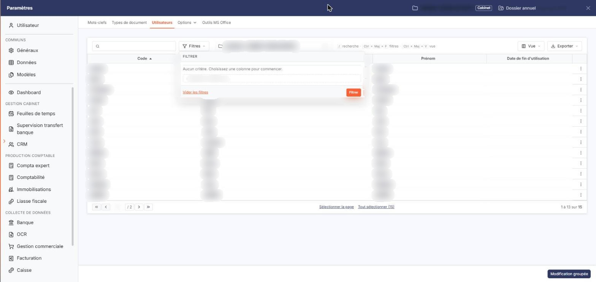
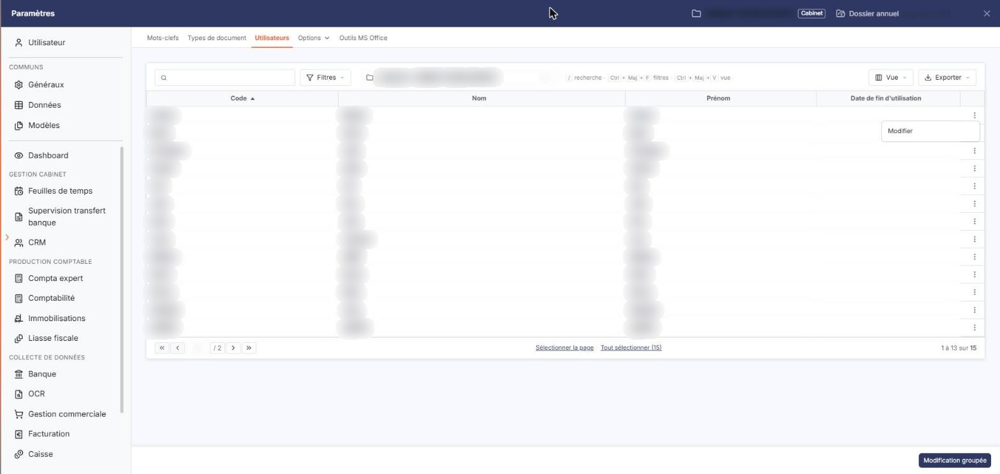
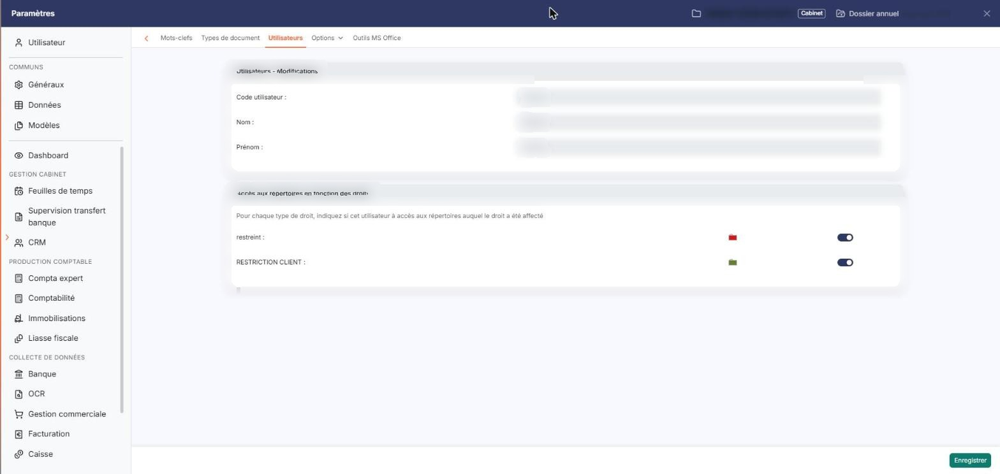
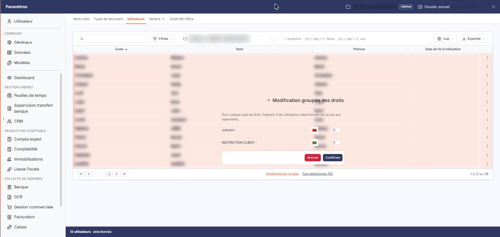

# Utilisateurs


**Où le trouver :** Panneau **Paramètres** › **Vos documents** › **Utilisateurs**



**En bref** — Cet écran indique, pour chaque utilisateur de la société gérée, les types de droit dont il bénéficie et donc les répertoires de la GED auxquels il accède.

* Pour modifier les accès d'un utilisateur : vérifiez le sélecteur « Société gérée », ouvrez sa fiche par le crayon « Modifier », réglez les interrupteurs, puis bouton \[Enregistrer].
* Pour appliquer les mêmes droits à plusieurs utilisateurs : sélectionnez-en au moins deux, bouton \[Modification groupée], réglez les interrupteurs, puis bouton \[Confirmer].
* Pour retrouver un utilisateur : champ « Rechercher un utilisateur… » ou bouton \[Filtres].


L'écran « Utilisateurs », que vous ouvrez dans le panneau Paramètres, rubrique « Vos documents », onglet « Utilisateurs », sert à indiquer, pour chaque utilisateur, les types de droit dont il bénéficie, et donc les répertoires auxquels il a accès. Les types de droit se définissent au préalable dans le menu déroulant « Options » de cette même rubrique, entrée « Droits des répertoires ».

<figure><figcaption>
Écran « Utilisateurs » de la nouvelle interface
</figcaption></figure>

Vous ne créez ni ne supprimez d'utilisateur depuis cette option : vous n'y modifiez que ses accès aux répertoires.

**a) Le choix de la société gérée**

**Société gérée** : ce sélecteur, placé dans la barre de la liste entre les boutons \[Filtres] et \[Vue], commande ce que l'option affiche. Les utilisateurs listés et les droits que vous leur accordez le sont pour la société gérée choisie ici. Commencez donc par vérifier cette valeur avant de modifier des droits.

**b) La liste des utilisateurs**

Chaque ligne correspond à un utilisateur et porte quatre colonnes :

Les commandes de ligne se trouvent en fin de ligne et apparaissent au survol : le crayon « Modifier » ouvre la fiche de l'utilisateur, et le menu « Autres actions » (trois points) ne propose que « Modifier ».

La barre de la liste est celle du logiciel : le champ « Rechercher un utilisateur… », le bouton \[Filtres], le sélecteur « Société gérée », le bouton \[Vue], qui vous permet de choisir les colonnes affichées, et le bouton \[Exporter], dont le menu propose « Aperçu édition HTML », « Imprimer », « Exporter en Excel », « Exporter en PDF » et « Envoyer la liste par e-mail ». Il n'y a plus de case à cocher : un clic sur une ligne la sélectionne, et les liens « Sélectionner la page » et « Tout sélectionner (N) », sous la liste, sélectionnent les lignes de la page affichée ou l'ensemble des lignes.

Le bouton \[Filtres] ouvre le volet « Filtrer », où « + Ajouter un critère sur… » vous permet de poser un critère sur une colonne de la liste — le code, le nom, le prénom ou la date de fin d'utilisation. Aucun critère n'est obligatoire, et le volet porte les boutons habituels du logiciel : bouton **\[Vider les filtres]** et bouton **\[Filtrer]**. Dès qu'un critère est posé, le lien « Tout effacer » apparaît à côté du bouton \[Filtres].

**c) La fiche d'un utilisateur**

La fiche comporte deux rubriques.

La rubrique « Utilisateurs - Modifications » rappelle le **Code utilisateur :**, le **Nom :** et le **Prénom :**. Aucun de ces trois champs n'est saisissable : l'identité de l'utilisateur ne s'administre pas ici.

La rubrique « Accès aux répertoires en fonction des droits » est celle sur laquelle vous travaillez. Elle présente une ligne par type de droit défini pour la société gérée, avec le pictogramme de dossier dans la couleur du droit et un interrupteur, sans texte. Activez l'interrupteur pour donner à cet utilisateur l'accès aux répertoires portant ce droit, désactivez-le pour le lui retirer.

bouton **\[Enregistrer]**

Enregistre les droits de l'utilisateur.

**Flèche « Retour »**

Placée à gauche de la barre d'onglets du panneau, elle referme la fiche et revient à la liste.

**d) La modification groupée**

bouton **\[Modification groupée]**

Ce bouton, placé en bas à droite de l'écran, vous évite de reprendre les fiches une par une : il applique les mêmes droits à plusieurs utilisateurs d'un seul coup.

## Autres vues de l'écran

<figure><figcaption>
Bouton [Filtrer]
</figcaption></figure>

<figure><figcaption>
La fiche d'un utilisateur
</figcaption></figure>

<figure><figcaption>
La fiche d'un utilisateur
</figcaption></figure>

<figure><figcaption>
La modification groupée
</figcaption></figure>
